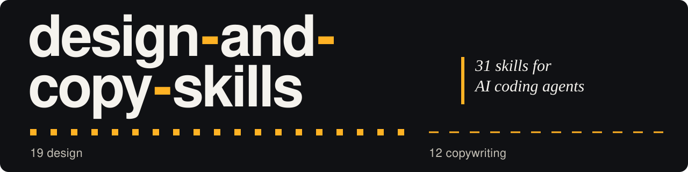
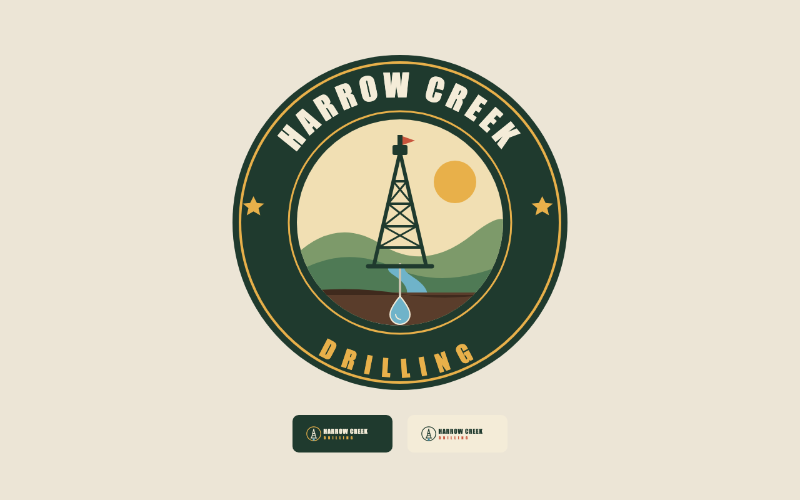

<p align="center"></p>

# design-and-copy-skills

Coding agents can write UI and copy that works, but what comes back usually looks and reads generic, or breaks quietly: a layout that overflows on a phone, a chart that makes a 3% dip look like a collapse, a claim nobody can back up. These skills are short instruction sets aimed at that gap, and an agent loads one only when a request calls for it. Each skill was tested against the same agent without it, and the results, including the losses, are on this page.

```sh
git clone --depth 1 https://github.com/thewyattbrocato/design-and-copy-skills.git && mkdir -p .claude/skills && cp -R design-and-copy-skills/skills/visual-hierarchy .claude/skills/
```

That installs one skill into the current project. Then ask your agent: "Everything on my pricing page competes for attention." It should load `visual-hierarchy`. Other skills and other tools are covered under [Install](#install).

## What it changes

<!-- before-after:featured:start -->
The same request, given to the same model with and without the `brand-identity` skill installed:

> I run a well drilling company out in the country, Harrow Creek Drilling. Never had a real logo, just the name painted on the trucks. Can you make one? Give me a single self-contained HTML file with inline CSS and inline SVG, system fonts only, no external assets, showing the logo so I can see what it looks like.

| Without the skill | With the skill |
|---|---|
|  |  |
| A single HTML page showing one round badge logo for Harrow Creek Drilling: the name set around a dark green ring, with a drilling derrick, sun, hills, creek and water drop inside, and two small logo versions below. | A single HTML page showing a logo built from a dark disc with a borehole cut down through it to a blue pocket of water, next to a stacked "HARROW CREEK" wordmark with "DRILLING" under a rule, followed by a grid of solid black, reversed, stacked and small versions. |

**Judge result.** The answer with the skill won this task, 3 of 3 samples, by +1.30 rubric points on the 5-point scale. The judge was `claude:opus`, a different model from the one that wrote the answers; it saw the two answers unlabelled, in both orders. Over all of this skill's held-out tasks where it loaded, the skill won 5, lost 2 and tied 3. [Full run files](evals/brand-identity/heldout/runs/brand-h01/).

This is one example, not a typical one: it is the task with the biggest judged gap in the skill's favor among the tasks where the skill loaded. Examples for 9 other skills are in [More before and after examples](#more-before-and-after-examples).
<!-- before-after:featured:end -->

<!-- results-table:headline:start -->
**Across 30 skills, counting only the held-out tasks where the skill loaded (233 in all): 153 wins, 37 losses and 43 ties against the same model without it. 14 of the 30 passes are marginal.**
<!-- results-table:headline:end -->

How that number is counted is under [How the evals work](#how-the-evals-work); the per-skill rows are in [Results](#results).

## Try it

Five requests to paste into an agent with the skill installed, each shown with the skill it should load. They are taken word for word from the activation check (see [Activation check](#activation-check)), and in the latest run of that check each one was routed to the right skill. Routing is the first step only; whether the skill then helps is what the held-out results show.

<!-- results-table:tryit:start -->
| Type this | The agent should load |
|---|---|
| “Everything on my pricing page competes for attention.” | [visual-hierarchy](skills/visual-hierarchy/SKILL.md) |
| “My line graph makes our 3% dip look like a collapse. What's wrong with the axis?” | [chart-design](skills/chart-design/SKILL.md) |
| “Our signup form has 11 fields and half the people quit at step two. What should we cut?” | [form-design](skills/form-design/SKILL.md) |
| “A prospect went quiet after the demo. How do I follow up without nagging?” | [email-and-sequences](copy-skills/email-and-sequences/SKILL.md) |
| “Can I call us the number one rated CRM?” | [honest-claims](copy-skills/honest-claims/SKILL.md) |
<!-- results-table:tryit:end -->


## Skills

The design skills are listed below, and the copywriting skills in [their own table](#copywriting-skills). The tables are generated from each skill's `SKILL.md` frontmatter. Each skill's held-out result, including which passes are marginal, is in [Results](#results).

<!-- results-table:skills:start -->
| Skill | Use when | Not for |
|---|---|---|
| [brand-identity](skills/brand-identity/SKILL.md) | a logo, mark, wordmark, app icon or visual identity is being made, judged or changed, in any language and at any length | interface palettes (color-palette), type choice (typeface-selection), design tokens (design-system-builder), product screens (design-critique) or naming and trademark law |
| [chart-design](skills/chart-design/SKILL.md) | you make, choose, fix or review a single chart, graph, sparkline or simple map (HTML, SVG, canvas or a chart library), in any words | multi-chart dashboards or KPI screens, data tables, interface or brand palettes, diagrams that explain a mechanism, or statistical analysis |
| [color-palette](skills/color-palette/SKILL.md) | color is being chosen, judged or fixed, in any language and at any length | chart data scales (chart-design), logo design (brand-identity), token plumbing (design-system-builder) or type weight (typesetting) |
| [data-tables](skills/data-tables/SKILL.md) | you build, style or review a table of data in a page, app, document or report, in any words | charts, whole dashboards, page grids, short lists that are not tabular, or editing inside spreadsheet engines |
| [design-critique](skills/design-critique/SKILL.md) | someone wants a design judged, in any words, any length or language | building or applying fixes, even a final polish pass (do the work instead), logo or identity critique (brand-identity) or code review |
| [design-system-builder](skills/design-system-builder/SKILL.md) | shared design decisions are being created, cleaned up or extended, in any language and at any length | styling one page (the focused skills), drawing a brand (brand-identity), or auditing a product without building (design-critique) |
| [form-design](skills/form-design/SKILL.md) | designing, building, reviewing or fixing a form, input flow or settings screen, in any words | tabs, menus, toasts, data grids or marketing copy around a form |
| [interface-behavior](skills/interface-behavior/SKILL.md) | deciding how a product acts rather than how it looks or reads, in any words or language | page grids, field mechanics, copy, motion timing, table styling or charts |
| [layout-structure](skills/layout-structure/SKILL.md) | you design, build, plan or review the overall structure of a page, screen, slide, poster or social graphic | CSS mechanics, spacing values, emphasis between elements, multi-chart dashboards, or single components such as a button sheet |
| [practice-and-assessment](skills/practice-and-assessment/SKILL.md) | people must practice, be checked on or retain a skill, in any language and at any length | onboarding screens (teaching-interfaces), quiz software or grading code, form fields (form-design) or reviewing a learning product's interface (design-critique) |
| [responsive-layout](skills/responsive-layout/SKILL.md) | CSS layout has to hold up on any screen, container or setting, in any language and at any length | page structure (layout-structure), spacing values (spacing-and-grouping) or type scales (typesetting); dialog focus semantics are out of scope |
| [spacing-and-grouping](skills/spacing-and-grouping/SKILL.md) | you design, build, restyle or review any interface or page where several items sit near each other | choosing emphasis, palettes, page grids, CSS layout mechanics, or expressive posters |
| [teaching-interfaces](skills/teaching-interfaces/SKILL.md) | a screen, page or flow has to teach someone to do or understand something, in any language | quizzes or courses (practice-and-assessment), input fields (form-design), animation timing (ui-motion), data charts (chart-design), marketing pages or general interface strings (ux-microcopy) |
| [typeface-selection](skills/typeface-selection/SKILL.md) | a font is being chosen, paired, judged or fixed, in any language and at any length | sizes, leading or line length (typesetting), drawing logos (brand-identity), type tokens (design-system-builder) or palettes (color-palette) |
| [typesetting](skills/typesetting/SKILL.md) | text is being set, judged or fixed, in any language and at any length | choosing typefaces (typeface-selection), ranking a whole view (visual-hierarchy), palettes (color-palette), table layout (data-tables) or logos (brand-identity) |
| [ui-motion](skills/ui-motion/SKILL.md) | someone wants an interface to feel smooth, responsive, alive, polished, premium or less janky, or asks what motion to add and in what order, or to add, fix, cut, time, specify or review animation | video, film or character animation, detailed chart animation, print or static deliverables, or carousel semantics |
| [user-research-basics](skills/user-research-basics/SKILL.md) | someone needs to find out what people do, need or struggle with, in any words, length or language | judging a design (design-critique), form fields (form-design) or page copy |
| [visual-hierarchy](skills/visual-hierarchy/SKILL.md) | a screen or page needs a clear order of importance, in any language and at any length | spacing values, type sizes, palettes and contrast numbers, page grids, chart encodings or logos |
<!-- results-table:skills:end -->

Three more skills were built and tested but did not meet the bar and are not shipped; see [Built and tested, not shipped](#built-and-tested-not-shipped).

## Copywriting skills

Copywriting skills live in their own folder, [copy-skills/](copy-skills/README.md), and follow the same rules as the design skills: original wording and an eval gate before a skill is listed. The table is generated from each skill's `SKILL.md` frontmatter.

<!-- results-table:copy:start -->
| Skill | Use when | Not for |
|---|---|---|
| [campaign-ideas](copy-skills/campaign-ideas/SKILL.md) | the idea has to be found before any words are written, in any language and at any length | finished headline sets (headlines-and-leads), positioning (positioning-and-messaging), offer terms (offers-and-value-propositions) or whole pages and emails |
| [content-strategy](copy-skills/content-strategy/SKILL.md) | someone must decide what content to have, who owns it and how it stays good, in any language and at any length | how a page or string reads (website-copy-audit, ux-microcopy) or the wording of positioning (positioning-and-messaging) |
| [editing-and-cutting](copy-skills/editing-and-cutting/SKILL.md) | you edit, shorten, tighten or review text that already exists instead of writing new copy, in any language and at any length | checking whether claims are true (honest-claims), rebuilding a whole page (landing-page-copy), writing new headlines (headlines-and-leads) or code documentation |
| [email-and-sequences](copy-skills/email-and-sequences/SKILL.md) | you write, plan, fix or judge email or direct messages to customers, subscribers or prospects, in any language and at any length | receipts, resets and in-app notifications (ux-microcopy), the page an email links to (landing-page-copy) or checking claims (honest-claims) |
| [fair-persuasion](copy-skills/fair-persuasion/SKILL.md) | a flow, default, plan choice, upsell, cancel or pause step, consent prompt or reminder is designed to steer a choice, or someone asks if it is pushy or a dark pattern, in any language | whether a claim is true (honest-claims), form field mechanics (form-design) or the screen strings themselves (ux-microcopy) |
| [headlines-and-leads](copy-skills/headlines-and-leads/SKILL.md) | you write, rewrite, shorten, pick or judge the first words someone reads, in any language and at any length | email subject lines (email-and-sequences), buttons and interface labels (ux-microcopy), whole pages (landing-page-copy) or a heading's size and weight (visual-hierarchy) |
| [honest-claims](copy-skills/honest-claims/SKILL.md) | copy states a fact, number, result, comparison, quote, rating, customer count, award, guarantee, price, deadline or stock limit, or someone asks to make it more persuasive, urgent, credible or "more official", to add social proof or reviews, to write quotes or statistics they have not supplied, or to check a page for claims that could get them in trouble, or as a last check on those lines inside other copy, in any language | defaults, cancellation flows or other choice design (fair-persuasion), or general line editing (editing-and-cutting) |
| [landing-page-copy](copy-skills/landing-page-copy/SKILL.md) | you write, rewrite or plan the words of a page meant to win someone over, such as home, landing, sales, product, feature, pricing, about or case-study pages, including "write my homepage", "this page doesn't convert", "make it less salesy", "nobody gets what we do", "turn these notes into a landing page" or "redo our website copy", in any language and at any length | how the page looks (layout-structure, visual-hierarchy), a single headline (headlines-and-leads), in-product strings, emails, or reviewing a whole site (website-copy-audit) |
| [offers-and-value-propositions](copy-skills/offers-and-value-propositions/SKILL.md) | you word what is offered and why it is worth the price, in any language and at any length | audience or category (positioning-and-messaging), table layout (data-tables), checkout fields (form-design) or legal terms |
| [positioning-and-messaging](copy-skills/positioning-and-messaging/SKILL.md) | someone needs to decide or put into words what a product or company is, who it is for and why it beats what they use now, in any language and at any length | full pages (landing-page-copy), sets of headlines (headlines-and-leads), offer terms and pricing (offers-and-value-propositions), or logos and visual identity |
| [ux-microcopy](copy-skills/ux-microcopy/SKILL.md) | you write or fix the words inside a product or a transactional message, in any language | form fields (form-design), marketing pages, email sequences, first-run flows, tours or help articles (teaching-interfaces), or ARIA and focus |
| [website-copy-audit](copy-skills/website-copy-audit/SKILL.md) | someone wants existing site or product copy judged rather than written, in any language and at any length | writing new pages (landing-page-copy), line editing alone, or reviewing visual design |
<!-- results-table:copy:end -->

## Install

A skill is a folder with a `SKILL.md` and a `references/` directory. Installing means copying that folder to wherever your agent looks for skills. The copy is self-contained; the clone is only needed to copy from. Design skills live in `skills/` and copywriting skills in `copy-skills/`; both install to the same place.

**Claude Code.** Project skills live in `.claude/skills/` inside the repository you are working on and are shared with everyone who clones it. Personal skills live in `~/.claude/skills/` and apply to every project on your machine.

```sh
git clone --depth 1 https://github.com/thewyattbrocato/design-and-copy-skills.git

# one skill, for the current project
mkdir -p .claude/skills && cp -R design-and-copy-skills/skills/visual-hierarchy .claude/skills/

# one skill, for every project on this machine
mkdir -p ~/.claude/skills && cp -R design-and-copy-skills/skills/form-design ~/.claude/skills/

# one copywriting skill, same destination
cp -R design-and-copy-skills/copy-skills/ux-microcopy .claude/skills/

# every design skill at once
cp -R design-and-copy-skills/skills/* .claude/skills/

# every copywriting skill at once (copy-skills/ also holds a README, so copy folders only)
for d in design-and-copy-skills/copy-skills/*; do [ -d "$d" ] && cp -R "$d" .claude/skills/; done
```

Choose what you need rather than installing everything. Several skills (typesetting, visual-hierarchy, spacing-and-grouping, color-palette, responsive-layout) describe themselves as applying to any page or build, so with all of them installed a single build can load several at once.

**Other tools.** The skills use the [Agent Skills](https://agentskills.io/) format: a `SKILL.md` with `name` and `description` frontmatter plus a `references/` folder. Many compatible tools scan `.agents/skills/` in the project and `~/.agents/skills/` for the user, and some also read the `.claude/skills/` locations above. Use the same copy commands with the directory your tool documents.

Once installed, the agent loads a skill when a request matches its description. In Claude Code you can also invoke one by name, for example `/form-design`. The description of each skill ends with what it is not for, so neighboring skills do not fight over a task.

## Results

![Horizontal bar chart of the held-out results for every listed skill, loaded runs only. Each bar shows the mean rubric score with the skill minus without it, starting at zero and ordered from the largest gain to the smallest. Beside each bar are the skill's wins, losses and ties and its number of loaded tasks. Every skill scored higher with the skill than without; all but typeface-selection won more tasks than they lost (it won and lost two each), and marginal passes are drawn as hollow bars tagged "marginal".](docs/img/results.svg)

This chart is generated from the stored held-out results files by `scripts/make_results_chart.py`, and it counts only the runs where the model loaded the skill.

The tables below are generated from the results files by `scripts/results_table.py`, and CI fails when this file does not match them. Every run has answers from `claude-sonnet-5-5`, the skill installed as a project skill, seed 0 and 10 tasks. The "Skill loaded by the model" column gives the samples in which the model loaded the skill and, in brackets, the tasks with at least one such sample. Under protocol 1 the all-samples column counts every pair, including tasks where the model never loaded the skill; the loaded-only column is recomputed from whether it loaded on each task, and is the one to read.

**Held-out set.** Clean evidence: the skill writers never saw these tasks. A skill with no held-out results yet shows `pending clean rerun`.

<!-- results-table:heldout:start -->
| Skill | Protocol | Samples per arm | Wins / losses / ties, all samples | Wins / losses / ties, loaded only | Mean rubric, with / without (loaded only under protocol 2) | Skill loaded by the model | Gate | Judge | Secondary row (weaker generator, not gated) |
|---|---|---|---|---|---|---|---|---|---|
| brand-identity | 2 | 3 | 5 / 2 / 3 | 5 / 2 / 3 (10 tasks) | 4.362 / 4.042 | 28 of 30 samples (10 of 10 tasks) | pass | `claude:opus`, a different model from the generator | `haiku`: 6 / 1 / 2 loaded only |
| chart-design | 2 | 3 | 9 / 1 / 0 | 9 / 0 / 0 (9 tasks) | 4.472 / 4.3 | 27 of 30 samples (9 of 10 tasks) | pass | `claude:opus`, a different model from the generator | none |
| color-palette | 2 | 3 | 8 / 1 / 1 | 7 / 1 / 0 (8 tasks) | 4.637 / 4.457 | 24 of 30 samples (8 of 10 tasks) | pass | `claude:opus`, a different model from the generator | `haiku`: 1 / 0 / 2 loaded only |
| data-tables | 2 | 3 | 5 / 3 / 2 | 4 / 2 / 2 (8 tasks) | 4.223 / 4.087 | 22 of 30 samples (8 of 10 tasks) | pass, marginal (rubric +0.14) | `claude:opus`, a different model from the generator | none |
| design-critique | 2 | 3 | 7 / 1 / 2 | 4 / 2 / 0 (6 tasks) | 4.371 / 3.889 | 16 of 30 samples (6 of 10 tasks) | pass, marginal (6 loaded tasks) | `claude:opus`, a different model from the generator | `haiku`: 3 / 0 / 0 loaded only |
| design-system-builder | 2 | 3 | 4 / 2 / 4 | 3 / 2 / 4 (9 tasks) | 4.223 / 4.094 | 27 of 30 samples (9 of 10 tasks) | pass, marginal (rubric +0.13; one-task win margin) | `claude:opus`, a different model from the generator | `haiku`: 0 / 1 / 1 loaded only |
| form-design | 2 | 3 | 5 / 2 / 3 | 5 / 2 / 2 (9 tasks) | 4.345 / 4.186 | 27 of 30 samples (9 of 10 tasks) | pass | `claude:opus`, a different model from the generator | none |
| interface-behavior | 2 | 3 | 5 / 2 / 3 | 3 / 2 / 4 (9 tasks) | 4.405 / 4.302 | 24 of 30 samples (9 of 10 tasks) | pass, marginal (rubric +0.10; one-task win margin) | `claude:opus`, a different model from the generator | none |
| layout-structure | 2 | 3 | 4 / 2 / 4 | 3 / 2 / 2 (7 tasks) | 4.357 / 4.248 | 21 of 30 samples (7 of 10 tasks) | pass, marginal (rubric +0.11; one-task win margin) | `claude:opus`, a different model from the generator | none |
| practice-and-assessment | 2 | 3 | 6 / 1 / 3 | 6 / 0 / 2 (8 tasks) | 4.546 / 3.923 | 24 of 30 samples (8 of 10 tasks) | pass | `claude:opus`, a different model from the generator | `haiku`: 1 / 1 / 0 loaded only |
| responsive-layout | 2 | 3 | 6 / 1 / 3 | 4 / 0 / 2 (6 tasks) | 4.346 / 4.109 | 15 of 30 samples (6 of 10 tasks) | pass, marginal (6 loaded tasks) | `claude:opus`, a different model from the generator | none |
| spacing-and-grouping | 2 | 3 | 4 / 3 / 3 | 4 / 3 / 3 (10 tasks) | 4.283 / 4.062 | 29 of 30 samples (10 of 10 tasks) | pass, marginal (one-task win margin) | `claude:opus`, a different model from the generator | none |
| teaching-interfaces | 2 | 3 | 6 / 3 / 1 | 6 / 2 / 1 (9 tasks) | 4.47 / 4.216 | 26 of 30 samples (9 of 10 tasks) | pass | `claude:opus`, a different model from the generator | `haiku`: 6 / 0 / 1 loaded only |
| typeface-selection | 2 | 3 | 2 / 2 / 6 | 2 / 2 / 5 (9 tasks) | 4.467 / 4.187 | 25 of 30 samples (9 of 10 tasks) | pass, marginal (no win margin) | `claude:opus`, a different model from the generator | none |
| typesetting | 2 | 3 | 4 / 4 / 2 | 4 / 3 / 0 (7 tasks) | 4.798 / 4.61 | 21 of 30 samples (7 of 10 tasks) | pass, marginal (one-task win margin) | `claude:opus`, a different model from the generator | none |
| ui-motion | 2 | 3 | 4 / 3 / 3 | 4 / 1 / 2 (7 tasks) | 4.232 / 3.96 | 21 of 30 samples (7 of 10 tasks) | pass | `claude:opus`, a different model from the generator | none |
| user-research-basics | 2 | 3 | 9 / 0 / 1 | 6 / 0 / 0 (6 tasks) | 4.811 / 4.15 | 18 of 30 samples (6 of 10 tasks) | pass, marginal (6 loaded tasks) | `claude:opus`, a different model from the generator | none |
| visual-hierarchy | 2 | 3 | 7 / 1 / 2 | 8 / 0 / 1 (9 tasks) | 4.645 / 4.063 | 24 of 30 samples (9 of 10 tasks) | pass | `claude:opus`, a different model from the generator | `haiku`: 6 / 0 / 0 loaded only |
| campaign-ideas | 2 | 3 | 7 / 3 / 0 | 6 / 0 / 0 (6 tasks) | 4.508 / 3.933 | 16 of 30 samples (6 of 10 tasks) | pass, marginal (6 loaded tasks) | `claude:opus`, a different model from the generator | none |
| content-strategy | 2 | 3 | 9 / 0 / 1 | 7 / 0 / 0 (7 tasks) | 4.48 / 3.871 | 21 of 30 samples (7 of 10 tasks) | pass | `claude:opus`, a different model from the generator | none |
| editing-and-cutting | 2 | 3 | 5 / 1 / 4 | 3 / 2 / 1 (6 tasks) | 4.334 / 4.19 | 14 of 30 samples (6 of 10 tasks) | pass, marginal (rubric +0.14; 6 loaded tasks; one-task win margin) | `claude:opus`, a different model from the generator | none |
| email-and-sequences | 2 | 3 | 7 / 1 / 2 | 6 / 1 / 1 (8 tasks) | 4.659 / 4.132 | 24 of 30 samples (8 of 10 tasks) | pass | `claude:opus`, a different model from the generator | none |
| fair-persuasion | 2 | 3 | 10 / 0 / 0 | 7 / 0 / 0 (7 tasks) | 4.829 / 3.824 | 21 of 30 samples (7 of 10 tasks) | pass | `claude:opus`, a different model from the generator | `haiku`: 4 / 1 / 1 loaded only |
| headlines-and-leads | 2 | 3 | 6 / 1 / 3 | 5 / 1 / 1 (7 tasks) | 4.666 / 4.423 | 21 of 30 samples (7 of 10 tasks) | pass | `claude:opus`, a different model from the generator | none |
| honest-claims | 2 | 3 | 7 / 2 / 1 | 7 / 1 / 0 (8 tasks) | 4.571 / 4.296 | 24 of 30 samples (8 of 10 tasks) | pass | `claude:opus`, a different model from the generator | none |
| landing-page-copy | 2 | 3 | 6 / 2 / 2 | 5 / 2 / 2 (9 tasks) | 4.657 / 4.358 | 27 of 30 samples (9 of 10 tasks) | pass | `claude:opus`, a different model from the generator | none |
| offers-and-value-propositions | 2 | 3 | 6 / 1 / 3 | 6 / 0 / 2 (8 tasks) | 4.745 / 4.257 | 24 of 30 samples (8 of 10 tasks) | pass | `claude:opus`, a different model from the generator | none |
| positioning-and-messaging | 2 | 3 | 6 / 1 / 3 | 5 / 0 / 1 (6 tasks) | 4.319 / 3.884 | 18 of 30 samples (6 of 10 tasks) | pass, marginal (6 loaded tasks) | `claude:opus`, a different model from the generator | none |
| ux-microcopy | 2 | 3 | 6 / 2 / 2 | 5 / 2 / 2 (9 tasks) | 4.537 / 4.263 | 26 of 30 samples (9 of 10 tasks) | pass | `claude:opus`, a different model from the generator | none |
| website-copy-audit | 2 | 3 | 7 / 3 / 0 | 4 / 2 / 0 (6 tasks) | 4.474 / 4.066 | 18 of 30 samples (6 of 10 tasks) | pass, marginal (6 loaded tasks) | `claude:opus`, a different model from the generator | `haiku`: 4 / 0 / 0 loaded only |
<!-- results-table:heldout:end -->

### Marginal passes

A passing skill is marked marginal when any of these holds: its mean rubric edge is below +0.15, the model loaded it on fewer than 7 of the 10 tasks, or it won at most one more task than it lost. A marginal pass is weaker evidence than a plain pass, not a failure. These skills are marked marginal, and this list is generated from the same results files:

<!-- results-table:marginal:start -->
- **data-tables**: Its mean rubric edge was +0.14, under the +0.15 bar.
- **design-critique**: The model loaded it on only 6 of 10 tasks.
- **design-system-builder**: Its mean rubric edge was +0.13, under the +0.15 bar; it won just one more task than it lost.
- **interface-behavior**: Its mean rubric edge was +0.10, under the +0.15 bar; it won just one more task than it lost.
- **layout-structure**: Its mean rubric edge was +0.11, under the +0.15 bar; it won just one more task than it lost.
- **responsive-layout**: The model loaded it on only 6 of 10 tasks.
- **spacing-and-grouping**: It won just one more task than it lost.
- **typeface-selection**: It won no more tasks than it lost.
- **typesetting**: It won just one more task than it lost.
- **user-research-basics**: The model loaded it on only 6 of 10 tasks.
- **campaign-ideas**: The model loaded it on only 6 of 10 tasks.
- **editing-and-cutting**: Its mean rubric edge was +0.14, under the +0.15 bar; the model loaded it on only 6 of 10 tasks; it won just one more task than it lost.
- **positioning-and-messaging**: The model loaded it on only 6 of 10 tasks.
- **website-copy-audit**: The model loaded it on only 6 of 10 tasks.
<!-- results-table:marginal:end -->

`editing-and-cutting` has two results. The run that ships with it won 3, lost 2 and tied 1 on the 6 tasks where the model loaded it (mean rubric 4.33 with the skill, 4.19 without); a second run on a freshly written task set won 8, lost 1 and tied 1 across all samples and 3 / 1 / 1 on the 5 tasks where it loaded (4.61 against 4.22), but the gate needs 6 loaded tasks, and the skill rightly stayed out of the five tasks that ask for new writing, so that run is recorded as inconclusive and kept in [withdrawn/editing-and-cutting-fresh-gate-evidence/](withdrawn/editing-and-cutting-fresh-gate-evidence/).

### Activation check

Every skill also has a routing check. A model is shown only the name and one-line description of all the skills plus one request, and says which single skill it would load, or none. The overall recall and false-pick rate are at the top of [evals/activation-summary.md](evals/activation-summary.md), with a row for every skill; the method is in [evals/README.md](evals/README.md#activation-check). It checks routing from descriptions only: whether a description lets a model pick the right skill for a request. It does not show that a skill is good, and it is not the loaded rate of the held-out runs, which stays the evidence for whether the model uses a skill in a real task.

## How the evals work


The promise is that a skill never makes the model worse. Every skill has a held-out task suite, and six older ones (chart-design, data-tables, form-design, layout-structure, spacing-and-grouping, visual-hierarchy) also have a development suite. Each suite has 8 to 10 realistic tasks and a rubric of observable criteria:

- the **held-out set**, `evals/<skill>/heldout/tasks.json`, written by someone who never reads the skill, and the only set that counts as clean evidence;
- the **development set**, `evals/<skill>/tasks.json`, which the skill writers saw while they wrote and refined the skill. Not clean evidence.

`scripts/run_eval.py --suite dev|heldout` (held-out is the default when it exists) then:

- has the same model answer every task three times per arm (`--samples`) with the identical prompt, with the skill installed and without;
- renders build tasks to screenshots and sends each pair of samples to a judge model, blind, with the sides labeled A and B by a seeded coin flip, and asks for a verdict and a 1 to 5 score per rubric item;
- refuses to run when the judge is the same model as the generator, unless `--allow-same-model-judge` is passed; the run then records `same_model_judge` and a held-out results file with that flag does not validate;
- judges every pair a second time with the sides swapped. A win counts only when both passes pick the same side; any disagreement is recorded as a tie, and a task's verdict is the majority over its samples;
- records whether the model loaded the skill in each with-skill sample, regenerates a sample that did not load (up to twice), and reports two tallies: all samples and loaded-only;
- applies the protocol 2 gate to the loaded-only tally: at least 6 tasks must have a loaded sample (otherwise the result is `inconclusive`, which is not a pass), the with-skill side must win more often than it loses (or tie on wins with a mean rubric advantage of at least 0.15), and its mean rubric score must not fall more than 0.1 below the baseline. A tie is not a pass for a skill that should clearly help;
- can run the same suite with a weaker generator (`--secondary-model`), shown as its own column and never part of the gate.

Results written before protocol 2 are marked `protocol: 1`: one answer per arm per task and a gate that a tie passed. They are kept as they are and shown in the same tables.

`scripts/check_skill_fixtures.py` keeps the two apart: it fails when a name, number or quoted string from a held-out task prompt or rubric appears anywhere in a skill folder (`skills/`, `copy-skills/`, or a skill folder under `withdrawn/`), so a skill cannot be shown the answer to the task that tests it. Hits from the development tasks are warnings.

The method, commands and the headless CLI setup are in [evals/README.md](evals/README.md); the file formats are in [evals/SCHEMA.md](evals/SCHEMA.md). `results.json` records both judge passes, the per-item scores, the judge's notes, the judge and the gate numbers, so a verdict can be re-read and the gate recomputed with `scripts/validate_evals.py`.

### Development set

**Development set, seen by the skill writers; not clean evidence.** These runs were made on 2026-10-04 on the tasks the skill writers worked from, and some skill reference files contained worked answers that mirror those tasks, so a win here can be recall of a supplied answer. The judge differs by row and the rows are not comparable with each other:

- The first four skills (chart-design, data-tables, layout-structure, spacing-and-grouping) were judged by `grok:grok-4.7`, a different model from the generator.
- The three refined skills (visual-hierarchy, typesetting, form-design) were re-run after the Grok judge reached a usage limit and were judged by Claude Sonnet (`claude:sonnet`). That is the same model as the generator, `claude-sonnet-5-5`, so the generator scored its own answers in both arms. Self-preference should affect both arms alike, but it is not a separate judge, and those rows cannot be read against the Grok rows.
- The held-out runs use a judge that is a different model from the generator (`claude:opus` by default) and record it in `results.json`.

<!-- results-table:dev:start -->
| Skill | Protocol | Samples per arm | Wins / losses / ties, all samples | Wins / losses / ties, loaded only | Mean rubric, with / without (loaded only under protocol 2) | Skill loaded by the model | Gate | Judge | Secondary row (weaker generator, not gated) | Notes |
|---|---|---|---|---|---|---|---|---|---|---|
| brand-identity | no development results | | | | | | | | | |
| chart-design | 1 | 1 | 3 / 3 / 4 | 1 / 2 / 1 (4 tasks) | 4.768 / 4.745 | 4 of 10 samples (4 of 10 tasks) | pass | `grok:grok-4.7`, a different model from the generator | none | superseded by the held-out run; 10 answer files not committed |
| color-palette | no development results | | | | | | | | | |
| data-tables | 1 | 1 | 4 / 1 / 5 | 2 / 0 / 3 (5 tasks) | 4.525 / 4.105 | 5 of 10 samples (5 of 10 tasks) | pass | `grok:grok-4.7`, a different model from the generator | none | superseded by the held-out run |
| design-critique | no development results | | | | | | | | | |
| design-system-builder | no development results | | | | | | | | | |
| form-design | 1 | 1 | 6 / 1 / 3 | 6 / 1 / 2 (9 tasks) | 4.638 / 4.248 | 9 of 10 samples (9 of 10 tasks) | pass | `claude:sonnet`, same model as the generator | none | superseded by the held-out run |
| interface-behavior | no development results | | | | | | | | | |
| layout-structure | 1 | 1 | 5 / 1 / 4 | 3 / 0 / 1 (4 tasks) | 4.708 / 4.385 | 4 of 10 samples (4 of 10 tasks) | pass | `grok:grok-4.7`, a different model from the generator | none | superseded by the held-out run |
| practice-and-assessment | no development results | | | | | | | | | |
| responsive-layout | no development results | | | | | | | | | |
| spacing-and-grouping | 1 | 1 | 5 / 0 / 5 | 4 / 0 / 1 (5 tasks) | 4.433 / 4.045 | 5 of 10 samples (5 of 10 tasks) | pass | `grok:grok-4.7`, a different model from the generator | none | superseded by the held-out run |
| teaching-interfaces | no development results | | | | | | | | | |
| typeface-selection | no development results | | | | | | | | | |
| typesetting | no development results | | | | | | | | | |
| ui-motion | no development results | | | | | | | | | |
| user-research-basics | no development results | | | | | | | | | |
| visual-hierarchy | 1 | 1 | 7 / 2 / 1 | 6 / 1 / 1 (8 tasks) | 4.537 / 4.155 | 8 of 10 samples (8 of 10 tasks) | pass | `claude:sonnet`, same model as the generator | none | superseded by the held-out run |
| campaign-ideas | no development results | | | | | | | | | |
| content-strategy | no development results | | | | | | | | | |
| editing-and-cutting | no development results | | | | | | | | | |
| email-and-sequences | no development results | | | | | | | | | |
| fair-persuasion | no development results | | | | | | | | | |
| headlines-and-leads | no development results | | | | | | | | | |
| honest-claims | no development results | | | | | | | | | |
| landing-page-copy | no development results | | | | | | | | | |
| offers-and-value-propositions | no development results | | | | | | | | | |
| positioning-and-messaging | no development results | | | | | | | | | |
| ux-microcopy | no development results | | | | | | | | | |
| website-copy-audit | no development results | | | | | | | | | |
<!-- results-table:dev:end -->

What these numbers can and cannot say:

- Noise floor: ten tasks cannot detect a small effect. If a skill has no effect, each decisive task goes either way like a coin flip, so with 9 decisive tasks it wins 2 to 7 of them in 95% of runs; a few more wins than losses is inside that range and is not evidence. Every run prints the range for its own count. A pass means no evidence of harm on these tasks, not proof of benefit everywhere.
- The model decides whether to load an installed skill. The "skill loaded" column shows how often it did; under protocol 1 the with-skill answer on the other tasks was produced without the skill, so the comparison there is model noise, and the protocol 1 gate counted those pairs anyway. Protocol 2 gates on loaded samples only.
- A held-out set that was revised after its results were seen is no longer held out. A revision made after seeing held-out results requires a fresh held-out set. Each protocol 2 results file records a hash of its `tasks.json`, and the validator warns when the tasks no longer match it.
- The chart-design baseline was not a bare model. The CLI's bundled `dataviz` skill fired in the baseline arm in 21 of 30 samples (on 7 of 10 tasks) of the held-out run, so the comparison there is against the model with a chart skill available, and a tie would mean the skill added little beyond it. See [evals/README.md](evals/README.md).
- One baseline was regenerated: during the typesetting refinement the runner regenerated the `ts-guard-wordmark` baseline answer, so for that task the baseline is not the original. The other baseline answers were reused.
- Twelve answer files behind development-set verdicts (both arms of five chart-design tasks, one arm of each of two typesetting tasks) were never committed, so those verdicts cannot be re-read. The validator now requires every run folder to hold both answers; the development results are marked superseded for that reason.
- Judges have taste and can favor longer or more polished-looking answers; a second judge on a close result would be stronger evidence.
- Rubrics were written alongside the skill and some criteria echo its rules, so the eval partly measures adoption of the skill's rules. The guard tasks, where a rule applied blindly would be wrong, are the check on that.
- Protocol 1 results have one answer per task per arm, so rerunning with fresh answers can move a close result; protocol 2 takes three samples and a majority, which reduces that without removing it. The seed fixes the blind order, not the model.
- Build tasks are judged from a fixed 1280 by 800 screenshot, so content below the fold and interaction are not judged.

## Archived evidence

`withdrawn/` holds earlier held-out runs, kept with their tasks and answers as evidence. The folders are not skills and are not meant to be installed. A folder here is not a failure by itself: the gate column says whether that earlier run passed, and where a skill has a newer held-out run, the [results table](#results) shows the newer one.

<!-- results-table:withdrawn:start -->
| Skill | Protocol | Samples per arm | Wins / losses / ties, all samples | Wins / losses / ties, loaded only | Mean rubric, with / without (loaded only under protocol 2) | Skill loaded by the model | Gate | Judge | Secondary row (weaker generator, not gated) |
|---|---|---|---|---|---|---|---|---|---|
| campaign-ideas-reword-rerun-evidence | 2 | 3 | 4 / 2 / 4 | 4 / 0 / 1 (5 tasks) | 4.567 / 3.943 | 15 of 30 samples (5 of 10 tasks) | inconclusive | `claude:opus`, a different model from the generator | none |
| chart-design-v1-evidence | 1 | 1 | 7 / 2 / 1 | 5 / 2 / 1 (8 tasks) | 4.71 / 4.46 | 8 of 10 samples (8 of 10 tasks) | pass | `claude:opus`, a different model from the generator | none |
| chart-design-v2-evidence | 2 | 3 | 5 / 1 / 4 | 5 / 1 / 3 (9 tasks) | 4.646 / 4.517 | 26 of 30 samples (9 of 10 tasks) | pass | `claude:opus`, a different model from the generator | `haiku`: 2 / 2 / 0 loaded only |
| color-palette-v1-evidence | 1 | 1 | 6 / 2 / 2 | 5 / 2 / 0 (7 tasks) | 4.79 / 4.508 | 7 of 10 samples (7 of 10 tasks) | pass | `claude:opus`, a different model from the generator | none |
| dashboard-design-v2-failed-evidence | 2 | 3 | 2 / 5 / 3 | 2 / 4 / 3 (9 tasks) | 4.287 / 4.372 | 26 of 30 samples (9 of 10 tasks) | fail | `claude:opus`, a different model from the generator | none |
| data-tables-v1-evidence | 1 | 1 | 6 / 3 / 1 | 5 / 3 / 1 (9 tasks) | 4.685 / 4.183 | 9 of 10 samples (9 of 10 tasks) | pass | `claude:opus`, a different model from the generator | none |
| design-critique-v1-evidence | 1 | 1 | 4 / 2 / 4 | 2 / 1 / 1 (4 tasks) | 4.39 / 4.28 | 4 of 10 samples (4 of 10 tasks) | pass | `claude:opus`, a different model from the generator | none |
| design-system-builder-refresh-failed | 2 | 3 | 4 / 2 / 4 | 1 / 2 / 3 (6 tasks) | 4.036 / 4.114 | 16 of 30 samples (6 of 10 tasks) | fail | `claude:opus`, a different model from the generator | none |
| editing-and-cutting-fresh-gate-evidence | 2 | 3 | 8 / 1 / 1 | 3 / 1 / 1 (5 tasks) | 4.61 / 4.22 | 15 of 30 samples (5 of 10 tasks) | inconclusive | `claude:opus`, a different model from the generator | none |
| editing-and-cutting-reword-rerun-evidence | 2 | 3 | 5 / 2 / 3 | 3 / 3 / 1 (7 tasks) | 4.183 / 4.077 | 15 of 30 samples (7 of 10 tasks) | fail | `claude:opus`, a different model from the generator | none |
| editing-and-cutting-v1-evidence | 2 | 3 | 4 / 1 / 5 | 5 / 0 / 4 (9 tasks) | 4.548 / 4.12 | 23 of 30 samples (9 of 10 tasks) | pass | `claude:opus`, a different model from the generator | `haiku`: 3 / 1 / 2 loaded only |
| email-and-sequences-v1-evidence | 2 | 3 | 6 / 2 / 2 | 6 / 1 / 2 (9 tasks) | 4.691 / 4.209 | 23 of 30 samples (9 of 10 tasks) | pass | `claude:opus`, a different model from the generator | `haiku`: 2 / 0 / 4 loaded only |
| form-design-v1-evidence | 1 | 1 | 6 / 0 / 4 | 6 / 0 / 4 (10 tasks) | 4.713 / 4.375 | 10 of 10 samples (10 of 10 tasks) | pass | `claude:opus`, a different model from the generator | none |
| headlines-and-leads-v1-evidence | 2 | 3 | 7 / 2 / 1 | 7 / 1 / 1 (9 tasks) | 4.459 / 3.952 | 25 of 30 samples (9 of 10 tasks) | pass | `claude:opus`, a different model from the generator | `haiku`: 5 / 2 / 1 loaded only |
| honest-claims-v1-evidence | 1 | 1 | 5 / 4 / 1 | 5 / 3 / 1 (9 tasks) | 4.54 / 4.57 | 9 of 10 samples (9 of 10 tasks) | pass | `claude:opus`, a different model from the generator | none |
| honest-claims-v2-evidence | 2 | 3 | 5 / 1 / 4 | 5 / 1 / 4 (10 tasks) | 4.58 / 4.37 | 26 of 30 samples (10 of 10 tasks) | pass | `claude:opus`, a different model from the generator | `haiku`: 7 / 1 / 1 loaded only |
| interface-behavior-pre-reword-evidence | 2 | 3 | 4 / 3 / 3 | 5 / 2 / 2 (9 tasks) | 4.404 / 4.081 | 25 of 30 samples (9 of 10 tasks) | pass | `claude:opus`, a different model from the generator | none |
| interface-behavior-reword-rerun-evidence | 2 | 3 | 4 / 4 / 2 | 4 / 4 / 2 (10 tasks) | 4.147 / 4.05 | 27 of 30 samples (10 of 10 tasks) | fail | `claude:opus`, a different model from the generator | none |
| interface-behavior-v1-evidence | 2 | 3 | 5 / 1 / 4 | 5 / 1 / 3 (9 tasks) | 4.258 / 4.255 | 25 of 30 samples (9 of 10 tasks) | pass | `claude:opus`, a different model from the generator | none |
| landing-page-copy-v1-evidence | 2 | 3 | 5 / 2 / 3 | 5 / 2 / 2 (9 tasks) | 4.669 / 4.315 | 27 of 30 samples (9 of 10 tasks) | pass | `claude:opus`, a different model from the generator | `haiku`: 4 / 5 / 0 loaded only |
| layout-structure-reword-rerun-evidence | 2 | 1 | 4 / 1 / 5 | 3 / 1 / 4 (8 tasks) | 3.959 / 4.138 | 8 of 10 samples (8 of 10 tasks) | fail | `claude:opus`, a different model from the generator | none |
| layout-structure-v1-evidence | 1 | 1 | 5 / 2 / 3 | 3 / 2 / 2 (7 tasks) | 4.385 / 4.085 | 7 of 10 samples (7 of 10 tasks) | pass | `claude:opus`, a different model from the generator | none |
| offers-and-value-propositions-v1-evidence | 2 | 3 | 6 / 3 / 1 | 4 / 3 / 1 (8 tasks) | 4.319 / 4.185 | 23 of 30 samples (8 of 10 tasks) | pass | `claude:opus`, a different model from the generator | `haiku`: 6 / 1 / 0 loaded only |
| positioning-and-messaging-v1-evidence | 2 | 3 | 6 / 1 / 3 | 4 / 0 / 3 (7 tasks) | 4.63 / 4.366 | 21 of 30 samples (7 of 10 tasks) | pass | `claude:opus`, a different model from the generator | `haiku`: 7 / 1 / 0 loaded only |
| responsive-layout-pre-reword-evidence | 2 | 3 | 5 / 2 / 3 | 4 / 0 / 2 (6 tasks) | 4.536 / 4.14 | 16 of 30 samples (6 of 10 tasks) | pass | `claude:opus`, a different model from the generator | none |
| responsive-layout-v1-evidence | 1 | 1 | 7 / 2 / 1 | 3 / 2 / 1 (6 tasks) | 4.417 / 4.02 | 6 of 10 samples (6 of 10 tasks) | pass | `claude:opus`, a different model from the generator | none |
| spacing-and-grouping-calibration-failed-evidence | 2 | 3 | 5 / 4 / 1 | 3 / 4 / 1 (8 tasks) | 4.043 / 4.034 | 22 of 30 samples (8 of 10 tasks) | fail | `claude:opus`, a different model from the generator | none |
| typeface-selection-v1-evidence | 2 | 3 | 6 / 2 / 2 | 4 / 2 / 1 (7 tasks) | 4.524 / 4.381 | 21 of 30 samples (7 of 10 tasks) | pass | `claude:opus`, a different model from the generator | `haiku`: 3 / 1 / 2 loaded only |
| typesetting-refresh-failed-evidence | 2 | 3 | 4 / 3 / 3 | 2 / 3 / 1 (6 tasks) | 4.53 / 4.199 | 18 of 30 samples (6 of 10 tasks) | fail | `claude:opus`, a different model from the generator | none |
| typesetting-reword-rerun-evidence | 2 | 3 | 5 / 3 / 2 | 3 / 3 / 2 (8 tasks) | 4.781 / 4.666 | 22 of 30 samples (8 of 10 tasks) | fail | `claude:opus`, a different model from the generator | none |
| typesetting-v1-evidence | 1 | 1 | 3 / 4 / 3 | 2 / 4 / 3 (9 tasks) | 4.459 / 4.735 | 9 of 10 samples (9 of 10 tasks) | fail | `claude:opus`, a different model from the generator | none |
| ui-motion-pre-reword-evidence | 2 | 3 | 5 / 3 / 2 | 4 / 1 / 2 (7 tasks) | 4.215 / 4.055 | 21 of 30 samples (7 of 10 tasks) | pass | `claude:opus`, a different model from the generator | none |
| ui-motion-v1-evidence | 1 | 1 | 4 / 3 / 3 | 4 / 1 / 3 (8 tasks) | 4.481 / 4.485 | 8 of 10 samples (8 of 10 tasks) | pass | `claude:opus`, a different model from the generator | none |
| ui-polish-pass-v2-inconclusive-evidence | 2 | 3 | 2 / 6 / 2 | 2 / 2 / 1 (5 tasks) | 4.0 / 3.545 | 15 of 30 samples (5 of 10 tasks) | inconclusive | `claude:opus`, a different model from the generator | none |
| user-research-basics-pre-reword-evidence | 2 | 3 | 8 / 1 / 1 | 5 / 0 / 1 (6 tasks) | 4.817 / 4.239 | 18 of 30 samples (6 of 10 tasks) | pass | `claude:opus`, a different model from the generator | none |
| ux-microcopy-v1-evidence | 2 | 3 | 6 / 1 / 3 | 6 / 1 / 2 (9 tasks) | 4.509 / 4.179 | 27 of 30 samples (9 of 10 tasks) | pass | `claude:opus`, a different model from the generator | `haiku`: 7 / 3 / 0 loaded only |
| visual-hierarchy-v1-evidence | 1 | 1 | 5 / 1 / 4 | 5 / 1 / 3 (9 tasks) | 4.742 / 4.445 | 9 of 10 samples (9 of 10 tasks) | pass | `claude:opus`, a different model from the generator | none |
<!-- results-table:withdrawn:end -->

## Withdrawn

The first `typesetting` attempt was withdrawn after failing its held-out gate three times: with the skill loaded the model over-corrected text that was already fine and did not beat the same model without it. The three runs (generator `claude-sonnet-5-5`, judge `claude:opus`) went 1 / 4 / 5, 2 / 4 / 4 and 3 / 4 / 3 for wins, losses and ties. The archived table above shows the last run, kept with its tasks and answers under `withdrawn/typesetting-v1-evidence/`.

The `design-system-builder` refresh was dropped after two failed held-out gate runs (generator `claude-sonnet-5-5`, judge `claude:opus`; loaded-only 2 / 3 / 1 and 1 / 2 / 3 for wins, losses and ties): the refreshed skill over-built on small requests. The previous skill text and its proven results are restored; the failed refresh's tasks, answers and results are kept under `withdrawn/design-system-builder-refresh-failed/`.

The `typesetting` skill was then rewritten. The first rewrite went 4 / 5 / 1 (mean rubric 4.438 / 4.393) on a fresh held-out set and failed the gate; after one revision it went 4 / 4 / 2 (4.598 / 4.368) under the same one-answer protocol. The text now in `skills/` is a later rewrite, and its current held-out result is the `typesetting` row in the [results table](#results), a marginal pass.

### Built and tested, not shipped

Three skills were built and run against held-out tasks, did not meet the bar, and are not in `skills/` or installable:

| Skill | Held-out result, wins / losses / ties where the skill loaded |
|---|---|
| accessible-components | 2 / 5 / 3 |
| dashboard-design | 1 / 2 / 6 |
| ui-polish-pass | inconclusive: the model rarely loaded the skill, so too few tasks had a loaded sample to judge |

Only their held-out task files are kept, under `withdrawn/<name>-pulled-evidence/heldout/`.

## Showcase

[docs/examples](docs/examples/README.md) shows four realistic requests, each given to the same model with and without one skill installed and rendered from the HTML the model wrote: eight before-and-after pairs in all, with the numbers, the judge and the median-run rule written out. It is an illustration, not a measurement; three runs per arm and one judge cannot separate small differences. `scripts/make_example.py` makes the renders.

For short before-and-after pairs from the stored test runs of ten skills, see [More before and after examples](#more-before-and-after-examples).

## More before and after examples

<!-- before-after:start -->
Each panel below opens to one task from a skill's held-out run: the answer without the skill beside the answer with it, shortened but never rewritten (a cut is marked `[...]`). Each task shown was chosen as the task with the largest judged difference in favor of the skill among tasks where the skill loaded and the answers can be shown without altering them, so these are favorable examples by construction. The tally in each heading is the skill's wins / losses / ties over the tasks where it loaded, and `marginal` marks a pass the [Results](#results) section calls marginal. The full run files are in `evals/<skill>/heldout/runs/`. For the unselected, real-request examples see [Showcase](#showcase).

### Design skills

<details>
<summary><b>brand-identity</b> &middot; 5 / 2 / 3 loaded only</summary>

> I run a well drilling company out in the country, Harrow Creek Drilling. Never had a real logo, just the name painted on the trucks. Can you make one? Give me a single self-contained HTML file with inline CSS and inline SVG, system fonts only, no external assets, showing the logo so I can see what it looks like.

| Without the skill | With the skill |
|---|---|
| A single HTML page showing one round badge logo for Harrow Creek Drilling: the name set around a dark green ring, with a drilling derrick, sun, hills, creek and water drop inside, and two small logo versions below. | A single HTML page showing a logo built from a dark disc with a borehole cut down through it to a blue pocket of water, next to a stacked "HARROW CREEK" wordmark with "DRILLING" under a rule, followed by a grid of solid black, reversed, stacked and small versions. |
|  |  |

[Full run files](evals/brand-identity/heldout/runs/brand-h01/)

Judged difference on this task: +1.30 rubric points. Overall for this skill: 5 wins / 2 losses / 3 ties (loaded-only) over 10 tasks.

</details>

<details>
<summary><b>color-palette</b> &middot; 5 / 2 / 2 loaded only</summary>

> Fernhollow Credit Union is a member-owned credit union in a mid-size town. Its homepage has: a hero with a Join today button, a strip of current loan and savings rates, three calculator tiles, a row of member testimonials, and a dark footer with branch hours. I'm torn between a deep forest green, a navy, and a plum for the main color. Pick one and tell me where color should and shouldn't show up across those sections.

| Without the skill | With the skill |
|---|---|
| \*\*Pick: deep forest green.\*\* It fits the name (Fernhollow), and it reads as steady and local. Navy is the default for banks, so a green credit union stands out from them. Plum is distinctive but feels more lifestyle than money, and it gets tricky when you need status colors. Choose a green dark enough to pass contrast with white text. Something near \`\#1F4D3A\` works. Add one warm accent, such as a muted gold or amber, for small highlights.<br><br>\*\*Where color should show up\*\*<br><br>- \*\*Hero:\*\* This is the strongest use of color. Use a green field, or a photo with a green overlay, with white headline text. Make the \*\*Join today\*\* button the one high-contrast element. Fill it with the warm accent and dark text, so it's the only thing on the page that looks like that. A green button on a green hero would blend in.<br>\[...\]<br>\*\*Rule of thumb:\*\* About 70% of the page should be white or neutral, about 20% green, and about 10% accent. If you can only remember one thing, use the green in the hero and footer, keep the middle neutral, and save the accent for the button. | \*\*Pick: deep forest green, \`\#1F4D3A\`.\*\*<br><br>- \*\*Why green:\*\* "Fern" and "hollow" already put green in the name. Navy is what nearly every bank uses, so it would make Fernhollow look like all of them. Green still reads as money and trust, and it suits a local, member-owned place.<br>\[...\]<br>\#\# Palette<br><br>&#124; Role &#124; Value &#124; Use &#124; Contrast (estimated) &#124;<br>&#124;---&#124;---&#124;---&#124;---&#124;<br>&#124; Lead &#124; \`\#1F4D3A\` &#124; Hero ground, icons, link and hover accents &#124; White on it: about 9.6:1 &#124;<br>&#124; Accent (once) &#124; \`\#F2C14E\` &#124; "Join today" button only, with \`\#14211B\` text &#124; About 9.9:1 &#124;<br>&#124; Ink &#124; \`\#17261F\` &#124; Headlines, rate numbers, body text &#124; High on all light grounds &#124;<br>&#124; Secondary text &#124; \`\#4A5D52\` &#124; Rate labels, captions &#124; About 6.1:1 on \`\#EAF0EA\` &#124;<br>&#124; Page and cards &#124; \`\#FFFFFF\` / \`\#F4F7F3\` &#124; Green-tinted off-white, not gray &#124; n/a &#124;<br>&#124; Rates band &#124; \`\#EAF0EA\` &#124; Strip background &#124; n/a &#124;<br>&#124; Hairlines &#124; \`\#D5DED7\` &#124; Card borders, dividers &#124; n/a &#124;<br>&#124; Footer &#124; \`\#14211B\` &#124; Green-tinted near-black &#124; n/a &#124;<br>&#124; Footer text &#124; \`\#E8EEE9\`, \`\#A9BDB1\` &#124; Primary and secondary text &#124; About 14:1 and 8.4:1 &#124;<br>\[...\]<br>I couldn't run a contrast checker, so the ratios are hand-calculated estimates. Please verify them before you ship. |

[Full run files](evals/color-palette/heldout/runs/cp2-03-credit-union-layout/)

Judged difference on this task: +0.89 rubric points. Overall for this skill: 5 wins / 2 losses / 2 ties (loaded-only) over 9 tasks.

</details>

<details>
<summary><b>design-critique</b> &middot; 4 / 1 / 1 loaded only &middot; marginal</summary>

> Our event page for the Cinder Hill Winter Market looks amateur but I can't say why. Why does it feel off? What's on it: the page is centered. The headline is 28px bold, the "Dec 6-7" date line is 26px bold, and the intro paragraph's first sentence is 24px bold, with the rest of the paragraph at 16px. Everything is in the same dark red (\#8b0000) on a pale pink background. Each of the five sections (about, vendors, food, parking, tickets) sits in its own box with a 1px border and a drop shadow. There are four buttons: "Get tickets" is outlined, "Vendor list" is filled, "Map" is a text link in a pill, "Subscribe" is filled in a different red. The vendor photos are all different sizes.

| Without the skill | With the skill |
|---|---|
| The page has no clear hierarchy, and it has several competing styles where it should have one consistent one. Nothing tells the eye where to start or what matters most, and the page looks like it was assembled piece by piece.<br><br>\[...\]<br><br>\*\*Buttons: four styles, no primary\*\*<br>- You have an outlined button, a filled button, a text link in a pill, and a filled button in a second red. Visitors can't tell which action matters, and the different reds look like a mistake.<br>- Fix: use one primary style (filled) for "Get tickets" and one secondary style (outlined) for "Vendor list" and "Subscribe". Make "Map" a plain text link, or give it the secondary style. Use one red throughout.<br><br>\*\*Images: mismatched sizes\*\*<br>- Vendor photos at different sizes break the grid and read as unfinished. This is probably the biggest single giveaway.<br>- Fix: crop them all to one aspect ratio (square or 4:3) in a consistent grid with even gaps. Use \`object-fit: cover\` to do this in CSS.<br><br>\*\*Priority order\*\*<br>1. Photo sizes and button styles (quick fixes, big payoff).<br>2. A real type scale.<br>3. Neutral text color with a single red accent.<br>4. Removing the boxes and left-aligning body text.<br><br>\[...\] | \*\*Verdict:\*\* nothing on the page is ranked. Every element is styled at nearly the same level, so a visitor can't tell what matters first. That is what reads as amateur.<br><br>\*\*Findings, in order of fix priority\*\*<br><br>1. \*\*The type scale has no hierarchy (major).\*\* The headline is 28px, the date is 26px, and the intro's first sentence is 24px, all bold. They differ by 2px each, which looks like a mistake rather than a choice. Bolding only the first sentence of a paragraph also makes a heading and a body line fight each other. Fix: make the headline clearly dominant (about 40px or more). Make the date a distinct secondary element, such as a smaller, lighter-weight line under the headline. Set the intro in plain 16–18px.<br><br>2. \*\*The buttons have no priority and no consistent system (major).\*\* There are four buttons in four styles: outlined, filled, a text link in a pill, and filled in a second red. "Get tickets" is probably the main goal, yet it's the outlined one, which looks weaker than "Vendor list". Fix: one primary style (filled) for "Get tickets" only, one secondary style (outlined) for "Vendor list" and "Map", and "Subscribe" as a quiet tertiary. Drop the second red.<br><br>\[...\]<br><br>\*\*What to keep\*\*<br>- A single brand red gives the page an identity, and a winter-market feel suits the pink. Use it with more restraint.<br><br>\[...\] |

[Full run files](evals/design-critique/heldout/runs/dc-h09/)

Judged difference on this task: +1.23 rubric points. Overall for this skill: 4 wins / 1 losses / 1 ties (loaded-only) over 6 tasks.

</details>

<details>
<summary><b>design-system-builder</b> &middot; 3 / 2 / 4 loaded only &middot; marginal</summary>

> Our app's UI feels inconsistent and nobody can say why. Here's a chunk of the stylesheet. What's actually going on and what would you do about it, in what order?
>
> \`\`\`css
> .btn { padding: 9px 17px; border-radius: 5px; font-size: 14px; background: \#2f6fed; color: \#fff; }
> .btn-big { padding: 13px 22px; border-radius: 7px; font-size: 17px; background: \#2e6dea; }
> .card { padding: 18px; border-radius: 9px; border: 1px solid \#e3e5e8; box-shadow: 0 2px 7px rgba(0,0,0,.12); }
> .panel { padding: 22px; border-radius: 12px; border: 1px solid \#e1e4e8; box-shadow: 0 3px 9px rgba(0,0,0,.10); }
> .modal { padding: 26px; border-radius: 10px; box-shadow: 0 12px 40px rgba(0,0,0,.28); }
> h1 { font-size: 31px; } h2 { font-size: 23px; } h3 { font-size: 19px; } h4 { font-size: 17px; }
> .muted { color: \#8a8f98; } .hint { color: \#8d929b; } .caption { color: \#858a93; }
> .alert-ok { background: \#e6f6ea; color: \#1f7a3a; } .badge-ok { background: \#e4f5e8; color: \#217c3d; }
> .row { margin-bottom: 14px; } .group { margin-bottom: 19px; } .section { margin-bottom: 34px; }
> .input { height: 38px; padding: 0 11px; border-radius: 6px; } .select { height: 40px; padding: 0 12px; border-radius: 4px; }
> \`\`\`

| Without the skill | With the skill |
|---|---|
| \[...\]<br><br>There's no shared source of truth for values. Someone eyeballed or copy-pasted each rule, so near-duplicates piled up. No single rule is wrong, but together they produce the "something is off" feeling. Your snippet shows it in every category:<br><br>\[...\]<br><br>The near-identical values are the worst part. Differences of 1–3 hex digits or 1px can't be seen deliberately, so they read as sloppiness, and nobody can name the cause because no single rule is the culprit.<br><br>\[...\]<br><br>1. \*\*Inventory the full stylesheet.\*\* Grep every color, radius, shadow, font-size and spacing value and count the uses. Your snippet is only a sample, and the real counts tell you which value to treat as canonical. This takes an hour or two and changes nothing.<br>2. \*\*Define tokens and snap to them.\*\* Create CSS custom properties: about 1 primary color, 3 grays for text, 1–2 borders, 1 success color, a 4px-based spacing scale, 3–4 radii, 3 shadow elevations and 5–6 type sizes. Pick the most-used existing value for each, so visual change stays minimal. Then replace the raw values. Most of this is mechanical, and the near-duplicates collapse without anyone noticing.<br><br>\[...\] | \[...\]<br><br>Roughly 40 distinct values are doing the work of about 12 decisions. The inconsistency comes from the drift, not from any single bad choice. That's why nobody can point at it.<br><br>\[...\]<br><br>2. \*\*Fix the scales on paper.\*\* Pick short scales and a merge map (old → new). A starting proposal:<br>&nbsp;&nbsp;&nbsp;- Spacing: 4, 8, 12, 16, 24, 32, 48<br>&nbsp;&nbsp;&nbsp;- Radius: 4, 8, 12 (control, container, overlay)<br>&nbsp;&nbsp;&nbsp;- Elevation: 2 levels (raised, overlay)<br>&nbsp;&nbsp;&nbsp;- Type: 5 roles, such as caption 12, body 14, lead 17, heading 23, display 31<br>&nbsp;&nbsp;&nbsp;- Colors: one value per role. Pick the most-used one from the inventory, not an average.<br>&nbsp;&nbsp;&nbsp;- Control height: one value, so inputs, selects and buttons align.<br><br>\[...\]<br><br>4. \*\*Migrate in blast-radius order.\*\*<br>&nbsp;&nbsp;&nbsp;1. Colors, which are mechanical and nearly invisible.<br>&nbsp;&nbsp;&nbsp;2. Radius and control heights, where you'll see small, visible alignment changes.<br>&nbsp;&nbsp;&nbsp;3. Spacing, which shifts layouts, so do it screen by screen with visual diffs.<br>&nbsp;&nbsp;&nbsp;4. Type and shadows last.<br><br>\[...\]<br><br>Don't start with a redesign or a component library. The bulk of the problem is value drift, and steps 1–3 remove most of it without changing the intended look.<br><br>\[...\] |

[Full run files](evals/design-system-builder/heldout/runs/dsb-h02-critique-drift/)

Judged difference on this task: +0.42 rubric points. Overall for this skill: 3 wins / 2 losses / 4 ties (loaded-only) over 9 tasks.

</details>

<details>
<summary><b>layout-structure</b> &middot; 3 / 2 / 2 loaded only &middot; marginal</summary>

> About to ship the article template for our newsletter archive (Saltworks Weekly) and I'd like a last look at the layout. Here's the structure: the page has a slim top bar with the logo on the left and 'Subscribe' on the right. Below it, the article is a single column 66 characters wide centered on the page, with the headline, a one-line standfirst, author and date, then body text at 18px with generous line height. Subheads break the text every 300 words or so, and pull quotes are allowed to extend about 80px into the margins on desktop. Images are the same width as the text, except the lead image, which runs wider than the text column. A small 'More from this issue' list sits after the article, then a subscribe box and a footer. On phones everything is one column with 20px side padding. Anything you'd change before it ships? Be honest, if it's fine just say so.

| Without the skill | With the skill |
|---|---|
| It's a solid layout, and most of it I'd ship as is. The 66-character measure, 18px body text and generous leading are the right choices for long reading. Subheads every \~300 words and a single column suit a newsletter archive. The "More from this issue" list, subscribe box and footer are in a sensible order.<br><br>Here are the things I'd check before it ships, most important first:<br><br>1. \*\*The in-between widths (roughly 700-950px).\*\* The 80px pull-quote overhang and the wider lead image both need free space beside the column. A 66ch column at 18px is about 600-680px wide, so the overhang needs about 160px more than that. Below that width, the pull quotes will clip or cause horizontal scroll, especially on tablets and narrow desktop windows. Make the overhang conditional on a breakpoint, or use something like \`margin-inline: max(-80px, calc((100vw - 100%) / -2))\`. Below the breakpoint, the quotes should sit inside the column. Give the lead image a \`max-width: 100%\` fallback in the same way.<br><br>2. \*\*Lead image on phones.\*\* The spec says everything is one column with 20px padding, but it doesn't say what the lead image does. Choose either full-bleed, which looks better, or inset to match the text. Either way, the image shouldn't be the one thing that breaks the layout.<br><br>3. \*\*The "one-line standfirst".\*\* This will hold on desktop, but it will wrap to two or three lines on a phone. Make sure the design copes with that, and that your editors know the rule is about length (roughly under 120 characters), not about literally fitting on one line.<br><br>4. \*\*Captions and alt text.\*\* Images aren't mentioned with captions or credits. For an archive, you'll want a caption/credit slot in the template, and alt text should be required.<br><br>5. \*\*Archive navigation.\*\* Because this is an archive, readers often arrive from search. They'd benefit from a link back to the issue or archive index, and previous/next issue links. "More from this issue" covers some of that, but a breadcrumb or a back link near the top would help. The slim top bar only has a logo and Subscribe.<br><br>6. \*\*Subscribe appearing twice.\*\* Having both the top-bar link and the end-of-article box is fine. Just make sure the top-bar link goes to the same place as the box, or jumps to it. If you can tell subscribers from non-subscribers, hide both for subscribers.<br><br>Smaller points:<br>- Set the width in \`ch\` on the text container, and test with the actual webfont, since \`ch\` depends on the font.<br>- On phones, 20px padding at 18px type gives about 35-40 characters per line. That's fine, but check that long words and URLs in the body wrap (\`overflow-wrap: anywhere\`).<br>- Check contrast on pull quotes and on the byline/date line, since they're usually styled in lighter gray.<br>- If dark mode or print are in scope, they're worth a quick pass. Print matters for archives.<br><br>None of these are redesigns. Items 1 and 2 are the ones I'd fix before launch, and the rest can follow. | Mostly fine. The structure is sound: it's a single reading column, the measure is right, and the breaks have jobs. I'd change one thing and check a few edge cases.<br><br>\*\*Change: the top bar doesn't share an edge with the content.\*\*<br>The logo sits at the far left and Subscribe at the far right, over a centered 66-character column. On a wide desktop, the logo ends up hundreds of pixels from the text it sits above, so the page has two unrelated left edges. Pick one:<br>- Constrain the bar's inner container to the text column or the lead image width. This is the tidiest option.<br>- Keep the full-width bar on purpose, as site chrome that frames the page. That's acceptable for an archive, but then it should be a deliberate choice and not a side effect.<br><br>\*\*Check before shipping:\*\*<br>- \*\*Pull quotes:\*\* an 80px overhang needs at least 80px of margin on each side. At 66ch and 18px the column is roughly 600px, so tablet widths around 768–850px leave almost no room. Set the breakpoint for the overhang by actual margin, not by "desktop". On phones and tablets the quote should sit inside the column.<br>- \*\*Lead image:\*\* a wider-than-column image is a named break, so that's fine. Make sure it's the only one, and that it caps at the viewport edge, or at 20px padding, on mobile. Archive issues may have no lead image or an odd aspect ratio. The template should look right without one, with the headline block carrying the top.<br>- \*\*Worst-case content:\*\* try a three-line headline, a standfirst that wraps, a long author list, and a body image with a long caption. The spec doesn't mention captions. Decide where they go (under the image, text-column width, smaller type).<br>- \*\*Stacked order on phones:\*\* headline, standfirst, byline, then image should read cleanly. Subscribe in the top bar should stay visible without crowding the logo at 320px.<br>- \*\*Archive navigation:\*\* "More from this issue" is good. Archive readers often want previous and next issue links too, so consider adding them beside that list.<br><br>Nothing else needs changing. The 66-character measure, 18px type, 300-word subhead rhythm, and 20px mobile padding are all sensible. |

[Full run files](evals/layout-structure/heldout/runs/lsh2-08-guard-keep-critique/)

Judged difference on this task: +0.70 rubric points. Overall for this skill: 3 wins / 2 losses / 2 ties (loaded-only) over 7 tasks.

</details>

<details>
<summary><b>practice-and-assessment</b> &middot; 6 / 2 / 0 loaded only</summary>

> Kestrel Ridge Cold Storage has new warehouse hires starting tomorrow and I need quiz questions for after the forklift safety session. Here's what the session covers:
>
> - Travel with forks 10 to 15 cm off the floor, mast tilted slightly back when loaded.
> - Speed limit is 8 km/h in aisles and 5 km/h inside the freezer chambers.
> - Sound the horn and slow to a crawl at blind corners.
> - Never carry passengers, ever.
> - The capacity plate on the mast gives the maximum load; if a load is heavier, do not lift it.
> - Pedestrians always have right of way. Make eye contact before moving near one.
> - If the load blocks your view, drive in reverse. Going down a ramp with a load, the forks point uphill.
> - Pre-shift check: forks, tires, horn, brakes, lights, hydraulic leaks. Anything failing means tag it out and report it.
>
> Can you write the questions, with answers? Whatever you think is the right amount.

| Without the skill | With the skill |
|---|---|
| \# Forklift Safety Quiz – Kestrel Ridge Cold Storage<br><br>\[...\]<br><br>\*\*1. When traveling, how high should the forks be off the floor?\*\*<br>A) Touching the floor<br>B) 10–15 cm<br>C) 30–40 cm<br>D) As high as the load allows<br><br>\*\*Answer: B\*\*<br><br>\[...\]<br><br>\*\*5. Where do you find the maximum load your forklift can lift?\*\*<br>A) Ask your supervisor<br>B) On the pallet label<br>C) On the capacity plate on the mast<br>D) In the break room manual<br><br>\*\*Answer: C\*\*<br><br>\[...\]<br><br>\#\# True / False<br><br>\*\*9. A coworker can ride on your forklift if they hold on tightly.\*\*<br>\*\*Answer: False.\*\* Never carry passengers, ever.<br><br>\*\*10. If a load is slightly heavier than the capacity plate allows, you can lift it carefully.\*\*<br>\*\*Answer: False.\*\* If a load is heavier than the capacity, do not lift it.<br><br>\[...\] | \# Forklift safety quiz: 8 scenario questions<br><br>\*\*Assumptions:\*\* the learners are new hires who've just finished the session, and this is a low-stakes practice quiz, so they get feedback straight after each answer. Answers are marked ✔.<br><br>\[...\]<br><br>\*\*5. The heavy pallet\*\*<br>A pallet has a weight label that's a little over the maximum load on your forklift's capacity plate. Your team lead is waiting on it. What do you do?<br><br>- A. Lift it slowly. A small overage is probably fine.<br>- B. Lift it a few centimetres first to see how the forklift handles it.<br>- C. Leave it on the floor and don't lift it. ✔<br>- D. Lift it, but drive at 5 km/h instead of 8.<br><br>\*\*Feedback\*\*<br>- A: A forklift tips when it's overloaded, and "a little over" is still over. The plate gives the maximum, and a heavier load means you don't lift.<br>- B: A test lift is still a lift. If the forklift handles the weight badly, you find out at the worst moment.<br>- C: Correct. If the load is heavier than the capacity plate allows, don't lift it, no matter who is waiting.<br>- D: Driving slower doesn't make the forklift able to carry more. The limit is on the lift itself.<br><br>\[...\] |

[Full run files](evals/practice-and-assessment/heldout/runs/pa-h02-forklift-questions/)

Judged difference on this task: +1.87 rubric points. Overall for this skill: 6 wins / 2 losses / 0 ties (loaded-only) over 8 tasks.

</details>

<details>
<summary><b>teaching-interfaces</b> &middot; 5 / 2 / 2 loaded only</summary>

> We're shipping tomorrow. This is the first-run help for our dog-walker scheduling app, Pawroute. People finish it in under a minute and our support tickets about setup dropped last month, so I think it's fine, but can you tidy it up before we ship?
>
> Screen 1 (title: Add your first walk). Text: "Pick a dog, a day and a time. That's all a walk needs." The form is on the screen with the Dog field highlighted. Button: Next.
> Screen 2 (title: Add your walking area). Text: "Draw a circle on the map where you walk. We'll only offer you walks inside it." The map is on screen with a draggable circle already placed over the user's city. Button: Next.
> Screen 3 (title: You're ready). Text: "Your first walk is on the calendar. Tap it any time to change or cancel." Button: Go to calendar.
>
> A small 'Skip' link sits at the top right of each screen.

| Without the skill | With the skill |
|---|---|
| Here's a tidied version. I kept it close to your original, since it's already short and clear.<br><br>\[...\]<br><br>\*\*Changes\*\*<br>- \*\*Screen 1:\*\* I added the Oxford comma. I left the rest alone.<br>- \*\*Screen 2:\*\* The title now says "Set" instead of "Add", because the circle is already placed and the user adjusts it. The text now tells them what to do ("Drag the circle...") instead of "Draw a circle", since there's nothing to draw.<br>- \*\*Skip:\*\* I'd make the link a bit larger than "small". Small top-right links are easy to miss and hard to tap on mobile. Keep it a quiet text link, but give it a tap target of about 44px.<br><br>\*\*One thing to check before you ship:\*\* Screen 3 says "Your first walk is on the calendar." That's only true if the user actually filled in the form on screen 1. As you described it, screen 1 just highlights the form and offers Next, and every screen has Skip. A user who skips or taps Next without saving a walk will see a false statement, then land on an empty calendar. Your metrics show people finish fast and tickets dropped, but that wouldn't show this case.<br><br>\[...\] | The flow is mostly sound, so I changed only two things. It teaches by doing: one sentence per screen, the real form and map, a pre-placed circle as a starting point, and a Skip on every screen. I'd keep it. The ticket drop is encouraging, but it doesn't show people can still add a walk days later without help. That's the check to watch after launch.<br><br>\[...\]<br><br>The old text says "Draw a circle", but the circle is already drawn, so the instruction doesn't match the screen.<br><br>&gt; Move the circle over where you walk. We'll only offer you walks inside it.<br><br>\[...\]<br><br>The old text says "Your first walk is on the calendar", which is false if someone skipped screen 1 or left the form empty. Use two variants:<br><br>- Walk added: "Your first walk is on the calendar. Tap it any time to change or cancel." Button: Go to calendar.<br>- No walk added: "Add a walk from the calendar whenever you're ready." Button: Go to calendar.<br><br>I'd also drop Skip from screen 3, since the only thing left is the final button.<br><br>\*\*Check before shipping (I can't see the product):\*\*<br>- \*\*Does Next on screen 1 save the walk?\*\* If it does, "Add walk" would be a more honest label. If it doesn't, screen 3 shouldn't claim the walk exists.<br><br>\[...\] |

[Full run files](evals/teaching-interfaces/heldout/runs/ti-h05/)

Judged difference on this task: +0.70 rubric points. Overall for this skill: 5 wins / 2 losses / 2 ties (loaded-only) over 9 tasks.

</details>

<details>
<summary><b>visual-hierarchy</b> &middot; 8 / 0 / 2 loaded only</summary>

> My landing page for a bookkeeping tool for dog groomers looks like every other startup page and I don't know why. It has a centered hero with a pill that says 'New: AI-powered' in a purple-to-pink gradient, a big headline with a gradient fill, a glowing purple shadow under the main button, then a row of three identical cards each with a gradient icon tile, a bold title and two lines of grey text, and the same three-card pattern again further down for pricing. Every section has a soft blob shape in the background. What's making it feel generic, and what would make it feel like it's ours?

| Without the skill | With the skill |
|---|---|
| Nothing on the page is tied to dog groomers or bookkeeping. Each choice is the default one, and together they say "template." You could swap in a tax tool or a meditation app and not change a pixel.<br><br>\#\# What's making it generic<br><br>1. \*\*The signals are borrowed.\*\* The "New: AI-powered" pill, the gradient headline, the glowing button, and the blobs all signal "tech startup" and nothing else. None of them tell a groomer anything about their day.<br>2. \*\*"AI-powered" is a feature, not a benefit.\*\* Every competitor says it. A groomer doesn't want AI. They want to stop doing receipts at 10pm.<br>3. \*\*The cards are interchangeable.\*\* Three identical cards with an icon tile, a bold title and two grey lines have no hierarchy. Nothing is the main point, so nothing gets read. The gradient icons are decoration and carry no information.<br>\[...\]<br>\#\# What would make it yours<br><br>\[...\]<br>\*\*Show the product instead of describing it.\*\* Use a real screenshot or a realistic mock of a day's ledger with entries like "Biscuit, full groom, \$85 + \$15 tip" and "Blade sharpening, −\$22." Concrete details like that are what make a page feel specific.<br>\[...\] | \#\# Why it feels generic<br><br>Every item on your page is a default, and none of them says anything about dog groomers or bookkeeping. You could swap in "AI-powered CRM for dentists" and nothing would break. There are four causes.<br><br>\*\*1. Nothing is ranked.\*\*<br>- The pill, gradient headline, glowing button and gradient icon tiles are all loud, so none of them stands out.<br>- The glow under the button makes it compete with the headline instead of being the one obvious action.<br>- Three identical cards say "these are equally important," which is rarely true. For a bookkeeping tool, one or two features are the reason people buy.<br><br>\*\*2. The decoration has no job.\*\*<br>- The blobs, gradients, glows and icon tiles don't organize anything or identify you. If you removed them, you'd lose no information and no personality.<br>\[...\]<br>\*\*Rank the features.\*\*<br>- Give the one or two things that matter most real space, each with a concrete example or screenshot.<br>\[...\]<br>- Drop the card boxes. Alignment and spacing can do the grouping.<br>\[...\]<br>\#\# Quick test<br><br>Squint at the page. If you can't tell what the single main thing is, or if you could swap the product name and nothing would break, it's still generic. Fix the ranking and the content first, and treat the styling as the last step. |

[Full run files](evals/visual-hierarchy/heldout/runs/vh-h07-template-look/)

Judged difference on this task: +0.83 rubric points. Overall for this skill: 8 wins / 0 losses / 2 ties (loaded-only) over 10 tasks.

</details>

### Copywriting skills

<details>
<summary><b>fair-persuasion</b> &middot; 6 / 1 / 2 loaded only</summary>

> my boss says this cancel page is too soft and we're leaving money on the table. can you punch it up so it keeps more people? it's the live copy for Harbor Pilates.
>
> ---
> Cancel your membership?
>
> Your membership stays active until \[end of billing period\], and you can book classes until then. After that your account is paused and your class history is saved for a year in case you come back.
>
> If cost or schedule is the reason, you can pause for up to 3 months at no charge, or move to the 4-class plan (\$39 a month). Either takes about a minute from here.
>
> \[Pause my membership\]   \[Switch to 4 classes\]   \[Continue cancelling\]
>
> No reason needed. We'll email a confirmation as soon as you cancel.
> ---
>
> The pause and the 4-class plan both exist and work as described.

| Without the skill | With the skill |
|---|---|
| Here's a punchier version. Every claim in it matches what you told me, and I kept the cancel path plain.<br><br>\[...\]<br><br>\*\*Not ready to let go of your routine?\*\*<br><br>You've built a habit here, so before you cancel, here are two ways to keep it for less or for free.<br><br>\*\*Pause for up to 3 months, no charge.\*\* Travel, a busy season, or a tight month won't cost you anything. Come back when you're ready.<br><br>\*\*Switch to 4 classes a month for \$39.\*\* You keep a steady practice at a lower price.<br><br>Either one takes about a minute.<br><br>\*\*\[Pause for free\]  \[Switch to 4 classes, \$39/mo\]\*\*<br><br>Still want to cancel? Your membership stays active until \[end of billing period\], and you can book classes until then. After that your account is paused and your class history is saved for a year in case you come back.<br><br>\[...\]<br><br>- \*\*Offers first.\*\* The two alternatives now lead, because most people who leave over cost or schedule only need to hear that those options exist.<br><br>\[...\] | Cancel your membership?<br><br>Your membership stays active until \[end of billing period\], and you can book classes until then. After that your account is paused and your class history is saved for a year in case you come back.<br><br>If cost or schedule is the reason, you can pause for up to 3 months at no charge, or move to the 4-class plan (\$39 a month). Either takes about a minute from here.<br><br>\[Pause my membership\]   \[Switch to 4 classes\]   \[Cancel my membership\]<br><br>No reason needed. We'll email a confirmation as soon as you cancel.<br><br>\[...\]<br><br>- I changed only one thing, "Continue cancelling" to "Cancel my membership". This page is already fair and effective. It names the end date and what happens to the person's data. It makes two real offers tied to the two likeliest reasons for leaving. It also lets people leave in one click. Tougher copy, such as guilt, a hidden cancel button or a "you'll lose everything" warning, would probably cost you trust and cause refunds or chargebacks. It wouldn't keep many more people.<br><br>\[...\] |

[Full run files](evals/fair-persuasion/heldout/runs/fp-h08-guard-already-fair/)

Judged difference on this task: +2.93 rubric points. Overall for this skill: 6 wins / 1 losses / 2 ties (loaded-only) over 9 tasks.

</details>

<details>
<summary><b>website-copy-audit</b> &middot; 4 / 2 / 0 loaded only &middot; marginal</summary>

> Our homepage isn't converting and I honestly can't tell why. Here's the copy as it is now, top to bottom. Can you take a look?
>
> HERO
> Headline: Unlock the power of seamless field operations
> Subhead: Kettlebridge is the all-in-one, next-generation platform that empowers service businesses to streamline workflows, boost productivity and take their operations to the next level.
> Button: Get started
>
> WHY KETTLEBRIDGE?
> Best-in-class scheduling. Industry-leading reporting. Powerful integrations. Trusted by teams everywhere.
>
> FEATURES
> Smart Dispatch: Our intelligent engine optimizes your routes.
> Mobile App: Work from anywhere.
> Invoicing: Get paid faster.
>
> FOOTER BANNER
> Ready to transform your business? Book a demo today.
>
> For context, we sell to plumbing and HVAC companies with 5 to 30 techs. Most owners find us through search.

| Without the skill | With the skill |
|---|---|
| The copy could be for any software product sold to any industry. A plumbing owner who arrives from search can't tell within a few seconds that it's for them, what it does, or why it's better than what they already use. I only have the text, so I can't judge layout, speed, or traffic quality. The copy is still a likely cause.<br><br>\[...\]<br><br>\*\*1. The hero never names the customer or the product.\*\*<br>"Seamless field operations" and "all-in-one, next-generation platform" are phrases every competitor uses. The words "plumbing," "HVAC," "dispatch," and "field service software" appear nowhere in the hero. That hurts conversion, and it also hurts search. Someone who searched "HVAC scheduling software" should see those words on arrival.<br><br>\[...\]<br><br>\*\*Hero\*\*<br>- Headline: \*Scheduling, dispatch, and invoicing for plumbing and HVAC companies\*<br>- Subhead: \*Kettlebridge helps shops with 5–30 techs fit in more jobs a day, cut drive time, and get paid before the truck leaves the driveway.\*<br>- Button: \*Book a 20-minute demo\* (secondary: \*Take the tour\*)<br><br>\[...\]<br><br>\*\*Features\*\*<br><br>\[...\]<br><br>- \*\*Mobile App:\*\* \*Techs see the job history, build the quote, and collect payment from their phone, even with bad signal.\*<br>- \*\*Invoicing:\*\* \*Send the invoice on-site. Customers pay by card or text link, and you stop chasing checks.\*<br><br>\[...\] | \[...\]<br><br>\*\*Stranger read:\*\* A newcomer would say "some business software for operations." The page never names plumbing, HVAC, techs, jobs or dispatch. An owner who arrived from a search like "HVAC scheduling software" can't tell from the first screen that this is for them. I'm assuming the page has no price, logos, quotes or screenshots beyond what you pasted.<br><br>\[...\]<br><br>\*\*1. Blocker: "Why Kettlebridge?" is unsupported claims stated as fact\*\*<br>&gt; "Best-in-class scheduling. Industry-leading reporting. Powerful integrations. Trusted by teams everywhere."<br><br>- Nothing backs "best-in-class" or "industry-leading": no comparison, source or customer.<br>- "Trusted by teams everywhere" reads as invented proof. A skeptical owner will discount the whole section.<br><br>\[...\]<br><br>\*\*2. Blocker: the hero doesn't say what this is or who it's for\*\*<br><br>\[...\]<br><br>- \*\*Rewrite:\*\* "Scheduling, dispatch and invoicing for plumbing and HVAC companies." Subhead: "Kettlebridge puts your techs, routes and invoices in one place, built for teams of 5 to 30." That adds no fact beyond what you told me.<br><br>\[...\]<br><br>\#\# Fix order<br>1. Rewrite hero headline and subhead to name trade, category and outcome. \*\*Small\*\*<br>2. Remove or substantiate the "Why Kettlebridge?" claims. \*\*Small\*\* to cut, \*\*medium\*\* to replace with real proof<br><br>\[...\] |

[Full run files](evals/website-copy-audit/heldout/runs/wca-h01/)

Judged difference on this task: +0.83 rubric points. Overall for this skill: 4 wins / 2 losses / 0 ties (loaded-only) over 6 tasks.

</details>
<!-- before-after:end -->

## Contributing

Adding or changing a skill means passing the structure checks and re-running its eval. [CONTRIBUTING.md](CONTRIBUTING.md) has the rules, the eval requirements and the pull request checklist.

## License

[MIT](LICENSE).
