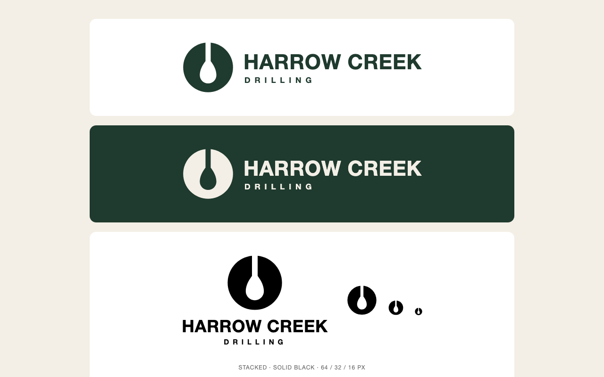
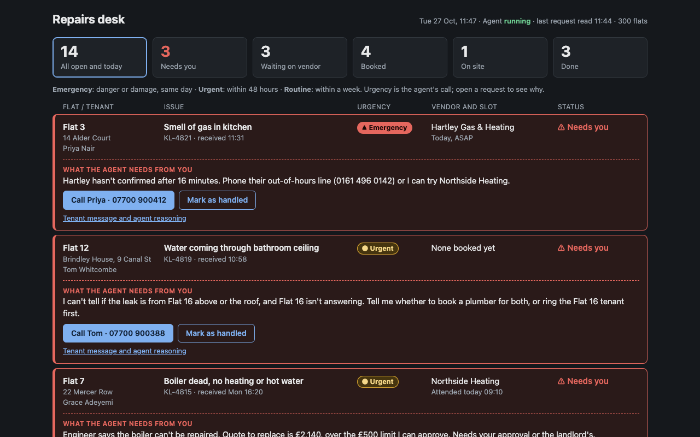
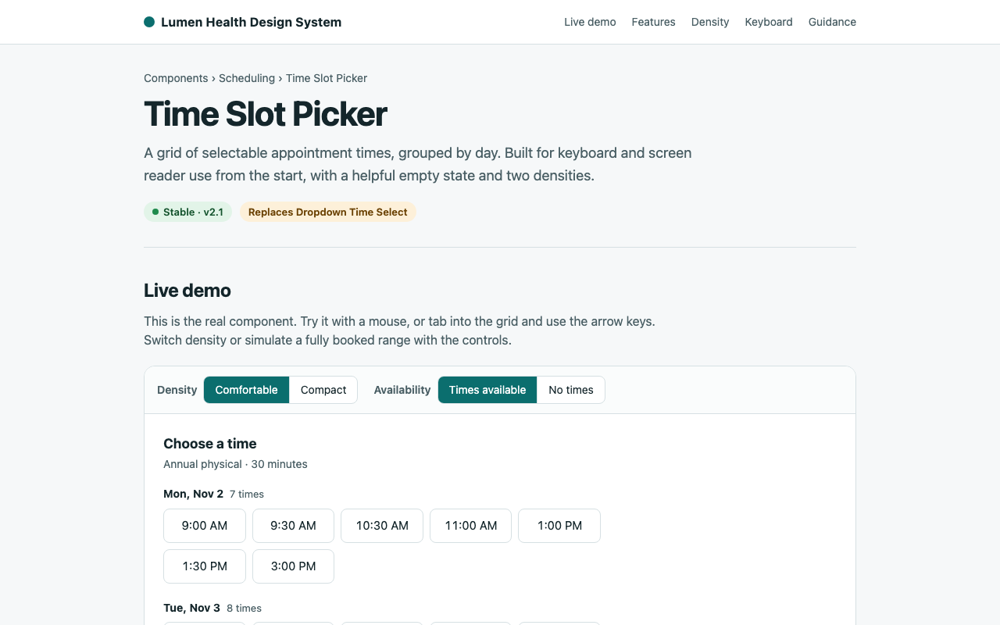
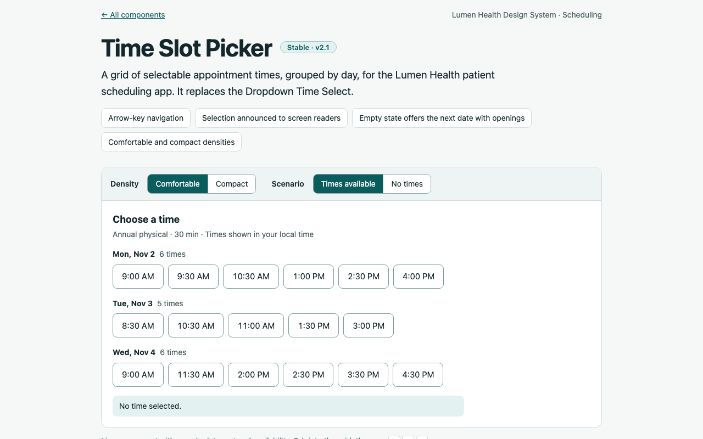
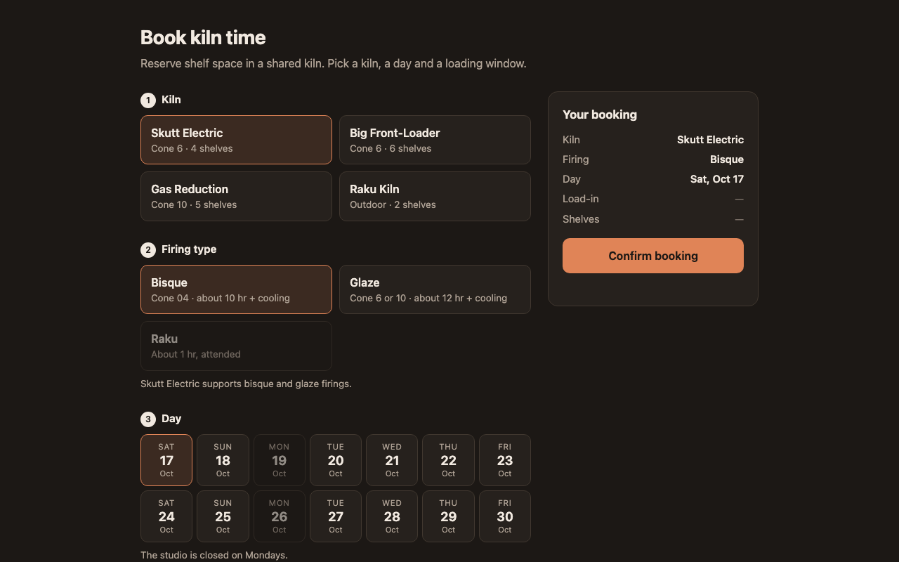
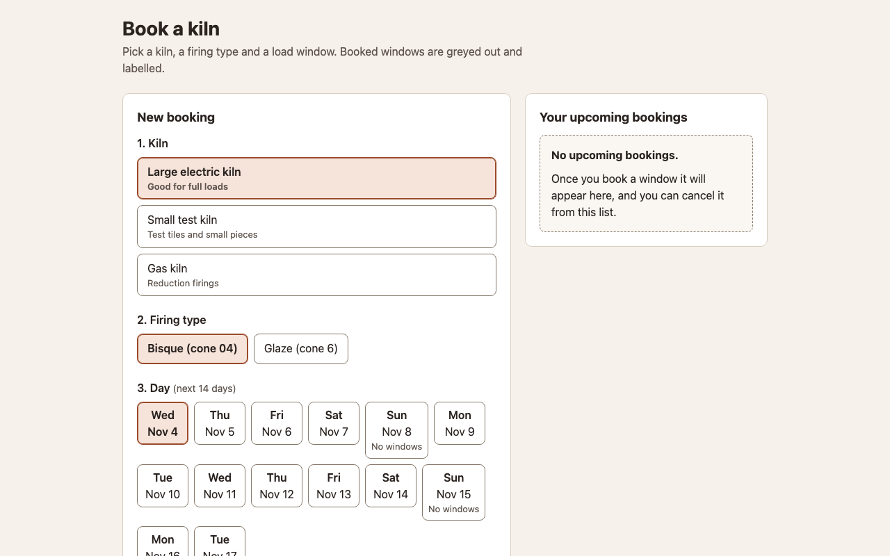

<!-- share-images:banner:start -->
<p align="center"></p>
<!-- share-images:banner:end -->

# design-and-copy-skills

Coding agents can write UI and copy that works, but what comes back usually looks and reads generic, or breaks quietly: a layout that overflows on a phone, a chart that makes a 3% dip look like a collapse, a claim nobody can back up. These skills are short instruction sets aimed at that gap, and an agent loads one only when a request calls for it. Each skill was tested against the same agent without it, and the results, including the losses, are on this page.

```sh
git clone --depth 1 https://github.com/thewyattbrocato/design-and-copy-skills.git && mkdir -p .claude/skills && cp -R design-and-copy-skills/skills/visual-hierarchy .claude/skills/
```

That installs one skill into the current project. Then ask your agent: "Everything on my pricing page competes for attention." It should load `visual-hierarchy`. Other skills and other tools are covered under [Install](#install).

## What is new

Updates merged since the last release, with the date each one merged. The evidence behind them is under [Latest round of updates](#latest-round-of-updates).

- 2026-11-02: [showing-work](skills/showing-work/SKILL.md), a new skill for pages and posts that present a piece of design work.
- 2026-11-04: [user-research-basics](skills/user-research-basics/references/running-sessions.md) now covers running research sessions.
- 2026-11-04: [pricing-and-packaging](skills/pricing-and-packaging/references/price-moves.md) gained a check for price moves.
- 2026-11-04: [sales-conversations](skills/sales-conversations/references/buying-groups.md) gained a buying-group reference.
- 2026-11-04: [presentation-design](skills/presentation-design/references/audience-and-argument.md) gained audience handling and live-room handling.
- 2026-11-04: [ui-polish-pass](skills/ui-polish-pass/references/page-and-focus-access.md) gained a page and focus access reference.
- 2026-11-04: [ux-microcopy](copy-skills/ux-microcopy/references/apology-and-repair.md) gained an apology and repair reference.
- 2026-11-04: [agent-interface-design](skills/agent-interface-design/references/long-jobs-fleets-and-permissions.md) now covers long jobs and many agents working at once.
- 2026-11-04: [design-critique](skills/design-critique/references/accessibility-review.md) gained an accessibility review reference.
- 2026-11-05: [content-strategy](copy-skills/content-strategy/references/documentation-upkeep.md) gained a documentation upkeep reference.
- 2026-11-05: [pricing-and-packaging](skills/pricing-and-packaging/references/discounts-and-negotiated-prices.md) gained a reference for discounts and negotiated prices.
- 2026-11-05: [user-research-basics](skills/user-research-basics/references/testing-designs-and-prototypes.md) gained a reference for testing designs and prototypes.
- 2026-11-05: refreshed images: the banner and counts, the [library map and skill-family cards](#what-each-family-changes) and the [before and after gallery](#more-before-and-after-examples).
- 2026-11-05: the [Skills at work film](docs/launch/skills-at-work.mp4), 88 seconds and silent, with a [text transcript](docs/launch/skills-at-work.md).
- 2026-11-05: the older 82-second demo video and its preview GIF are retired: they ended on the record from when the library had fewer skills, and nothing rebuilt them. The [Skills at work film](#watch-it-work) replaces them, and the results chart's PNG copy is rebuilt from the current chart.

Not everything tried made it in: twelve updates were tried and shelved because they missed the bar, and two merged updates (the user-research-basics testing references and its fresh second held-out set) show weaker evidence.

<!-- The count of twelve shelved updates is a maintainer-supplied figure. It cannot be derived from withdrawn/ and must be updated by hand when the next round changes it. -->

## What it changes

<!-- before-after:featured:start -->
The same request, given to the same model with and without the `brand-identity` skill installed:

> I run a well drilling company out in the country, Harrow Creek Drilling. Never had a real logo, just the name painted on the trucks. Can you make one? Give me a single self-contained HTML file with inline CSS and inline SVG, system fonts only, no external assets, showing the logo so I can see what it looks like.

| Without the skill | With the skill |
|---|---|
|  |  |
| A single HTML page showing one round badge logo for Harrow Creek Drilling: the name arched around a dark green ring with two gold stars, and inside it a drilling derrick with a red flag, a sun, green hills, a creek and a water drop at the end of the bore. Two small horizontal versions sit below. | A single HTML page showing a logo built from a dark green disc with a drill pipe cut down through it into a water drop, beside a "HARROW CREEK" wordmark with "DRILLING" spaced out underneath. The page repeats it reversed on dark green, then stacked in solid black with the mark at 64, 32 and 16 pixels. |

**Judge result.** The answer with the skill won this task, 3 of 3 samples, by +1.17 rubric points on the 5-point scale. The judge was `claude:opus`, a different model from the one that wrote the answers; it saw the two answers unlabelled, in both orders. Over all of this skill's held-out tasks where it loaded, the skill won 6, lost 3 and tied 1. Both answers are web pages; the screenshots are the stored renders of sample 1 of each side, and the text is a plain description of each screenshot. [Full run files](evals/brand-identity/heldout/runs/brand-h01/).

This is one example, not a typical one: it is the task with the biggest judged gap in the skill's favor among the tasks where the skill loaded. Examples for 15 other skills are in [More before and after examples](#more-before-and-after-examples).
<!-- before-after:featured:end -->

<!-- results-table:headline:start -->
**Across 38 skills, counting only the held-out tasks where the skill loaded (312 in all): 218 wins, 46 losses and 48 ties against the same model without it. 12 of the 38 passes are marginal.**
<!-- results-table:headline:end -->

How that number is counted is under [How the evals work](#how-the-evals-work); the per-skill rows are in [Results](#results).

## Watch it work

[](docs/launch/skills-at-work.mp4)

An 88-second silent film with captions, [Skills at work](docs/launch/skills-at-work.mp4), shows eight moves: a request arriving, a skill loading, then a form, a chart, a table, a deck, a pricing page and an accessibility pass. Every example is a saved screenshot or answer from the stored test runs (only the title and the skill-list drawing in move 2 are drawn, and its caption says so), and its counts are read from this repository's results files. Each of the six examples was picked to show the move, so they are favorable examples. A [still-image version](docs/launch/skills-at-work-still.png) for anyone who prefers no motion and a [text transcript](docs/launch/skills-at-work.md) sit beside the film. Rebuild it with `python3 scripts/make_film.py` (needs Chrome and ffmpeg).

The film says two more things plainly, and so does this page. In the latest round of updates, twelve proposed updates were tried and shelved because they missed the held-out bar; they are not in the library. And two merged updates show weaker evidence: the usability references added to user-research-basics, and the fresh second held-out set for that skill, which shows no measurable gain on the new set (4 wins, 2 losses and 2 ties on loaded tasks; mean rubric 4.29 with the skill, 4.30 without).

## What each family changes

<!-- share-images:families:start -->
![Map of the library: 38 skills in 8 families, 26 design and 12 copywriting, each skill marked as a plain or a marginal pass. Look and type (design, 5): brand-identity, color-palette, generated-ui-restyle, typeface-selection, typesetting (marginal). Layout and emphasis (design, 5): layout-structure, responsive-layout (marginal), showing-work, spacing-and-grouping, visual-hierarchy. Charts and tables (design, 2): chart-design, data-tables (marginal). Product behavior (design, 6): agent-interface-design (marginal), design-system-builder, form-design, interface-behavior (marginal), ui-motion, ui-polish-pass. Research and teaching (design, 5): design-critique, journey-and-service-mapping (marginal), practice-and-assessment, teaching-interfaces, user-research-basics (marginal). Selling and presenting (design, 3): presentation-design, pricing-and-packaging (marginal), sales-conversations. Messages and pages (copywriting, 8): campaign-ideas (marginal), content-strategy, email-and-sequences, headlines-and-leads, landing-page-copy, offers-and-value-propositions, positioning-and-messaging (marginal), ux-microcopy. Checking and editing (copywriting, 4): editing-and-cutting (marginal), fair-persuasion, honest-claims, website-copy-audit (marginal).](docs/launch/skill-families.svg)

The map groups the 38 skills by what they change in the answer; on disk they sit in two folders, `skills/` and `copy-skills/`. A solid mark is a plain pass and an outlined mark a marginal one. Each card below shows one real example from the family, taken from [More before and after examples](#more-before-and-after-examples): stored screenshots for a page the model built, or a few lines quoted word for word for a written answer. Each example is the skill's task with the largest judged difference, so the cards show the clearest cases, not typical ones. The family names and the one-line summaries are this README's grouping, not test results.

| | |
|---|---|
| ![Card for the Look and type family (brand-identity, color-palette, generated-ui-restyle, typeface-selection, typesetting): Color, fonts, text setting and marks, so a page or logo looks made for its product. Example from brand-identity, without the skill on the left and with it on the right. Left: Round badge logo for Harrow Creek Drilling: the name arched around a dark green ring with gold stars; inside, a drilling derrick, a sun, green hills, a creek and a water drop. Two very small horizontal versions sit below. Right: Logo page for Harrow Creek Drilling: a dark green disc with a drill pipe cut down into a water drop beside a HARROW CREEK wordmark, shown on white, reversed on dark green, and stacked in solid black with the mark at three small sizes. Judged difference +1.17.](docs/launch/families/look-and-type.png) | ![Card for the Layout and emphasis family (layout-structure, responsive-layout, showing-work, spacing-and-grouping, visual-hierarchy): What sits where, what reads first and how the page holds up on any screen. Example from showing-work, without the skill on the left and with it on the right. Left: Time Slot Picker launch page: top navigation, breadcrumb, title, summary and two tags, then a Live demo heading and introduction; the live component begins in the lower half of the screen. Right: Time Slot Picker launch page: title with a Stable v2.1 tag, a one-sentence summary, four chips for the key points, and the live component with density and scenario switches showing three days of times, all on the first screen. Judged difference +0.80.](docs/launch/families/layout-and-emphasis.png) |
| **Look and type.** Color, fonts, text setting and marks, so a page or logo looks made for its product. Shown with brand-identity: the stored screenshots, from the task with its largest judged difference (+1.17). | **Layout and emphasis.** What sits where, what reads first and how the page holds up on any screen. Shown with showing-work: the stored screenshots, from the task with its largest judged difference (+0.80). |
|  | ![Card for the Product behavior family (agent-interface-design, design-system-builder, form-design, interface-behavior, ui-motion, ui-polish-pass): How screens, forms, motion and agents act, and every state a real user meets. Example from ui-polish-pass, without the skill on the left and with it on the right. Left: Dark kiln booking page: steps for kiln, firing type and day, a grid of two weeks with Mondays dimmed, and a Your booking summary with a Confirm booking button while load-in and shelves are still blank. Right: Light kiln booking page: steps for kiln, firing type and the next 14 days, two days marked No windows, and a Your upcoming bookings panel with an empty state explaining that a booking will appear there and can be cancelled. Judged difference +0.93.](docs/launch/families/product-behavior.png) |
| **Charts and tables.** Honest axes, the right chart for the question, and tables that line up and read. Shown with chart-design: lines quoted from the stored answers, from the task with its largest judged difference (+0.47). | **Product behavior.** How screens, forms, motion and agents act, and every state a real user meets. Shown with ui-polish-pass: the stored screenshots, from the task with its largest judged difference (+0.93). |
| ![Card for the Research and teaching family (design-critique, journey-and-service-mapping, practice-and-assessment, teaching-interfaces, user-research-basics): Finding out what people need, teaching them, and judging a design with ranked findings. Example from practice-and-assessment, without the skill on the left and with it on the right. Left: "10. If a load is slightly heavier than the capacity plate allows, you can lift it carefully. Answer: False. If a load is heavier than the capacity, do not lift it." Right: "Jin is about to lift a pallet. The capacity plate on the mast shows the truck's maximum load, and the pallet's label shows a heavier weight. What does Jin do? B: Driving slowly doesn't fix a truck that's overloaded. It can still tip." Judged difference +1.67.](docs/launch/families/research-and-teaching.png) |  |
| **Research and teaching.** Finding out what people need, teaching them, and judging a design with ranked findings. Shown with practice-and-assessment: lines quoted from the stored answers, from the task with its largest judged difference (+1.67). | **Selling and presenting.** Prices and plans, sales calls, and talks that lead to a decision. Shown with sales-conversations: lines quoted from the stored answers, from the task with its largest judged difference (+1.90). |
| ![Card for the Messages and pages family (campaign-ideas, content-strategy, email-and-sequences, headlines-and-leads, landing-page-copy, offers-and-value-propositions, positioning-and-messaging, ux-microcopy): What to say and where: positioning, offers, headlines, pages, emails and product text. Example from ux-microcopy, without the skill on the left and with it on the right. Left: "Before you go: 30% off your next 3 months Join 3,000+ home cooks who keep dinner simple with Larkspur." Right: "Your price drops from \[CURRENT PRICE\] to \[DISCOUNTED PRICE\] a week. If you cancel, you won't be charged again." Judged difference +1.45.](docs/launch/families/messages-and-pages.png) | ![Card for the Checking and editing family (editing-and-cutting, fair-persuasion, honest-claims, website-copy-audit): Cutting, fact-checking claims, keeping persuasion fair and auditing what a site says. Example from fair-persuasion, without the skill on the left and with it on the right. Left: "Not ready to let go of your routine? You've built a habit here, so before you cancel, here are two ways to keep it for less or for free." Right: "I left it unchanged on purpose. The cancel button is equal in weight and not hidden." Judged difference +2.73.](docs/launch/families/checking-and-editing.png) |
| **Messages and pages.** What to say and where: positioning, offers, headlines, pages, emails and product text. Shown with ux-microcopy: lines quoted from the stored answers, from the task with its largest judged difference (+1.45). | **Checking and editing.** Cutting, fact-checking claims, keeping persuasion fair and auditing what a site says. Shown with fair-persuasion: lines quoted from the stored answers, from the task with its largest judged difference (+2.73). |
<!-- share-images:families:end -->

## Try it

Five requests to paste into an agent with the skill installed, each shown with the skill it should load. They are taken word for word from the activation check (see [Activation check](#activation-check)), and in the latest run of that check each one was routed to the right skill. Routing is the first step only; whether the skill then helps is what the held-out results show.

<!-- results-table:tryit:start -->
| Type this | The agent should load |
|---|---|
| “Everything on my pricing page competes for attention.” | [visual-hierarchy](skills/visual-hierarchy/SKILL.md) |
| “My line graph makes our 3% dip look like a collapse. What's wrong with the axis?” | [chart-design](skills/chart-design/SKILL.md) |
| “Our signup form has 11 fields and half the people quit at step two. What should we cut?” | [form-design](skills/form-design/SKILL.md) |
| “A prospect went quiet after the demo. How do I follow up without nagging?” | [email-and-sequences](copy-skills/email-and-sequences/SKILL.md) |
| “Can I call us the number one rated CRM?” | [honest-claims](copy-skills/honest-claims/SKILL.md) |
<!-- results-table:tryit:end -->


*How a skill loads: only its name and one-line description are always in context; the instructions load when a request matches.*

## Skills

The design skills are listed below, and the copywriting skills in [their own table](#copywriting-skills). The tables are generated from each skill's `SKILL.md` frontmatter. Each skill's held-out result, including which passes are marginal, is in [Results](#results).

<!-- results-table:skills:start -->
| Skill | Use when | Not for |
|---|---|---|
| [agent-interface-design](skills/agent-interface-design/SKILL.md) | designing software that does things for a person over time while they are not watching, in any words | chatbot wording and tone (ux-microcopy), ordinary notifications or settings (interface-behavior), consent and dark patterns (fair-persuasion), or open-ended generative chat products |
| [brand-identity](skills/brand-identity/SKILL.md) | a logo, mark, wordmark, app icon or visual identity is being made, judged or changed, in any language and at any length | interface palettes (color-palette), type choice (typeface-selection), design tokens (design-system-builder), product screens (design-critique) or naming and trademark law |
| [chart-design](skills/chart-design/SKILL.md) | you make, choose, fix or review a single chart, graph, sparkline or simple map (HTML, SVG, canvas or a chart library), in any words | multi-chart dashboards or KPI screens, data tables, interface or brand palettes, diagrams that explain a mechanism, or statistical analysis |
| [color-palette](skills/color-palette/SKILL.md) | color is being chosen, judged or fixed, in any language and at any length | chart data scales (chart-design), logo design (brand-identity), token plumbing (design-system-builder) or type weight (typesetting) |
| [data-tables](skills/data-tables/SKILL.md) | you build, style or review a table of data in a page, app, document or report, in any words | charts, whole dashboards, page grids, short lists that are not tabular, or editing inside spreadsheet engines |
| [design-critique](skills/design-critique/SKILL.md) | someone wants a design judged, in any words, any length or language | building or applying fixes, even a final polish pass (do the work instead), logo or identity critique (brand-identity) or code review |
| [design-system-builder](skills/design-system-builder/SKILL.md) | shared design decisions are being created, cleaned up or extended, in any language and at any length | styling one page (the focused skills), drawing a brand (brand-identity), or auditing a product without building (design-critique) |
| [form-design](skills/form-design/SKILL.md) | designing, building, reviewing or fixing a form, input flow or settings screen, in any words | tabs, menus, toasts, data grids or marketing copy around a form |
| [generated-ui-restyle](skills/generated-ui-restyle/SKILL.md) | a screen, page or component looks machine-generated or like an untouched starter template and should look designed for its own product, in any language and any words | missing states or accessibility on a look that works (ui-polish-pass), scored critiques (design-critique), logos (brand-identity), one layer alone such as a palette (color-palette), or one named fix |
| [interface-behavior](skills/interface-behavior/SKILL.md) | deciding how a product acts rather than how it looks or reads, in any words or language | page grids, field mechanics, copy, motion timing, table styling or charts |
| [journey-and-service-mapping](skills/journey-and-service-mapping/SKILL.md) | mapping, planning or critiquing how a person experiences a product or service over time, in any words or language | one screen or flow inside a product (interface-behavior), planning or running research (user-research-basics), diagrams that explain how a thing works (teaching-interfaces) or the visual layout of a page (layout-structure) |
| [layout-structure](skills/layout-structure/SKILL.md) | you design, build, plan or review the overall structure of a page, screen, slide, poster or social graphic | CSS mechanics, spacing values, emphasis between elements, multi-chart dashboards, or single components such as a button sheet |
| [practice-and-assessment](skills/practice-and-assessment/SKILL.md) | people must practice, be checked on or retain a skill, in any language and at any length | onboarding screens (teaching-interfaces), quiz software or grading code, form fields (form-design) or reviewing a learning product's interface (design-critique) |
| [presentation-design](skills/presentation-design/SKILL.md) | a talk, slide deck, pitch, readout or other spoken presentation is being planned, structured, written, cut or reviewed, in any language and at any length | the visual styling of one slide or page (visual-hierarchy), a chart on its own (chart-design), written documents (editing-and-cutting), or the mechanics of producing a slide file |
| [pricing-and-packaging](skills/pricing-and-packaging/SKILL.md) | what to charge, or how to package it, is being decided or checked, in any language and at any length | the wording of offers, guarantees and tier names on a page (offers-and-value-propositions), persuasion ethics and defaults (fair-persuasion), the layout of a comparison table (data-tables) or financial modelling and accounting |
| [responsive-layout](skills/responsive-layout/SKILL.md) | CSS layout has to hold up on any screen, container or setting, in any language and at any length | page structure (layout-structure), spacing values (spacing-and-grouping) or type scales (typesetting); dialog focus semantics are out of scope |
| [sales-conversations](skills/sales-conversations/SKILL.md) | a live sales conversation is being planned, run or reviewed, in any words or language | written outreach sequences (email-and-sequences), whether a persuasion lever is fair (fair-persuasion), whether a claim is true (honest-claims), research meant to learn rather than sell (user-research-basics), slide craft (presentation-design) or setting prices (pricing-and-packaging) |
| [showing-work](skills/showing-work/SKILL.md) | a page, post, outline, slide or tile has to present a piece of design work someone made, in any language and any words | a customer story told to sell a product (landing-page-copy), the structure of a talk or deck (presentation-design), faux product interfaces inside demos, or page grids and emphasis on their own (layout-structure, visual-hierarchy) |
| [spacing-and-grouping](skills/spacing-and-grouping/SKILL.md) | you design, build, restyle or review any interface or page where several items sit near each other | choosing emphasis, palettes, page grids, CSS layout mechanics, or expressive posters |
| [teaching-interfaces](skills/teaching-interfaces/SKILL.md) | a screen, page or flow has to teach someone to do or understand something, in any language | quizzes or courses (practice-and-assessment), input fields (form-design), animation timing (ui-motion), data charts (chart-design), marketing pages or general interface strings (ux-microcopy) |
| [typeface-selection](skills/typeface-selection/SKILL.md) | a font is being chosen, paired, judged or fixed, in any language and at any length | sizes, leading or line length (typesetting), drawing logos (brand-identity), type tokens (design-system-builder) or palettes (color-palette) |
| [typesetting](skills/typesetting/SKILL.md) | text is being set, judged or fixed, in any language and at any length | choosing typefaces (typeface-selection), ranking a whole view (visual-hierarchy), palettes (color-palette), table layout (data-tables) or logos (brand-identity) |
| [ui-motion](skills/ui-motion/SKILL.md) | someone wants an interface to feel smooth, responsive, alive, polished, premium or less janky, or asks what motion to add and in what order, or to add, fix, cut, time, specify or review animation | video, film or character animation, detailed chart animation, print or static deliverables, or carousel semantics |
| [ui-polish-pass](skills/ui-polish-pass/SKILL.md) | an interface should be finished, not just functional, however the ask is worded | visual redesigns, scored critiques (design-critique) or one named fix |
| [user-research-basics](skills/user-research-basics/SKILL.md) | someone needs to find out what people do, need or struggle with, in any words, length or language | judging a design (design-critique), form fields (form-design) or page copy |
| [visual-hierarchy](skills/visual-hierarchy/SKILL.md) | a screen or page needs a clear order of importance, in any language and at any length | spacing values, type sizes, palettes and contrast numbers, page grids, chart encodings or logos |
<!-- results-table:skills:end -->

Two more skills were built and tested but did not meet the bar and are not shipped; see [Built and tested, not shipped](#built-and-tested-not-shipped).

## Copywriting skills

Copywriting skills live in their own folder, [copy-skills/](copy-skills/README.md), and follow the same rules as the design skills: original wording and an eval gate before a skill is listed. The table is generated from each skill's `SKILL.md` frontmatter.

<!-- results-table:copy:start -->
| Skill | Use when | Not for |
|---|---|---|
| [campaign-ideas](copy-skills/campaign-ideas/SKILL.md) | the idea has to be found before any words are written, in any language and at any length | finished headline sets (headlines-and-leads), positioning (positioning-and-messaging), offer terms (offers-and-value-propositions) or whole pages and emails |
| [content-strategy](copy-skills/content-strategy/SKILL.md) | someone must decide what content to have, who owns it and how it stays good, in any language and at any length | how a page or string reads (website-copy-audit, ux-microcopy) or the wording of positioning (positioning-and-messaging) |
| [editing-and-cutting](copy-skills/editing-and-cutting/SKILL.md) | you edit, shorten, tighten or review text that already exists instead of writing new copy, in any language and at any length | checking whether claims are true (honest-claims), rebuilding a whole page (landing-page-copy), writing new headlines (headlines-and-leads) or code documentation |
| [email-and-sequences](copy-skills/email-and-sequences/SKILL.md) | you write, plan, fix or judge email or direct messages to customers, subscribers or prospects, in any language and at any length | receipts, resets and in-app notifications (ux-microcopy), the page an email links to (landing-page-copy) or checking claims (honest-claims) |
| [fair-persuasion](copy-skills/fair-persuasion/SKILL.md) | a flow, default, plan choice, upsell, cancel or pause step, consent prompt or reminder is designed to steer a choice, or someone asks if it is pushy or a dark pattern, in any language | whether a claim is true (honest-claims), form field mechanics (form-design) or the screen strings themselves (ux-microcopy) |
| [headlines-and-leads](copy-skills/headlines-and-leads/SKILL.md) | you write, rewrite, shorten, pick or judge the first words someone reads, in any language and at any length | email subject lines (email-and-sequences), buttons and interface labels (ux-microcopy), whole pages (landing-page-copy) or a heading's size and weight (visual-hierarchy) |
| [honest-claims](copy-skills/honest-claims/SKILL.md) | copy states a fact, number, result, comparison, quote, rating, customer count, award, guarantee, price, deadline or stock limit, or someone asks to make it more persuasive, urgent, credible or "more official", to add social proof or reviews, to write quotes or statistics they have not supplied, or to check a page for claims that could get them in trouble, or as a last check on those lines inside other copy, in any language | defaults, cancellation flows or other choice design (fair-persuasion), or general line editing (editing-and-cutting) |
| [landing-page-copy](copy-skills/landing-page-copy/SKILL.md) | you write, rewrite or plan the words of a page meant to win someone over, such as home, landing, sales, product, feature, pricing, about or case-study pages, including "write my homepage", "this page doesn't convert", "make it less salesy", "nobody gets what we do", "turn these notes into a landing page" or "redo our website copy", in any language and at any length | how the page looks (layout-structure, visual-hierarchy), a single headline (headlines-and-leads), in-product strings, emails, or reviewing a whole site (website-copy-audit) |
| [offers-and-value-propositions](copy-skills/offers-and-value-propositions/SKILL.md) | you word what is offered and why it is worth the price, in any language and at any length | audience or category (positioning-and-messaging), table layout (data-tables), checkout fields (form-design) or legal terms |
| [positioning-and-messaging](copy-skills/positioning-and-messaging/SKILL.md) | someone needs to decide or put into words what a product or company is, who it is for and why it beats what they use now, in any language and at any length | full pages (landing-page-copy), sets of headlines (headlines-and-leads), offer terms and pricing (offers-and-value-propositions), or logos and visual identity |
| [ux-microcopy](copy-skills/ux-microcopy/SKILL.md) | you write or fix the words inside a product or a transactional message, in any language | form fields (form-design), marketing pages, email sequences, first-run flows, tours or help articles (teaching-interfaces), or ARIA and focus |
| [website-copy-audit](copy-skills/website-copy-audit/SKILL.md) | someone wants existing site or product copy judged rather than written, in any language and at any length | writing new pages (landing-page-copy), line editing alone, or reviewing visual design |
<!-- results-table:copy:end -->

## Install

A skill is a folder with a `SKILL.md` and a `references/` directory. Installing means copying that folder to wherever your agent looks for skills. The copy is self-contained; the clone is only needed to copy from. Design skills live in `skills/` and copywriting skills in `copy-skills/`; both install to the same place.

**Claude Code.** Project skills live in `.claude/skills/` inside the repository you are working on and are shared with everyone who clones it. Personal skills live in `~/.claude/skills/` and apply to every project on your machine.

```sh
git clone --depth 1 https://github.com/thewyattbrocato/design-and-copy-skills.git

# one skill, for the current project
mkdir -p .claude/skills && cp -R design-and-copy-skills/skills/visual-hierarchy .claude/skills/

# one skill, for every project on this machine
mkdir -p ~/.claude/skills && cp -R design-and-copy-skills/skills/form-design ~/.claude/skills/

# one copywriting skill, same destination
cp -R design-and-copy-skills/copy-skills/ux-microcopy .claude/skills/

# every design skill at once
cp -R design-and-copy-skills/skills/* .claude/skills/

# every copywriting skill at once (copy-skills/ also holds a README, so copy folders only)
for d in design-and-copy-skills/copy-skills/*; do [ -d "$d" ] && cp -R "$d" .claude/skills/; done
```

Choose what you need rather than installing everything. Several skills (typesetting, visual-hierarchy, spacing-and-grouping, color-palette, responsive-layout) describe themselves as applying to any page or build, so with all of them installed a single build can load several at once.

**Other tools.** The skills use the [Agent Skills](https://agentskills.io/) format: a `SKILL.md` with `name` and `description` frontmatter plus a `references/` folder. Many compatible tools scan `.agents/skills/` in the project and `~/.agents/skills/` for the user, and some also read the `.claude/skills/` locations above. Use the same copy commands with the directory your tool documents.

Once installed, the agent loads a skill when a request matches its description. In Claude Code you can also invoke one by name, for example `/form-design`. The description of each skill ends with what it is not for, so neighboring skills do not fight over a task.

## Results

<!-- results-chart:alt:start -->
![Horizontal bar chart of the held-out results for every listed skill, loaded runs only. Each bar shows the mean rubric score with the skill minus without it, starting at zero and ordered from the largest gain to the smallest. Beside each bar are the skill's wins, losses and ties and its number of loaded tasks. 37 of the 38 skills scored higher with the skill than without, and one is not higher (user-research-basics at -0.01, drawn as a hollow loss bar tagged "marginal"); every skill won more tasks than it lost. The 12 marginal passes are drawn as hollow bars tagged "marginal".](docs/img/results.svg)
<!-- results-chart:alt:end -->

This chart is generated from the stored held-out results files by `scripts/make_results_chart.py`, and it counts only the runs where the model loaded the skill.

The tables below are generated from the results files by `scripts/results_table.py`, and CI fails when this file does not match them. Every run has answers from `claude-sonnet-5-5`, the skill installed as a project skill, seed 0 and 10 tasks. The "Skill loaded by the model" column gives the samples in which the model loaded the skill and, in brackets, the tasks with at least one such sample. Under protocol 1 the all-samples column counts every pair, including tasks where the model never loaded the skill; the loaded-only column is recomputed from whether it loaded on each task, and is the one to read.

**Held-out set.** Clean evidence: the skill writers never saw these tasks. A skill with no held-out results yet shows `pending clean rerun`.

<!-- results-table:heldout:start -->
| Skill | Protocol | Samples per arm | Wins / losses / ties, all samples | Wins / losses / ties, loaded only | Mean rubric, with / without (loaded only under protocol 2) | Skill loaded by the model | Gate | Judge | Secondary row (weaker generator, not gated) |
|---|---|---|---|---|---|---|---|---|---|
| agent-interface-design | 2 | 3 | 6 / 4 / 0 | 6 / 3 / 0 (9 tasks) | 4.056 / 3.927 | 26 of 30 samples (9 of 10 tasks) | pass, marginal (rubric +0.13) | `claude:opus`, a different model from the generator | `haiku`: 3 / 2 / 1 loaded only |
| brand-identity | 2 | 3 | 5 / 3 / 2 | 6 / 3 / 1 (10 tasks) | 4.377 / 3.989 | 28 of 30 samples (10 of 10 tasks) | pass | `claude:opus`, a different model from the generator | `haiku`: 5 / 2 / 2 loaded only |
| chart-design | 2 | 3 | 9 / 1 / 0 | 9 / 1 / 0 (10 tasks) | 4.562 / 4.301 | 28 of 30 samples (10 of 10 tasks) | pass | `claude:opus`, a different model from the generator | none |
| color-palette | 2 | 3 | 8 / 1 / 1 | 7 / 1 / 0 (8 tasks) | 4.637 / 4.457 | 24 of 30 samples (8 of 10 tasks) | pass | `claude:opus`, a different model from the generator | `haiku`: 1 / 0 / 2 loaded only |
| data-tables | 2 | 3 | 6 / 4 / 0 | 5 / 4 / 0 (9 tasks) | 4.299 / 4.258 | 23 of 30 samples (9 of 10 tasks) | pass, marginal (rubric +0.04; one-task win margin) | `claude:opus`, a different model from the generator | none |
| design-critique | 2 | 3 | 8 / 2 / 0 | 7 / 1 / 1 (9 tasks) | 4.367 / 3.966 | 25 of 30 samples (9 of 10 tasks) | pass | `claude:opus`, a different model from the generator | `haiku`: 3 / 0 / 2 loaded only |
| design-system-builder | 2 | 3 | 6 / 1 / 3 | 5 / 1 / 3 (9 tasks) | 4.244 / 4.046 | 26 of 30 samples (9 of 10 tasks) | pass | `claude:opus`, a different model from the generator | `haiku`: 2 / 1 / 0 loaded only |
| form-design | 2 | 3 | 5 / 1 / 4 | 5 / 1 / 3 (9 tasks) | 4.441 / 4.168 | 27 of 30 samples (9 of 10 tasks) | pass | `claude:opus`, a different model from the generator | none |
| generated-ui-restyle | 2 | 3 | 8 / 1 / 1 | 7 / 1 / 1 (9 tasks) | 4.17 / 3.815 | 25 of 30 samples (9 of 10 tasks) | pass | `claude:opus`, a different model from the generator | none |
| interface-behavior | 2 | 3 | 5 / 2 / 3 | 4 / 2 / 1 (7 tasks) | 4.6 / 4.467 | 21 of 30 samples (7 of 10 tasks) | pass, marginal (rubric +0.13) | `claude:opus`, a different model from the generator | none |
| journey-and-service-mapping | 2 | 3 | 6 / 1 / 3 | 5 / 1 / 0 (6 tasks) | 4.396 / 3.935 | 18 of 30 samples (6 of 10 tasks) | pass, marginal (6 loaded tasks) | `claude:opus`, a different model from the generator | `haiku`: 4 / 1 / 1 loaded only |
| layout-structure | 2 | 3 | 5 / 1 / 4 | 4 / 2 / 2 (8 tasks) | 4.373 / 4.167 | 21 of 30 samples (8 of 10 tasks) | pass | `claude:opus`, a different model from the generator | none |
| practice-and-assessment | 2 | 3 | 7 / 1 / 2 | 6 / 1 / 1 (8 tasks) | 4.504 / 3.895 | 24 of 30 samples (8 of 10 tasks) | pass | `claude:opus`, a different model from the generator | `haiku`: 1 / 0 / 1 loaded only |
| presentation-design | 2 | 3 | 7 / 1 / 2 | 7 / 1 / 2 (10 tasks) | 4.687 / 4.253 | 30 of 30 samples (10 of 10 tasks) | pass | `claude:opus`, a different model from the generator | none |
| pricing-and-packaging | 2 | 3 | 5 / 1 / 4 | 4 / 2 / 3 (9 tasks) | 4.333 / 4.276 | 22 of 30 samples (9 of 10 tasks) | pass, marginal (rubric +0.06) | `claude:opus`, a different model from the generator | `haiku`: 5 / 2 / 0 loaded only |
| responsive-layout | 2 | 3 | 6 / 1 / 3 | 4 / 0 / 2 (6 tasks) | 4.346 / 4.109 | 15 of 30 samples (6 of 10 tasks) | pass, marginal (6 loaded tasks) | `claude:opus`, a different model from the generator | none |
| sales-conversations | 2 | 3 | 8 / 1 / 1 | 7 / 1 / 1 (9 tasks) | 4.486 / 3.725 | 27 of 30 samples (9 of 10 tasks) | pass | `claude:opus`, a different model from the generator | `haiku`: 5 / 1 / 2 loaded only |
| showing-work | 2 | 3 | 7 / 3 / 0 | 7 / 3 / 0 (10 tasks) | 4.657 / 4.457 | 28 of 30 samples (10 of 10 tasks) | pass | `claude:opus`, a different model from the generator | none |
| spacing-and-grouping | 2 | 3 | 5 / 2 / 3 | 5 / 2 / 3 (10 tasks) | 4.282 / 4.062 | 28 of 30 samples (10 of 10 tasks) | pass | `claude:opus`, a different model from the generator | none |
| teaching-interfaces | 2 | 3 | 6 / 1 / 3 | 6 / 2 / 1 (9 tasks) | 4.478 / 4.282 | 25 of 30 samples (9 of 10 tasks) | pass | `claude:opus`, a different model from the generator | `haiku`: 4 / 2 / 1 loaded only |
| typeface-selection | 2 | 3 | 6 / 1 / 3 | 5 / 1 / 3 (9 tasks) | 4.403 / 4.071 | 25 of 30 samples (9 of 10 tasks) | pass | `claude:opus`, a different model from the generator | none |
| typesetting | 2 | 3 | 3 / 1 / 6 | 2 / 1 / 4 (7 tasks) | 4.792 / 4.67 | 18 of 30 samples (7 of 10 tasks) | pass, marginal (rubric +0.12; one-task win margin) | `claude:opus`, a different model from the generator | none |
| ui-motion | 2 | 3 | 4 / 3 / 3 | 4 / 1 / 2 (7 tasks) | 4.232 / 3.96 | 21 of 30 samples (7 of 10 tasks) | pass | `claude:opus`, a different model from the generator | none |
| ui-polish-pass | 2 | 3 | 9 / 0 / 1 | 8 / 0 / 1 (9 tasks) | 3.896 / 3.404 | 27 of 30 samples (9 of 10 tasks) | pass | `claude:opus`, a different model from the generator | `haiku`: 3 / 1 / 1 loaded only |
| user-research-basics | 2 | 3 | 5 / 2 / 2 | 4 / 2 / 2 (8 tasks) | 4.292 / 4.3 | 20 of 27 samples (8 of 9 tasks) | pass, marginal (rubric -0.01) | `claude:opus`, a different model from the generator | none |
| visual-hierarchy | 2 | 3 | 7 / 1 / 2 | 8 / 0 / 1 (9 tasks) | 4.645 / 4.063 | 24 of 30 samples (9 of 10 tasks) | pass | `claude:opus`, a different model from the generator | `haiku`: 6 / 0 / 0 loaded only |
| campaign-ideas | 2 | 3 | 7 / 0 / 3 | 5 / 0 / 1 (6 tasks) | 4.578 / 3.897 | 17 of 30 samples (6 of 10 tasks) | pass, marginal (6 loaded tasks) | `claude:opus`, a different model from the generator | none |
| content-strategy | 2 | 3 | 10 / 0 / 0 | 7 / 0 / 0 (7 tasks) | 4.577 / 3.845 | 19 of 30 samples (7 of 10 tasks) | pass | `claude:opus`, a different model from the generator | none |
| editing-and-cutting | 2 | 3 | 5 / 1 / 4 | 3 / 2 / 1 (6 tasks) | 4.334 / 4.19 | 14 of 30 samples (6 of 10 tasks) | pass, marginal (rubric +0.14; 6 loaded tasks; one-task win margin) | `claude:opus`, a different model from the generator | none |
| email-and-sequences | 2 | 3 | 8 / 2 / 0 | 7 / 2 / 0 (9 tasks) | 4.651 / 4.17 | 23 of 30 samples (9 of 10 tasks) | pass | `claude:opus`, a different model from the generator | none |
| fair-persuasion | 2 | 3 | 9 / 0 / 1 | 8 / 0 / 0 (8 tasks) | 4.829 / 3.908 | 22 of 30 samples (8 of 10 tasks) | pass | `claude:opus`, a different model from the generator | `haiku`: 4 / 2 / 0 loaded only |
| headlines-and-leads | 2 | 3 | 3 / 1 / 6 | 3 / 0 / 4 (7 tasks) | 4.546 / 4.357 | 21 of 30 samples (7 of 10 tasks) | pass | `claude:opus`, a different model from the generator | none |
| honest-claims | 2 | 3 | 7 / 2 / 1 | 6 / 1 / 1 (8 tasks) | 4.542 / 4.329 | 24 of 30 samples (8 of 10 tasks) | pass | `claude:opus`, a different model from the generator | none |
| landing-page-copy | 2 | 3 | 8 / 2 / 0 | 7 / 2 / 0 (9 tasks) | 4.715 / 4.386 | 27 of 30 samples (9 of 10 tasks) | pass | `claude:opus`, a different model from the generator | none |
| offers-and-value-propositions | 2 | 3 | 8 / 0 / 2 | 8 / 0 / 0 (8 tasks) | 4.729 / 4.28 | 24 of 30 samples (8 of 10 tasks) | pass | `claude:opus`, a different model from the generator | none |
| positioning-and-messaging | 2 | 3 | 7 / 0 / 3 | 6 / 0 / 0 (6 tasks) | 4.438 / 3.864 | 17 of 30 samples (6 of 10 tasks) | pass, marginal (6 loaded tasks) | `claude:opus`, a different model from the generator | none |
| ux-microcopy | 2 | 3 | 6 / 1 / 3 | 6 / 1 / 2 (9 tasks) | 4.648 / 4.142 | 26 of 30 samples (9 of 10 tasks) | pass | `claude:opus`, a different model from the generator | none |
| website-copy-audit | 2 | 3 | 6 / 2 / 2 | 5 / 0 / 1 (6 tasks) | 4.695 / 3.973 | 17 of 30 samples (6 of 10 tasks) | pass, marginal (6 loaded tasks) | `claude:opus`, a different model from the generator | `haiku`: 4 / 0 / 0 loaded only |
<!-- results-table:heldout:end -->

### Marginal passes

A passing skill is marked marginal when any of these holds: its mean rubric edge is below +0.15, the model loaded it on fewer than 7 of the 10 tasks, or it won at most one more task than it lost. A marginal pass is weaker evidence than a plain pass, not a failure. These skills are marked marginal, and this list is generated from the same results files:

<!-- results-table:marginal:start -->
- **agent-interface-design**: Its mean rubric edge was +0.13, under the +0.15 bar.
- **data-tables**: Its mean rubric edge was +0.04, under the +0.15 bar; it won just one more task than it lost.
- **interface-behavior**: Its mean rubric edge was +0.13, under the +0.15 bar.
- **journey-and-service-mapping**: The model loaded it on only 6 of 10 tasks.
- **pricing-and-packaging**: Its mean rubric edge was +0.06, under the +0.15 bar.
- **responsive-layout**: The model loaded it on only 6 of 10 tasks.
- **typesetting**: Its mean rubric edge was +0.12, under the +0.15 bar; it won just one more task than it lost.
- **user-research-basics**: Its mean rubric edge was -0.01, under the +0.15 bar.
- **campaign-ideas**: The model loaded it on only 6 of 10 tasks.
- **editing-and-cutting**: Its mean rubric edge was +0.14, under the +0.15 bar; the model loaded it on only 6 of 10 tasks; it won just one more task than it lost.
- **positioning-and-messaging**: The model loaded it on only 6 of 10 tasks.
- **website-copy-audit**: The model loaded it on only 6 of 10 tasks.
<!-- results-table:marginal:end -->

`editing-and-cutting` has two results. The run that ships with it won 3, lost 2 and tied 1 on the 6 tasks where the model loaded it (mean rubric 4.33 with the skill, 4.19 without); a second run on a freshly written task set won 8, lost 1 and tied 1 across all samples and 3 / 1 / 1 on the 5 tasks where it loaded (4.61 against 4.22), but the gate needs 6 loaded tasks, and the skill rightly stayed out of the five tasks that ask for new writing, so that run is recorded as inconclusive and kept in [withdrawn/editing-and-cutting-fresh-gate-evidence/](withdrawn/editing-and-cutting-fresh-gate-evidence/).

### Latest round of updates

Two skills were added after the earlier share cards were drawn: `generated-ui-restyle`, for screens that look machine-generated or like an untouched starter template, and `showing-work`, for pages and posts that present a piece of design work. Then came a round of twelve merged changes to existing skills. Each was merged only after its skill's held-out suite was run again, and most were also tested on a fresh task set written blind for the change:

- `agent-interface-design` now covers long-running jobs, many agents working at once, how eager an agent should be, and permission scopes.
- `design-critique` gained an accessibility-review reference and a pass for AI features.
- `presentation-design` gained an audience-and-argument reference and handling for the live room.
- `sales-conversations` gained a buying-groups reference and two lines for live meetings.
- `pricing-and-packaging` gained a check for price moves and, separately, a reference for discounts and negotiated prices.
- `ui-polish-pass` gained a page-and-focus access reference.
- `ux-microcopy` gained an apology-and-repair reference.
- `content-strategy` gained a documentation-upkeep reference.
- `user-research-basics` gained a reference for running sessions and, separately, one for testing designs and prototypes, and its held-out set was then replaced by a fresh blind second set.

Two of these merged updates rest on weaker evidence than the rest. The `user-research-basics` usability references (testing designs and prototypes) passed with the skill loading on only 6 of 10 tasks, the fewest the gate accepts; that run is kept as `user-research-basics-v1b-evidence` in [Archived evidence](#archived-evidence). The fresh second held-out set that then became its set of record shows no measurable gain: 4 wins, 2 losses and 2 ties where the skill loaded, with a mean rubric score 0.01 below the baseline, which is why its row is marked marginal.

In the same round, twelve other updates were tried and tested the same way, missed the bar and were shelved. None of them is in the skills.

<!-- The count of twelve shelved updates is a maintainer-supplied figure. It cannot be derived from withdrawn/ and must be updated by hand when the next round changes it. -->

### Activation check

Every skill also has a routing check. A model is shown only the name and one-line description of all the skills plus one request, and says which single skill it would load, or none. The overall recall and false-pick rate are at the top of [evals/activation-summary.md](evals/activation-summary.md), with a row for every skill; the method is in [evals/README.md](evals/README.md#activation-check). It checks routing from descriptions only: whether a description lets a model pick the right skill for a request. It does not show that a skill is good, and it is not the loaded rate of the held-out runs, which stays the evidence for whether the model uses a skill in a real task.

## How the evals work


*How each skill is tested: blind tasks, three answers per side, a different model judging both orders, loaded runs only.*

The promise is that a skill never makes the model worse. Every skill has a held-out task suite, and six older ones (chart-design, data-tables, form-design, layout-structure, spacing-and-grouping, visual-hierarchy) also have a development suite. Each suite has 8 to 10 realistic tasks and a rubric of observable criteria:

- the **held-out set**, `evals/<skill>/heldout/tasks.json`, written by someone who never reads the skill, and the only set that counts as clean evidence;
- the **development set**, `evals/<skill>/tasks.json`, which the skill writers saw while they wrote and refined the skill. Not clean evidence.

`scripts/run_eval.py --suite dev|heldout` (held-out is the default when it exists) then:

- has the same model answer every task three times per arm (`--samples`) with the identical prompt, with the skill installed and without;
- renders build tasks to screenshots and sends each pair of samples to a judge model, blind, with the sides labeled A and B by a seeded coin flip, and asks for a verdict and a 1 to 5 score per rubric item;
- refuses to run when the judge is the same model as the generator, unless `--allow-same-model-judge` is passed; the run then records `same_model_judge` and a held-out results file with that flag does not validate;
- judges every pair a second time with the sides swapped. A win counts only when both passes pick the same side; any disagreement is recorded as a tie, and a task's verdict is the majority over its samples;
- records whether the model loaded the skill in each with-skill sample, regenerates a sample that did not load (up to twice), and reports two tallies: all samples and loaded-only;
- applies the protocol 2 gate to the loaded-only tally: at least 6 tasks must have a loaded sample (otherwise the result is `inconclusive`, which is not a pass), the with-skill side must win more often than it loses (or tie on wins with a mean rubric advantage of at least 0.15), and its mean rubric score must not fall more than 0.1 below the baseline. A tie is not a pass for a skill that should clearly help;
- can run the same suite with a weaker generator (`--secondary-model`), shown as its own column and never part of the gate.

Results written before protocol 2 are marked `protocol: 1`: one answer per arm per task and a gate that a tie passed. They are kept as they are and shown in the same tables.

`scripts/check_skill_fixtures.py` keeps the two apart: it fails when a name, number or quoted string from a held-out task prompt or rubric appears anywhere in a skill folder (`skills/`, `copy-skills/`, or a skill folder under `withdrawn/`), so a skill cannot be shown the answer to the task that tests it. Hits from the development tasks are warnings.

The method, commands and the headless CLI setup are in [evals/README.md](evals/README.md); the file formats are in [evals/SCHEMA.md](evals/SCHEMA.md). `results.json` records both judge passes, the per-item scores, the judge's notes, the judge and the gate numbers, so a verdict can be re-read and the gate recomputed with `scripts/validate_evals.py`.

### Development set

**Development set, seen by the skill writers; not clean evidence.** These runs were made on 2026-10-04 on the tasks the skill writers worked from, and some skill reference files contained worked answers that mirror those tasks, so a win here can be recall of a supplied answer. The judge differs by row and the rows are not comparable with each other:

- The first four skills (chart-design, data-tables, layout-structure, spacing-and-grouping) were judged by `grok:grok-4.7`, a different model from the generator.
- The three refined skills (visual-hierarchy, typesetting, form-design) were re-run after the Grok judge reached a usage limit and were judged by Claude Sonnet (`claude:sonnet`). That is the same model as the generator, `claude-sonnet-5-5`, so the generator scored its own answers in both arms. Self-preference should affect both arms alike, but it is not a separate judge, and those rows cannot be read against the Grok rows.
- The held-out runs use a judge that is a different model from the generator (`claude:opus` by default) and record it in `results.json`.

<!-- results-table:dev:start -->
| Skill | Protocol | Samples per arm | Wins / losses / ties, all samples | Wins / losses / ties, loaded only | Mean rubric, with / without (loaded only under protocol 2) | Skill loaded by the model | Gate | Judge | Secondary row (weaker generator, not gated) | Notes |
|---|---|---|---|---|---|---|---|---|---|---|
| agent-interface-design | no development results | | | | | | | | | |
| brand-identity | no development results | | | | | | | | | |
| chart-design | 1 | 1 | 3 / 3 / 4 | 1 / 2 / 1 (4 tasks) | 4.768 / 4.745 | 4 of 10 samples (4 of 10 tasks) | pass | `grok:grok-4.7`, a different model from the generator | none | superseded by the held-out run; 10 answer files not committed |
| color-palette | no development results | | | | | | | | | |
| data-tables | 1 | 1 | 4 / 1 / 5 | 2 / 0 / 3 (5 tasks) | 4.525 / 4.105 | 5 of 10 samples (5 of 10 tasks) | pass | `grok:grok-4.7`, a different model from the generator | none | superseded by the held-out run |
| design-critique | no development results | | | | | | | | | |
| design-system-builder | no development results | | | | | | | | | |
| form-design | 1 | 1 | 6 / 1 / 3 | 6 / 1 / 2 (9 tasks) | 4.638 / 4.248 | 9 of 10 samples (9 of 10 tasks) | pass | `claude:sonnet`, same model as the generator | none | superseded by the held-out run |
| generated-ui-restyle | no development results | | | | | | | | | |
| interface-behavior | no development results | | | | | | | | | |
| journey-and-service-mapping | no development results | | | | | | | | | |
| layout-structure | 1 | 1 | 5 / 1 / 4 | 3 / 0 / 1 (4 tasks) | 4.708 / 4.385 | 4 of 10 samples (4 of 10 tasks) | pass | `grok:grok-4.7`, a different model from the generator | none | superseded by the held-out run |
| practice-and-assessment | no development results | | | | | | | | | |
| presentation-design | no development results | | | | | | | | | |
| pricing-and-packaging | no development results | | | | | | | | | |
| responsive-layout | no development results | | | | | | | | | |
| sales-conversations | no development results | | | | | | | | | |
| showing-work | no development results | | | | | | | | | |
| spacing-and-grouping | 1 | 1 | 5 / 0 / 5 | 4 / 0 / 1 (5 tasks) | 4.433 / 4.045 | 5 of 10 samples (5 of 10 tasks) | pass | `grok:grok-4.7`, a different model from the generator | none | superseded by the held-out run |
| teaching-interfaces | no development results | | | | | | | | | |
| typeface-selection | no development results | | | | | | | | | |
| typesetting | no development results | | | | | | | | | |
| ui-motion | no development results | | | | | | | | | |
| ui-polish-pass | no development results | | | | | | | | | |
| user-research-basics | no development results | | | | | | | | | |
| visual-hierarchy | 1 | 1 | 7 / 2 / 1 | 6 / 1 / 1 (8 tasks) | 4.537 / 4.155 | 8 of 10 samples (8 of 10 tasks) | pass | `claude:sonnet`, same model as the generator | none | superseded by the held-out run |
| campaign-ideas | no development results | | | | | | | | | |
| content-strategy | no development results | | | | | | | | | |
| editing-and-cutting | no development results | | | | | | | | | |
| email-and-sequences | no development results | | | | | | | | | |
| fair-persuasion | no development results | | | | | | | | | |
| headlines-and-leads | no development results | | | | | | | | | |
| honest-claims | no development results | | | | | | | | | |
| landing-page-copy | no development results | | | | | | | | | |
| offers-and-value-propositions | no development results | | | | | | | | | |
| positioning-and-messaging | no development results | | | | | | | | | |
| ux-microcopy | no development results | | | | | | | | | |
| website-copy-audit | no development results | | | | | | | | | |
<!-- results-table:dev:end -->

What these numbers can and cannot say:

- Noise floor: ten tasks cannot detect a small effect. If a skill has no effect, each decisive task goes either way like a coin flip, so with 9 decisive tasks it wins 2 to 7 of them in 95% of runs; a few more wins than losses is inside that range and is not evidence. Every run prints the range for its own count. A pass means no evidence of harm on these tasks, not proof of benefit everywhere.
- The model decides whether to load an installed skill. The "skill loaded" column shows how often it did; under protocol 1 the with-skill answer on the other tasks was produced without the skill, so the comparison there is model noise, and the protocol 1 gate counted those pairs anyway. Protocol 2 gates on loaded samples only.
- A held-out set that was revised after its results were seen is no longer held out. A revision made after seeing held-out results requires a fresh held-out set. Each protocol 2 results file records a hash of its `tasks.json`, and the validator warns when the tasks no longer match it.
- The chart-design baseline was not a bare model. The CLI's bundled `dataviz` skill fired in the baseline arm in 21 of 30 samples (on 7 of 10 tasks) of the held-out run, so the comparison there is against the model with a chart skill available, and a tie would mean the skill added little beyond it. See [evals/README.md](evals/README.md).
- One baseline was regenerated: during the typesetting refinement the runner regenerated the `ts-guard-wordmark` baseline answer, so for that task the baseline is not the original. The other baseline answers were reused.
- Twelve answer files behind development-set verdicts (both arms of five chart-design tasks, one arm of each of two typesetting tasks) were never committed, so those verdicts cannot be re-read. The validator now requires every run folder to hold both answers; the development results are marked superseded for that reason.
- Judges have taste and can favor longer or more polished-looking answers; a second judge on a close result would be stronger evidence.
- Rubrics were written alongside the skill and some criteria echo its rules, so the eval partly measures adoption of the skill's rules. The guard tasks, where a rule applied blindly would be wrong, are the check on that.
- Protocol 1 results have one answer per task per arm, so rerunning with fresh answers can move a close result; protocol 2 takes three samples and a majority, which reduces that without removing it. The seed fixes the blind order, not the model.
- Build tasks are judged from a fixed 1280 by 800 screenshot, so content below the fold and interaction are not judged.

## Archived evidence

`withdrawn/` holds earlier held-out runs, kept with their tasks and answers as evidence. The folders are not skills and are not meant to be installed. A folder here is not a failure by itself: the gate column says whether that earlier run passed, and where a skill has a newer held-out run, the [results table](#results) shows the newer one.

<!-- results-table:withdrawn:start -->
| Skill | Protocol | Samples per arm | Wins / losses / ties, all samples | Wins / losses / ties, loaded only | Mean rubric, with / without (loaded only under protocol 2) | Skill loaded by the model | Gate | Judge | Secondary row (weaker generator, not gated) |
|---|---|---|---|---|---|---|---|---|---|
| agent-interface-design-v2-scope-evidence | 2 | 3 | 5 / 1 / 4 | 6 / 0 / 2 (8 tasks) | 4.194 / 3.929 | 18 of 30 samples (8 of 10 tasks) | pass | `claude:opus`, a different model from the generator | none |
| campaign-ideas-reword-rerun-evidence | 2 | 3 | 4 / 2 / 4 | 4 / 0 / 1 (5 tasks) | 4.567 / 3.943 | 15 of 30 samples (5 of 10 tasks) | inconclusive | `claude:opus`, a different model from the generator | none |
| chart-design-v1-evidence | 1 | 1 | 7 / 2 / 1 | 5 / 2 / 1 (8 tasks) | 4.71 / 4.46 | 8 of 10 samples (8 of 10 tasks) | pass | `claude:opus`, a different model from the generator | none |
| chart-design-v2-evidence | 2 | 3 | 5 / 1 / 4 | 5 / 1 / 3 (9 tasks) | 4.646 / 4.517 | 26 of 30 samples (9 of 10 tasks) | pass | `claude:opus`, a different model from the generator | `haiku`: 2 / 2 / 0 loaded only |
| color-palette-v1-evidence | 1 | 1 | 6 / 2 / 2 | 5 / 2 / 0 (7 tasks) | 4.79 / 4.508 | 7 of 10 samples (7 of 10 tasks) | pass | `claude:opus`, a different model from the generator | none |
| content-strategy-fresh-docs-upkeep-evidence | 2 | 3 | 7 / 2 / 1 | 5 / 1 / 0 (6 tasks) | 3.822 / 3.467 | 18 of 30 samples (6 of 10 tasks) | pass | `claude:opus`, a different model from the generator | none |
| dashboard-design-v2-failed-evidence | 2 | 3 | 2 / 5 / 3 | 2 / 4 / 3 (9 tasks) | 4.287 / 4.372 | 26 of 30 samples (9 of 10 tasks) | fail | `claude:opus`, a different model from the generator | none |
| data-tables-v1-evidence | 1 | 1 | 6 / 3 / 1 | 5 / 3 / 1 (9 tasks) | 4.685 / 4.183 | 9 of 10 samples (9 of 10 tasks) | pass | `claude:opus`, a different model from the generator | none |
| design-critique-access-ai-fresh-v2-evidence | 2 | 3 | 4 / 1 / 5 | 4 / 0 / 2 (6 tasks) | 4.339 / 4.017 | 18 of 30 samples (6 of 10 tasks) | pass | `claude:opus`, a different model from the generator | none |
| design-critique-fresh-v1-unloaded-evidence | 2 | 3 | 3 / 2 / 5 | 3 / 0 / 0 (3 tasks) | 4.454 / 3.663 | 9 of 30 samples (3 of 10 tasks) | inconclusive | `claude:opus`, a different model from the generator | none |
| design-critique-v1-evidence | 2 | 3 | 7 / 1 / 2 | 4 / 2 / 0 (6 tasks) | 4.371 / 3.889 | 16 of 30 samples (6 of 10 tasks) | pass | `claude:opus`, a different model from the generator | `haiku`: 3 / 0 / 0 loaded only |
| design-system-builder-refresh-failed | 2 | 3 | 4 / 2 / 4 | 1 / 2 / 3 (6 tasks) | 4.036 / 4.114 | 16 of 30 samples (6 of 10 tasks) | fail | `claude:opus`, a different model from the generator | none |
| editing-and-cutting-fresh-gate-evidence | 2 | 3 | 8 / 1 / 1 | 3 / 1 / 1 (5 tasks) | 4.61 / 4.22 | 15 of 30 samples (5 of 10 tasks) | inconclusive | `claude:opus`, a different model from the generator | none |
| editing-and-cutting-reword-rerun-evidence | 2 | 3 | 5 / 2 / 3 | 3 / 3 / 1 (7 tasks) | 4.183 / 4.077 | 15 of 30 samples (7 of 10 tasks) | fail | `claude:opus`, a different model from the generator | none |
| editing-and-cutting-v1-evidence | 2 | 3 | 4 / 1 / 5 | 5 / 0 / 4 (9 tasks) | 4.548 / 4.12 | 23 of 30 samples (9 of 10 tasks) | pass | `claude:opus`, a different model from the generator | `haiku`: 3 / 1 / 2 loaded only |
| email-and-sequences-v1-evidence | 2 | 3 | 6 / 2 / 2 | 6 / 1 / 2 (9 tasks) | 4.691 / 4.209 | 23 of 30 samples (9 of 10 tasks) | pass | `claude:opus`, a different model from the generator | `haiku`: 2 / 0 / 4 loaded only |
| form-design-v1-evidence | 1 | 1 | 6 / 0 / 4 | 6 / 0 / 4 (10 tasks) | 4.713 / 4.375 | 10 of 10 samples (10 of 10 tasks) | pass | `claude:opus`, a different model from the generator | none |
| headlines-and-leads-v1-evidence | 2 | 3 | 7 / 2 / 1 | 7 / 1 / 1 (9 tasks) | 4.459 / 3.952 | 25 of 30 samples (9 of 10 tasks) | pass | `claude:opus`, a different model from the generator | `haiku`: 5 / 2 / 1 loaded only |
| honest-claims-v1-evidence | 1 | 1 | 5 / 4 / 1 | 5 / 3 / 1 (9 tasks) | 4.54 / 4.57 | 9 of 10 samples (9 of 10 tasks) | pass | `claude:opus`, a different model from the generator | none |
| honest-claims-v2-evidence | 2 | 3 | 5 / 1 / 4 | 5 / 1 / 4 (10 tasks) | 4.58 / 4.37 | 26 of 30 samples (10 of 10 tasks) | pass | `claude:opus`, a different model from the generator | `haiku`: 7 / 1 / 1 loaded only |
| interface-behavior-pre-reword-evidence | 2 | 3 | 4 / 3 / 3 | 5 / 2 / 2 (9 tasks) | 4.404 / 4.081 | 25 of 30 samples (9 of 10 tasks) | pass | `claude:opus`, a different model from the generator | none |
| interface-behavior-reword-rerun-evidence | 2 | 3 | 4 / 4 / 2 | 4 / 4 / 2 (10 tasks) | 4.147 / 4.05 | 27 of 30 samples (10 of 10 tasks) | fail | `claude:opus`, a different model from the generator | none |
| interface-behavior-v1-evidence | 2 | 3 | 5 / 1 / 4 | 5 / 1 / 3 (9 tasks) | 4.258 / 4.255 | 25 of 30 samples (9 of 10 tasks) | pass | `claude:opus`, a different model from the generator | none |
| landing-page-copy-v1-evidence | 2 | 3 | 5 / 2 / 3 | 5 / 2 / 2 (9 tasks) | 4.669 / 4.315 | 27 of 30 samples (9 of 10 tasks) | pass | `claude:opus`, a different model from the generator | `haiku`: 4 / 5 / 0 loaded only |
| layout-structure-reword-rerun-evidence | 2 | 1 | 4 / 1 / 5 | 3 / 1 / 4 (8 tasks) | 3.959 / 4.138 | 8 of 10 samples (8 of 10 tasks) | fail | `claude:opus`, a different model from the generator | none |
| layout-structure-v1-evidence | 1 | 1 | 5 / 2 / 3 | 3 / 2 / 2 (7 tasks) | 4.385 / 4.085 | 7 of 10 samples (7 of 10 tasks) | pass | `claude:opus`, a different model from the generator | none |
| offers-and-value-propositions-v1-evidence | 2 | 3 | 6 / 3 / 1 | 4 / 3 / 1 (8 tasks) | 4.319 / 4.185 | 23 of 30 samples (8 of 10 tasks) | pass | `claude:opus`, a different model from the generator | `haiku`: 6 / 1 / 0 loaded only |
| positioning-and-messaging-v1-evidence | 2 | 3 | 6 / 1 / 3 | 4 / 0 / 3 (7 tasks) | 4.63 / 4.366 | 21 of 30 samples (7 of 10 tasks) | pass | `claude:opus`, a different model from the generator | `haiku`: 7 / 1 / 0 loaded only |
| presentation-design-v1-evidence | 2 | 3 | 6 / 2 / 2 | 4 / 2 / 1 (7 tasks) | 4.41 / 4.208 | 21 of 30 samples (7 of 10 tasks) | pass | `claude:opus`, a different model from the generator | `haiku`: 4 / 1 / 2 loaded only |
| presentation-design-v1-rerun-evidence | 2 | 3 | 7 / 0 / 3 | 4 / 0 / 3 (7 tasks) | 4.666 / 4.167 | 21 of 30 samples (7 of 10 tasks) | pass | `claude:opus`, a different model from the generator | none |
| responsive-layout-pre-reword-evidence | 2 | 3 | 5 / 2 / 3 | 4 / 0 / 2 (6 tasks) | 4.536 / 4.14 | 16 of 30 samples (6 of 10 tasks) | pass | `claude:opus`, a different model from the generator | none |
| responsive-layout-v1-evidence | 1 | 1 | 7 / 2 / 1 | 3 / 2 / 1 (6 tasks) | 4.417 / 4.02 | 6 of 10 samples (6 of 10 tasks) | pass | `claude:opus`, a different model from the generator | none |
| sales-conversations-buying-group-evidence | 2 | 3 | 7 / 1 / 1 | 7 / 1 / 1 (9 tasks) | 4.469 / 4.228 | 27 of 27 samples (9 of 9 tasks) | pass | `claude:opus`, a different model from the generator | none |
| spacing-and-grouping-calibration-failed-evidence | 2 | 3 | 5 / 4 / 1 | 3 / 4 / 1 (8 tasks) | 4.043 / 4.034 | 22 of 30 samples (8 of 10 tasks) | fail | `claude:opus`, a different model from the generator | none |
| typeface-selection-v1-evidence | 2 | 3 | 6 / 2 / 2 | 4 / 2 / 1 (7 tasks) | 4.524 / 4.381 | 21 of 30 samples (7 of 10 tasks) | pass | `claude:opus`, a different model from the generator | `haiku`: 3 / 1 / 2 loaded only |
| typesetting-refresh-failed-evidence | 2 | 3 | 4 / 3 / 3 | 2 / 3 / 1 (6 tasks) | 4.53 / 4.199 | 18 of 30 samples (6 of 10 tasks) | fail | `claude:opus`, a different model from the generator | none |
| typesetting-reword-rerun-evidence | 2 | 3 | 5 / 3 / 2 | 3 / 3 / 2 (8 tasks) | 4.781 / 4.666 | 22 of 30 samples (8 of 10 tasks) | fail | `claude:opus`, a different model from the generator | none |
| typesetting-v1-evidence | 1 | 1 | 3 / 4 / 3 | 2 / 4 / 3 (9 tasks) | 4.459 / 4.735 | 9 of 10 samples (9 of 10 tasks) | fail | `claude:opus`, a different model from the generator | none |
| ui-motion-pre-reword-evidence | 2 | 3 | 5 / 3 / 2 | 4 / 1 / 2 (7 tasks) | 4.215 / 4.055 | 21 of 30 samples (7 of 10 tasks) | pass | `claude:opus`, a different model from the generator | none |
| ui-motion-v1-evidence | 1 | 1 | 4 / 3 / 3 | 4 / 1 / 3 (8 tasks) | 4.481 / 4.485 | 8 of 10 samples (8 of 10 tasks) | pass | `claude:opus`, a different model from the generator | none |
| ui-polish-pass-fresh-v1-unloaded-evidence | 2 | 3 | 5 / 2 / 2 | 2 / 1 / 0 (3 tasks) | 4.322 / 3.833 | 9 of 27 samples (3 of 9 tasks) | inconclusive | `claude:opus`, a different model from the generator | none |
| ui-polish-pass-fresh-v2-evidence | 2 | 3 | 5 / 1 / 3 | 3 / 1 / 2 (6 tasks) | 4.521 / 4.269 | 17 of 27 samples (6 of 9 tasks) | pass | `claude:opus`, a different model from the generator | none |
| ui-polish-pass-v1-evidence | 2 | 3 | 6 / 2 / 2 | 4 / 2 / 2 (8 tasks) | 4.345 / 3.999 | 24 of 30 samples (8 of 10 tasks) | pass | `claude:opus`, a different model from the generator | `haiku`: 5 / 1 / 0 loaded only |
| ui-polish-pass-v2-inconclusive-evidence | 2 | 3 | 2 / 6 / 2 | 2 / 2 / 1 (5 tasks) | 4.0 / 3.545 | 15 of 30 samples (5 of 10 tasks) | inconclusive | `claude:opus`, a different model from the generator | none |
| ui-polish-pass-v2-pre-page-focus-evidence | 2 | 3 | 7 / 3 / 0 | 7 / 2 / 0 (9 tasks) | 3.867 / 3.5 | 27 of 30 samples (9 of 10 tasks) | pass | `claude:opus`, a different model from the generator | `haiku`: 2 / 0 / 2 loaded only |
| user-research-basics-pre-reword-evidence | 2 | 3 | 8 / 1 / 1 | 5 / 0 / 1 (6 tasks) | 4.817 / 4.239 | 18 of 30 samples (6 of 10 tasks) | pass | `claude:opus`, a different model from the generator | none |
| user-research-basics-v1b-evidence | 2 | 3 | 7 / 2 / 1 | 6 / 0 / 0 (6 tasks) | 4.8 / 4.216 | 17 of 30 samples (6 of 10 tasks) | pass | `claude:opus`, a different model from the generator | none |
| ux-microcopy-fresh-apology-names-evidence | 2 | 3 | 6 / 1 / 3 | 5 / 1 / 0 (6 tasks) | 4.722 / 4.283 | 18 of 30 samples (6 of 10 tasks) | pass | `claude:opus`, a different model from the generator | none |
| ux-microcopy-v1-evidence | 2 | 3 | 6 / 1 / 3 | 6 / 1 / 2 (9 tasks) | 4.509 / 4.179 | 27 of 30 samples (9 of 10 tasks) | pass | `claude:opus`, a different model from the generator | `haiku`: 7 / 3 / 0 loaded only |
| visual-hierarchy-v1-evidence | 1 | 1 | 5 / 1 / 4 | 5 / 1 / 3 (9 tasks) | 4.742 / 4.445 | 9 of 10 samples (9 of 10 tasks) | pass | `claude:opus`, a different model from the generator | none |
<!-- results-table:withdrawn:end -->

## Withdrawn

The first `typesetting` attempt was withdrawn after failing its held-out gate three times: with the skill loaded the model over-corrected text that was already fine and did not beat the same model without it. The three runs (generator `claude-sonnet-5-5`, judge `claude:opus`) went 1 / 4 / 5, 2 / 4 / 4 and 3 / 4 / 3 for wins, losses and ties. The archived table above shows the last run, kept with its tasks and answers under `withdrawn/typesetting-v1-evidence/`.

The `design-system-builder` refresh was dropped after two failed held-out gate runs (generator `claude-sonnet-5-5`, judge `claude:opus`; loaded-only 2 / 3 / 1 and 1 / 2 / 3 for wins, losses and ties): the refreshed skill over-built on small requests. The previous skill text and its proven results are restored; the failed refresh's tasks, answers and results are kept under `withdrawn/design-system-builder-refresh-failed/`.

The `typesetting` skill was then rewritten. The first rewrite went 4 / 5 / 1 (mean rubric 4.438 / 4.393) on a fresh held-out set and failed the gate; after one revision it went 4 / 4 / 2 (4.598 / 4.368) under the same one-answer protocol. The text now in `skills/` is a later rewrite, and its current held-out result is the `typesetting` row in the [results table](#results), a marginal pass.

### Built and tested, not shipped

Two skills were built and run against held-out tasks, did not meet the bar, and are not in `skills/` or installable:

| Skill | Held-out result, wins / losses / ties where the skill loaded |
|---|---|
| accessible-components | 2 / 5 / 3 |
| dashboard-design | 1 / 2 / 6 |

Only their held-out task files are kept, under `withdrawn/<name>-pulled-evidence/heldout/`.

`ui-polish-pass` failed two earlier tests and was shipped only after a rewritten description and a fresh blind test; the earlier evidence is under [`withdrawn/ui-polish-pass-pulled-evidence/`](withdrawn/ui-polish-pass-pulled-evidence/) and [`withdrawn/ui-polish-pass-v2-inconclusive-evidence/`](withdrawn/ui-polish-pass-v2-inconclusive-evidence/).

## Showcase

[docs/examples](docs/examples/README.md) shows four realistic requests, each given to the same model with and without one skill installed and rendered from the HTML the model wrote: eight before-and-after pairs in all, with the numbers, the judge and the median-run rule written out. It is an illustration, not a measurement; three runs per arm and one judge cannot separate small differences. `scripts/make_example.py` makes the renders.

For short before-and-after pairs from the stored test runs, see [More before and after examples](#more-before-and-after-examples).

## More before and after examples

<!-- before-after:start -->
Each panel below opens to one task from a skill's held-out run: the answer without the skill beside the answer with it. Each task shown was chosen as the task with the largest judged difference in favor of the skill among tasks where the skill loaded, so these are favorable examples by construction. The answers shown are the first of the three samples in which the skill loaded, not the best one. Text answers are shortened but never rewritten (a cut is marked `[...]`), and `scripts/before_after_gallery.py` checks every excerpt against the stored answer. The tally in each heading is the skill's wins / losses / ties over the tasks where it loaded, and `marginal` marks a pass the [Results](#results) section calls marginal. The full run files are in `evals/<skill>/heldout/runs/`. For the unselected, real-request examples see [Showcase](#showcase).

### Design skills

<details>
<summary><b>agent-interface-design</b> &middot; 6 / 3 / 0 loaded only &middot; marginal</summary>

> We manage about 300 rental flats (Kestrel Lettings). We have an agent that reads tenant repair requests, decides how urgent each one is, and books a plumber, electrician or whoever from our vendor list. Dede in the office checks on it between phone calls. Can you build the page she looks at? One self-contained HTML file, inline CSS, system fonts, no external assets. Make up realistic sample data.

| Without the skill | With the skill |
|---|---|
| A dark "Repairs desk" page: a header with the time and "Agent running", six count tiles (14 open, 3 needs you, 3 waiting on vendor, 4 booked, 1 on site, 3 done), a legend for the urgency levels, then a table of requests. The three that need Dede are expanded, each with what the agent needs from her, a call button and "Mark as handled". | A dark "Repairs desk · Kestrel Lettings" page: a status bar with the agent's last action, next inbox check, today's counts and a Pause agent button, one paragraph on what the agent may and may not do, a "Needs you now (3)" list that says what was done so far and what is needed, and a side column with what to do if the agent is wrong or stuck, its spending limits and how it reads the rules. |
|  |  |

Both answers are web pages; the screenshots are the stored renders of sample 2 of each side, and the text is a plain description of each screenshot. [Full run files](evals/agent-interface-design/heldout/runs/aid-h01-repairs-control-page/)

Judged difference on this task: +1.55 rubric points. Overall for this skill: 6 wins / 3 losses / 0 ties (loaded-only) over 9 tasks.

</details>

<details>
<summary><b>brand-identity</b> &middot; 6 / 3 / 1 loaded only</summary>

> I run a well drilling company out in the country, Harrow Creek Drilling. Never had a real logo, just the name painted on the trucks. Can you make one? Give me a single self-contained HTML file with inline CSS and inline SVG, system fonts only, no external assets, showing the logo so I can see what it looks like.

| Without the skill | With the skill |
|---|---|
| A single HTML page showing one round badge logo for Harrow Creek Drilling: the name arched around a dark green ring with two gold stars, and inside it a drilling derrick with a red flag, a sun, green hills, a creek and a water drop at the end of the bore. Two small horizontal versions sit below. | A single HTML page showing a logo built from a dark green disc with a drill pipe cut down through it into a water drop, beside a "HARROW CREEK" wordmark with "DRILLING" spaced out underneath. The page repeats it reversed on dark green, then stacked in solid black with the mark at 64, 32 and 16 pixels. |
|  |  |

Both answers are web pages; the screenshots are the stored renders of sample 1 of each side, and the text is a plain description of each screenshot. [Full run files](evals/brand-identity/heldout/runs/brand-h01/)

Judged difference on this task: +1.17 rubric points. Overall for this skill: 6 wins / 3 losses / 1 ties (loaded-only) over 10 tasks.

</details>

<details>
<summary><b>chart-design</b> &middot; 9 / 1 / 0 loaded only</summary>

> I'm sending this to our board tomorrow and want a last look before it goes. Anything I should change? Here's the markup:
>
> &lt;figure style='font-family:system-ui,sans-serif;max-width:640px;margin:0'&gt;
> &lt;figcaption style='font-weight:600;font-size:18px'&gt;Weekly active members rose by about a quarter in six months&lt;/figcaption&gt;
> &lt;div style='font-size:13px;color:\#555;margin:4px 0 12px'&gt;Fernhill Swim Club members who checked in at least once in the week, first week of each month, January to June 2026. Source: club check-in system.&lt;/div&gt;
> &lt;svg viewBox='0 0 640 290' width='100%' role='img' aria-label='Line chart of weekly active members rising from 410 in January to 521 in June'&gt;
> &lt;g stroke='\#e3e3e3'&gt;&lt;line x1='60' x2='600' y1='240' y2='240'/&gt;&lt;line x1='60' x2='600' y1='173' y2='173'/&gt;&lt;line x1='60' x2='600' y1='107' y2='107'/&gt;&lt;line x1='60' x2='600' y1='40' y2='40'/&gt;&lt;/g&gt;
> &lt;g font-size='12' fill='\#666' text-anchor='end'&gt;&lt;text x='52' y='244'&gt;0&lt;/text&gt;&lt;text x='52' y='177'&gt;200&lt;/text&gt;&lt;text x='52' y='111'&gt;400&lt;/text&gt;&lt;text x='52' y='44'&gt;600&lt;/text&gt;&lt;/g&gt;
> &lt;polyline fill='none' stroke='\#1d5fa8' stroke-width='2.5' points='80,103 184,96 288,88 392,83 496,74 600,66'/&gt;
> &lt;g fill='\#1d5fa8'&gt;&lt;circle cx='80' cy='103' r='3.5'/&gt;&lt;circle cx='600' cy='66' r='3.5'/&gt;&lt;/g&gt;
> &lt;g font-size='12' fill='\#333'&gt;&lt;text x='80' y='92' text-anchor='middle'&gt;410&lt;/text&gt;&lt;text x='590' y='56' text-anchor='end' font-weight='600'&gt;521&lt;/text&gt;&lt;/g&gt;
> &lt;g font-size='12' fill='\#666' text-anchor='middle'&gt;&lt;text x='80' y='260'&gt;Jan&lt;/text&gt;&lt;text x='184' y='260'&gt;Feb&lt;/text&gt;&lt;text x='288' y='260'&gt;Mar&lt;/text&gt;&lt;text x='392' y='260'&gt;Apr&lt;/text&gt;&lt;text x='496' y='260'&gt;May&lt;/text&gt;&lt;text x='600' y='260'&gt;Jun&lt;/text&gt;&lt;/g&gt;
> &lt;/svg&gt;
> &lt;/figure&gt;

| Without the skill | With the skill |
|---|---|
| The chart is mostly sound. I checked the geometry against the data: the axis scale is consistent, and the 410 and 521 points sit where they should. The baseline starts at zero, so the rise isn't exaggerated. I'd change three things.<br><br>1. \*\*The data stops at June, and today is mid-October.\*\* The board will likely ask about July through September. If you have those weeks, add them. If not, say in the subtitle why the chart ends in June, or be ready with an answer.<br><br>2. \*\*The headline undersells the number.\*\* 410 to 521 is +27%, which is a bit more than "about a quarter." I'd use the exact figure: "Weekly active members rose 27% in six months, from 410 to 521". That also puts the endpoints in the headline.<br><br>3. \*\*"In six months" is slightly loose.\*\* January to June is five months of growth across six monthly readings. "January to June" or "over the first half of 2026" avoids a pedantic objection.<br>\[...\]<br>The alt text, source line, definition of "active," and color contrast are all good as they are. | This is ready to send. The chart is honest, and I only have a few optional tweaks.<br><br>\*\*What I checked\*\*<br>- \*\*Scale:\*\* The y-axis starts at 0, and the point positions match the axis. 410 lands at y≈103 and 521 at y≈66, both correct for the 0/200/400/600 ticks. The rise looks as big as it is.<br>- \*\*Labels:\*\* Only the endpoints are labeled, and the labels don't collide with the line.<br>\[...\]<br>\*\*Worth changing before it goes out\*\*<br>1. \*\*Check the headline against the numbers.\*\* 410 → 521 is +27%, so "about a quarter" is slightly low. A board may do the math. "Weekly active members rose 27% in six months" is more precise and still short. If you prefer the softer wording, "more than a quarter" is accurate.<br>2. \*\*Expect a seasonality question.\*\* January to June is only six months, and swim clubs often have seasonal patterns. The chart has nothing to compare against, such as the same months in 2025 or a target. If you have that data, a faint gray line for last year would answer the question before it's asked.<br>\[...\]<br>I'd make change 1 and decide on change 2 based on whether you have last year's data. |

The excerpts are from sample 1 of each side. [Full run files](evals/chart-design/heldout/runs/cd3-h05-guard-already-good-line/)

Judged difference on this task: +0.47 rubric points. Overall for this skill: 9 wins / 1 losses / 0 ties (loaded-only) over 10 tasks.

</details>

<details>
<summary><b>color-palette</b> &middot; 7 / 1 / 0 loaded only</summary>

> Fernhollow Credit Union is a member-owned credit union in a mid-size town. Its homepage has: a hero with a Join today button, a strip of current loan and savings rates, three calculator tiles, a row of member testimonials, and a dark footer with branch hours. I'm torn between a deep forest green, a navy, and a plum for the main color. Pick one and tell me where color should and shouldn't show up across those sections.

| Without the skill | With the skill |
|---|---|
| \*\*Pick: deep forest green.\*\* It fits the name (Fernhollow), and it reads as steady and local. Navy is the default for banks, so a green credit union stands out from them. Plum is distinctive but feels more lifestyle than money, and it gets tricky when you need status colors. Choose a green dark enough to pass contrast with white text. Something near \`\#1F4D3A\` works. Add one warm accent, such as a muted gold or amber, for small highlights.<br><br>\*\*Where color should show up\*\*<br><br>- \*\*Hero:\*\* This is the strongest use of color. Use a green field, or a photo with a green overlay, with white headline text. Make the \*\*Join today\*\* button the one high-contrast element. Fill it with the warm accent and dark text, so it's the only thing on the page that looks like that. A green button on a green hero would blend in.<br>\[...\]<br>\*\*Rule of thumb:\*\* About 70% of the page should be white or neutral, about 20% green, and about 10% accent. If you can only remember one thing, use the green in the hero and footer, keep the middle neutral, and save the accent for the button. | \*\*Pick: deep forest green.\*\* No brand color was given, so I chose it for three reasons:<br>- It matches the name, Fernhollow.<br>- It reads as local and member-owned. Navy is the default for banks, and plum is memorable but gets awkward next to rates and status messages.<br>- It supports a warm contrasting action color, so the Join button is the only thing that pops.<br><br>I couldn't run code, so the contrast ratios below are hand-calculated estimates.<br><br>\#\# Palette<br><br>&#124; Role &#124; Value &#124; Notes &#124;<br>&#124;---&#124;---&#124;---&#124;<br>&#124; Lead green &#124; \`\#1F4D3A\` &#124; Hero ground and key accents. White on it is about 9.6:1. &#124;<br>&#124; Action &#124; \`\#E9B949\` (marigold) &#124; Join button only, with \`\#14231C\` text at about 8.8:1. It sits on the green hero at about 5.3:1, and the lightness gap keeps the edge crisp. &#124;<br>\[...\]<br>- \*\*Rate strip:\*\* Use the pale tint ground, with the rate numerals in near-black text. Green appears only in small labels, such as "Auto loan", and a thin top rule. Don't use red or green to show whether a rate went up or down. If you show a change, use an arrow and a word.<br>\[...\]<br>- The brand green is never used for success or error states. Use a separate red for errors and a separate, lighter green for confirmations. Always pair them with an icon or label. |

The excerpts are from sample 1 of each side. [Full run files](evals/color-palette/heldout/runs/cp2-03-credit-union-layout/)

Judged difference on this task: +0.89 rubric points. Overall for this skill: 7 wins / 1 losses / 0 ties (loaded-only) over 8 tasks.

</details>

<details>
<summary><b>design-critique</b> &middot; 7 / 1 / 1 loaded only</summary>

> I think this is done and I'm about to send it to the printer for our flyer QR page. Be brutal, I want to know what's wrong with it before the committee sees it.
>
> Loan Shed is our volunteer-run tool library. This is the page people land on.
>
> \`\`\`html
> &lt;h1&gt;Borrow a tile saw for the weekend. Return it clean by Monday 5pm.&lt;/h1&gt;
> &lt;p&gt;Loan Shed is the tool library at the back of the Eastgate Methodist hall. 400-odd tools, run by volunteers, free for members. Membership is \$20 a year, or pay what you can.&lt;/p&gt;
> &lt;p&gt;Open Saturdays 10-1 and Wednesday evenings 6-8.&lt;/p&gt;
> &lt;a class="btn" href="/join"&gt;Join for \$20&lt;/a&gt;
> &lt;a class="btn-secondary" href="/catalogue"&gt;See what we have&lt;/a&gt;
>
> &lt;h2&gt;Popular this month&lt;/h2&gt;
> &lt;ul&gt;
>   &lt;li&gt;&lt;strong&gt;Wet tile saw&lt;/strong&gt;: 2 days, back by Monday&lt;/li&gt;
>   &lt;li&gt;&lt;strong&gt;Post hole digger&lt;/strong&gt;: 3 days&lt;/li&gt;
>   &lt;li&gt;&lt;strong&gt;Orbital sander&lt;/strong&gt;: 1 week&lt;/li&gt;
>   &lt;li&gt;&lt;strong&gt;Pressure washer&lt;/strong&gt;: 2 days&lt;/li&gt;
> &lt;/ul&gt;
>
> &lt;h2&gt;How borrowing works&lt;/h2&gt;
> &lt;ol&gt;
>   &lt;li&gt;Join (bring photo ID the first time).&lt;/li&gt;
>   &lt;li&gt;Pick tools from the catalogue or just ask a volunteer on the day.&lt;/li&gt;
>   &lt;li&gt;Bring them back clean. If something breaks, tell us, it happens.&lt;/li&gt;
> &lt;/ol&gt;
> &lt;p&gt;Questions? Email lend&#64;loanshed.example or find Renata at the Saturday desk.&lt;/p&gt;
> \`\`\`

| Without the skill | With the skill |
|---|---|
| The copy is good: it's concrete, warm, and tells people what to do. The problems are in the logistics it implies and in the missing basics. In order of severity:<br><br>\*\*Fix before printing\*\*<br><br>1. \*\*You can't return it by Monday 5pm.\*\* You're open Saturday 10-1 and Wednesday 6-8, so there's no Monday opening. The headline, the tile saw ("back by Monday") and the pressure washer ("2 days") all promise something the hours contradict. The same goes for the post hole digger: 3 days from Saturday is Tuesday, and you're closed. If there's a drop box or an arrangement, say so. If there isn't, the headline is wrong.<br><br>2. \*\*No address.\*\* "The back of the Eastgate Methodist hall" doesn't help a stranger who scanned a flyer. Add the street address, a map link, and which door to use.<br>\[...\]<br>\*\*The committee will ask about these\*\*<br><br>6. \*\*Nothing on safety or liability.\*\* You're lending wet tile saws and pressure washers to the public with no mention of induction, a waiver, a deposit, or late fees.<br>\[...\]<br>I'd fix \#1 first, because the page's main promise breaks on contact with your own opening hours. Do you have a Monday drop-off arrangement I should be writing around, or is that a real gap? | \*\*Verdict: the copy is good, but the page leaves out the things someone holding the flyer needs most: where it is, when you can return a tool, and whether \$20 is a hard price. Fix those before printing.\*\*<br><br>\#\# Findings, worst first<br><br>\*\*1. Blocker: the Monday 5pm return doesn't fit your opening hours.\*\*<br>- The H1 and the tile saw line say "back by Monday 5pm."<br>- You're only open Saturday 10-1 and Wednesday 6-8.<br>\[...\]<br>- Fix: say how Monday returns work, or change the deadline to a time you're actually open.<br>\[...\]<br>\*\*3. Major: "Join for \$20" contradicts "pay what you can."\*\*<br>- Someone who can't spare \$20 sees the button and assumes the page doesn't apply to them. That's the person your sliding-scale offer is for.<br>\[...\]<br>\#\# Keep<br>- \*\*The voice.\*\* "400-odd tools," "tell us, it happens" and "pay what you can" make it sound like a friendly neighbourhood place rather than an institution.<br>- \*\*The three-step borrowing list.\*\* It's short and in order, and it answers "how hard is this?"<br>\[...\]<br>\#\# Not checked<br>- CSS, colour contrast, button tap size and font sizes, since none were supplied.<br>- Whether \`/join\` and \`/catalogue\` work, and the QR code itself. Scan the printed proof on a real phone, on mobile data. |

The excerpts are from sample 1 of each side. [Full run files](evals/design-critique/heldout/runs/dcx-09/)

Judged difference on this task: +1.06 rubric points. Overall for this skill: 7 wins / 1 losses / 1 ties (loaded-only) over 9 tasks.

</details>

<details>
<summary><b>design-system-builder</b> &middot; 5 / 1 / 3 loaded only</summary>

> Our app's UI feels inconsistent and nobody can say why. Here's a chunk of the stylesheet. What's actually going on and what would you do about it, in what order?
>
> \`\`\`css
> .btn { padding: 9px 17px; border-radius: 5px; font-size: 14px; background: \#2f6fed; color: \#fff; }
> .btn-big { padding: 13px 22px; border-radius: 7px; font-size: 17px; background: \#2e6dea; }
> .card { padding: 18px; border-radius: 9px; border: 1px solid \#e3e5e8; box-shadow: 0 2px 7px rgba(0,0,0,.12); }
> .panel { padding: 22px; border-radius: 12px; border: 1px solid \#e1e4e8; box-shadow: 0 3px 9px rgba(0,0,0,.10); }
> .modal { padding: 26px; border-radius: 10px; box-shadow: 0 12px 40px rgba(0,0,0,.28); }
> h1 { font-size: 31px; } h2 { font-size: 23px; } h3 { font-size: 19px; } h4 { font-size: 17px; }
> .muted { color: \#8a8f98; } .hint { color: \#8d929b; } .caption { color: \#858a93; }
> .alert-ok { background: \#e6f6ea; color: \#1f7a3a; } .badge-ok { background: \#e4f5e8; color: \#217c3d; }
> .row { margin-bottom: 14px; } .group { margin-bottom: 19px; } .section { margin-bottom: 34px; }
> .input { height: 38px; padding: 0 11px; border-radius: 6px; } .select { height: 40px; padding: 0 12px; border-radius: 4px; }
> \`\`\`

| Without the skill | With the skill |
|---|---|
| \#\# What's going on<br><br>There's no shared source of truth for values. Someone eyeballed or copy-pasted each rule, so near-duplicates piled up. No single rule is wrong, but together they produce the "something is off" feeling. Your snippet shows it in every category:<br>\[...\]<br>The near-identical values are the worst part. Differences of 1–3 hex digits or 1px can't be seen deliberately, so they read as sloppiness, and nobody can name the cause because no single rule is the culprit.<br>\[...\]<br>\#\# What I'd do, in order<br><br>1. \*\*Inventory the full stylesheet.\*\* Grep every color, radius, shadow, font-size and spacing value and count the uses. Your snippet is only a sample, and the real counts tell you which value to treat as canonical. This takes an hour or two and changes nothing.<br>2. \*\*Define tokens and snap to them.\*\* Create CSS custom properties: about 1 primary color, 3 grays for text, 1–2 borders, 1 success color, a 4px-based spacing scale, 3–4 radii, 3 shadow elevations and 5–6 type sizes. Pick the most-used existing value for each, so visual change stays minimal. Then replace the raw values. Most of this is mechanical, and the near-duplicates collapse without anyone noticing.<br>\[...\]<br>Steps 1–2 give most of the payoff. Step 4 is what stops the problem from returning. | \*\*What's going on:\*\* there's no shared set of decisions. Each rule was written by eye, so every value is close to its neighbors but not equal to them. No single difference is visible, but together they make everything look slightly off.<br>\[...\]<br>2. \*\*Fix the scales on paper.\*\* Use short scales. These are proposals to adjust against your inventory:<br>&nbsp;&nbsp;&nbsp;- Spacing: 4, 8, 12, 16, 24, 32, 48.<br>&nbsp;&nbsp;&nbsp;- Radius: 4, 8, 12.<br>&nbsp;&nbsp;&nbsp;- Elevation: 2 or 3 levels, such as raised and overlay.<br>&nbsp;&nbsp;&nbsp;- Type: 5 or 6 roles (caption, body, body-large, h3, h2, h1).<br>&nbsp;&nbsp;&nbsp;- Control height: 40 for all form controls.<br>\[...\]<br>4. \*\*Migrate in order of least visible change first.\*\*<br>&nbsp;&nbsp;&nbsp;1. Colors. Merging the blues, grays, greens and borders is nearly invisible. Collapse \`.muted\`, \`.hint\` and \`.caption\` into one role.<br>&nbsp;&nbsp;&nbsp;2. Radius, border and shadow.<br>&nbsp;&nbsp;&nbsp;3. Spacing and type. These shift layouts, so go screen by screen.<br>&nbsp;&nbsp;&nbsp;4. Merge \`.card\` and \`.panel\` into one component, and align \`.input\` and \`.select\` to one control spec. \`.btn\` and \`.btn-big\` become one button with a size variant.<br><br>&nbsp;&nbsp;&nbsp;Write the merge map (old value → token) before you touch anything, so each change is mechanical and reviewable.<br>\[...\]<br>\*\*Assumptions:\*\* a single-brand web app with a small team, and no existing design system or token file. If you already have one, I'd extend it instead of building this. |

The excerpts are from sample 1 of each side. [Full run files](evals/design-system-builder/heldout/runs/dsb-h02-critique-drift/)

Judged difference on this task: +0.58 rubric points. Overall for this skill: 5 wins / 1 losses / 3 ties (loaded-only) over 9 tasks.

</details>

<details>
<summary><b>layout-structure</b> &middot; 4 / 2 / 2 loaded only</summary>

> About to ship the article template for our newsletter archive (Saltworks Weekly) and I'd like a last look at the layout. Here's the structure: the page has a slim top bar with the logo on the left and 'Subscribe' on the right. Below it, the article is a single column 66 characters wide centered on the page, with the headline, a one-line standfirst, author and date, then body text at 18px with generous line height. Subheads break the text every 300 words or so, and pull quotes are allowed to extend about 80px into the margins on desktop. Images are the same width as the text, except the lead image, which runs wider than the text column. A small 'More from this issue' list sits after the article, then a subscribe box and a footer. On phones everything is one column with 20px side padding. Anything you'd change before it ships? Be honest, if it's fine just say so.

| Without the skill | With the skill |
|---|---|
| It's a solid layout, and most of it I'd ship as is. The 66-character measure, 18px body text and generous leading are the right choices for long reading. Subheads every \~300 words and a single column suit a newsletter archive. The "More from this issue" list, subscribe box and footer are in a sensible order.<br><br>Here are the things I'd check before it ships, most important first:<br><br>1. \*\*The in-between widths (roughly 700-950px).\*\* The 80px pull-quote overhang and the wider lead image both need free space beside the column. A 66ch column at 18px is about 600-680px wide, so the overhang needs about 160px more than that. Below that width, the pull quotes will clip or cause horizontal scroll, especially on tablets and narrow desktop windows.<br>\[...\]<br>4. \*\*Captions and alt text.\*\* Images aren't mentioned with captions or credits. For an archive, you'll want a caption/credit slot in the template, and alt text should be required.<br><br>5. \*\*Archive navigation.\*\* Because this is an archive, readers often arrive from search.<br>\[...\]<br>None of these are redesigns. Items 1 and 2 are the ones I'd fix before launch, and the rest can follow. | It's mostly sound. The single capped column, the subheads, and the hanging pull quotes with a clear job are all right for a long read. Here is what I'd change or check before shipping.<br><br>\*\*Worth fixing\*\*<br>1. \*\*Pull quote overflow.\*\* A 66-character column at 18px is roughly 600 to 650px wide. On a 800 to 900px viewport, each margin is only about 80 to 125px. A quote hanging 80px into it will touch or clip at the screen edge. Only hang quotes when each side margin is at least 80px plus about 24px of breathing room. Below that width, keep them inside the column. Test at 768, 900, and 1024px.<br>\[...\]<br>3. \*\*Top bar edge.\*\* A logo pinned to the far left over a centered column gives you two unrelated vertical edges. Either align the bar's inner container with the lead image width (or the text column), or keep it full-width on purpose, as many sites do. Pick one deliberately. If the bar stays full-width, it's a minor issue.<br>\[...\]<br>\*\*Leave as is\*\*<br>- 66 characters at 18px with generous leading.<br>- Subheads about every 300 words.<br>- A lead image wider than the text, since it is the one deliberate break.<br>- The order after the article: more from this issue, then the subscribe box, then the footer. It stacks fine on a phone.<br><br>None of this is a redesign. Fix the pull quote breakpoint and define the phone behavior, and it's ready to ship. |

The excerpts are from sample 1 of each side. [Full run files](evals/layout-structure/heldout/runs/lsh2-08-guard-keep-critique/)

Judged difference on this task: +0.80 rubric points. Overall for this skill: 4 wins / 2 losses / 2 ties (loaded-only) over 8 tasks.

</details>

<details>
<summary><b>practice-and-assessment</b> &middot; 6 / 1 / 1 loaded only</summary>

> Kestrel Ridge Cold Storage has new warehouse hires starting tomorrow and I need quiz questions for after the forklift safety session. Here's what the session covers:
>
> - Travel with forks 10 to 15 cm off the floor, mast tilted slightly back when loaded.
> - Speed limit is 8 km/h in aisles and 5 km/h inside the freezer chambers.
> - Sound the horn and slow to a crawl at blind corners.
> - Never carry passengers, ever.
> - The capacity plate on the mast gives the maximum load; if a load is heavier, do not lift it.
> - Pedestrians always have right of way. Make eye contact before moving near one.
> - If the load blocks your view, drive in reverse. Going down a ramp with a load, the forks point uphill.
> - Pre-shift check: forks, tires, horn, brakes, lights, hydraulic leaks. Anything failing means tag it out and report it.
>
> Can you write the questions, with answers? Whatever you think is the right amount.

| Without the skill | With the skill |
|---|---|
| \# Forklift Safety Quiz – Kestrel Ridge Cold Storage<br><br>\#\# Multiple Choice<br><br>\*\*1. When traveling, how high should the forks be off the floor?\*\*<br>A) Touching the floor<br>B) 10–15 cm<br>C) 30–40 cm<br>D) As high as the load allows<br><br>\*\*Answer: B\*\*<br>\[...\]<br>\*\*5. Where do you find the maximum load your forklift can lift?\*\*<br>A) Ask your supervisor<br>B) On the pallet label<br>C) On the capacity plate on the mast<br>D) In the break room manual<br><br>\*\*Answer: C\*\*<br>\[...\]<br>\#\# True / False<br><br>\*\*9. A coworker can ride on your forklift if they hold on tightly.\*\*<br>\*\*Answer: False.\*\* Never carry passengers, ever.<br><br>\*\*10. If a load is slightly heavier than the capacity plate allows, you can lift it carefully.\*\*<br>\*\*Answer: False.\*\* If a load is heavier than the capacity, do not lift it.<br>\[...\]<br>\*\*Notes:\*\* The quiz has 15 questions and covers every point from the session. | These are 8 scenario questions, one per topic in the session. I assumed the hires take them right after the session with the session rules at hand. Each wrong answer has a one-line explanation, so the quiz also works as feedback.<br>\[...\]<br>\*\*5. The heavy pallet\*\*<br>Jin is about to lift a pallet. The capacity plate on the mast shows the truck's maximum load, and the pallet's label shows a heavier weight. What does Jin do?<br><br>A. Lift it a few centimeters to see how the truck handles it<br>B. Lift it and drive at a crawl<br>C. Not lift it, leave it where it is, and tell \[supervisor/lead\]<br>D. Lift it, but only with the mast tilted back as far as it goes<br><br>\*\*Answer: C.\*\*<br>- A: A test lift can tip the truck or strain the hydraulics, and he'd find out when it's too late.<br>- B: Driving slowly doesn't fix a truck that's overloaded. It can still tip.<br>- D: Tilting back doesn't increase capacity. If the load is heavier than the plate allows, don't lift it.<br>\[...\]<br>- Use these at the end of the session, then ask the same eight again tomorrow without the answers, with changed details (different names, different loads). That later, changed version is the better evidence they've learned it. |

The excerpts are from sample 1 of each side. [Full run files](evals/practice-and-assessment/heldout/runs/pa-h02-forklift-questions/)

Judged difference on this task: +1.67 rubric points. Overall for this skill: 6 wins / 1 losses / 1 ties (loaded-only) over 8 tasks.

</details>

<details>
<summary><b>sales-conversations</b> &middot; 7 / 1 / 1 loaded only</summary>

> critique my call notes before I send them to my manager please
>
> Call with Marcus Oyelaran, owner of Harbor Lane Tile &amp; Stone (3 showrooms, 22 staff), Tues 14 Oct, 40 min.
> - Problem: quotes go out 3-4 days after site visit; he thinks he loses roughly 1 in 4 jobs to whoever quotes first. Avg job \~\$6,800. He estimated about 14 quotes/month go cold. His words: 'that's my whole margin right there.'
> - Now: estimators write quotes in spreadsheets, office manager Dee retypes into invoicing. No tool in place; tried a template system 2 yrs ago, staff dropped it.
> - Decision: Marcus decides alone under \$15k/yr; his accountant sees anything over. Our price \~\$9k/yr.
> - Timing: wants it running before spring season, so live by 1 March at the latest.
> - Concern: Dee's workload during switchover; last software change cost them a week.
> - Next step: I'm sending a 2-week pilot proposal scoped to one showroom by Fri 17 Oct; Marcus and Dee will review it with me on Thurs 23 Oct at 9am (calendar invite accepted). Dee will send me a sample of last month's quotes beforehand.
> - Risk: if the pilot goes quiet, he may fall back on 'wait until after spring'. Plan: ask Marcus on 23 Oct what result in the pilot he would need to see to buy.

| Without the skill | With the skill |
|---|---|
| Overall the notes are strong. They're specific, they separate fact from Marcus's estimates, and they end with a dated next step and a risk plan. Here is what I'd fix before sending.<br><br>\*\*Fix first\*\*<br>1. \*\*The dates don't match this year.\*\* Today is 28 Oct 2026, and 14 Oct 2026 is a Wednesday, not a Tuesday. Your weekdays (Tue 14, Fri 17, Thu 23) match 2025.<br>\[...\]<br>2. \*\*The risk mitigation comes too late.\*\* You plan to ask what result Marcus needs to see on 23 Oct, after the proposal is written. Ask before then, or build the proposal around a draft success criterion, such as "quotes out within 24 hours at the pilot showroom".<br>\[...\]<br>\*\*Tighten\*\*<br>- \*\*Label the numbers as his estimates.\*\* You say "he thinks" for the 1 in 4, but the 14 cold quotes a month and the \$6,800 average job read as fact. Add the implied figure: 14 × \$6,800 ≈ \$95k a month in quotes that go cold. That's the headline your manager will want.<br>\[...\]<br>- \*\*Dee is a gatekeeper who isn't labeled as one.\*\* She's the retyping bottleneck, she's worried about switchover, and she's in the review meeting.<br>\[...\]<br>If you fix the date issue and the risk plan, the rest is polish. I can draft a revised version if you'd like. | These notes already work, so I'd send them with one change.<br><br>\*\*What holds up\*\*<br>- \*\*The problem is sized in his numbers.\*\* You have about 14 cold quotes a month, roughly 1 in 4 jobs lost, a \~\$6,800 average job, and a 3-4 day quote lag. His figures are labeled as his estimates, and you haven't turned them into a savings number he didn't give you.<br>- \*\*The route to purchase is clear.\*\* Marcus signs alone under \$15k and your \~\$9k is under that, so the accountant isn't in the path. Dee is named as the second stakeholder.<br>\[...\]<br>\*\*The one change: don't wait until 23 Oct to ask what result would make him buy.\*\*<br>- \*\*What it costs:\*\* The pilot proposal goes out on 17 Oct, before you've asked. If you scope it without his success measure, the 23 Oct meeting becomes a review of a pilot that may not prove what he cares about. \[...\]<br>- \*\*Replacement:\*\* Put a proposed success measure in the proposal and ask him to confirm or change it on the 23rd. Something like: "In the pilot, we'd compare time from site visit to quote against today's 3-4 days at \[showroom\]. Is that the result you'd need to see, or is it something else?"<br>\[...\]<br>- Name the showroom for the pilot, or write \`\[to learn\]\` if Marcus hasn't picked one. |

The excerpts are from sample 1 of each side. [Full run files](evals/sales-conversations/heldout/runs/sc-h07-guard-good-notes/)

Judged difference on this task: +1.90 rubric points. Overall for this skill: 7 wins / 1 losses / 1 ties (loaded-only) over 9 tasks.

</details>

<details>
<summary><b>showing-work</b> &middot; 7 / 3 / 0 loaded only</summary>

> We're shipping a new component in our design system at Lumen Health (patient scheduling app) called the Time Slot Picker, and I'm doing the launch page that goes on our internal design system site. What it is: a grid of selectable appointment times grouped by day. Key points: it supports keyboard arrow navigation, it announces selection to screen readers, it handles 'no times available' with an empty state that offers the next date with openings, and it has two densities (comfortable and compact). Status is 'Stable, v2.1'. Replaces the old Dropdown Time Select. Don't make up adoption stats or quotes, we haven't measured anything yet. Please build the page as one HTML file, inline CSS, no external assets or images. I'd like the component itself to appear live on the page.

| Without the skill | With the skill |
|---|---|
| A design system page for the Time Slot Picker: a top bar with section links, a breadcrumb, the title, a two-line summary, "Stable · v2.1" and "Replaces Dropdown Time Select" tags, then a "Live demo" heading with an introduction above the working component, which starts below the middle of the first screen. | A design system page for the Time Slot Picker: the title with a "Stable · v2.1" tag, one sentence saying what it is and what it replaces, four chips naming the key points, and the working component with density and availability switches already on the first screen, showing three days of times and "No time selected." |
|  |  |

Both answers are web pages; the screenshots are the stored renders of sample 1 of each side, and the text is a plain description of each screenshot. [Full run files](evals/showing-work/heldout/runs/sw-05-launch-page-component-build/)

Judged difference on this task: +0.80 rubric points. Overall for this skill: 7 wins / 3 losses / 0 ties (loaded-only) over 10 tasks.

</details>

<details>
<summary><b>teaching-interfaces</b> &middot; 6 / 2 / 1 loaded only</summary>

> I'm putting together an explainer page for homeowners on how a heat pump water heater works, for the site of a small plumbing company (Tidewater Plumbing). I have a diagram: a tank in the middle, a fan and evaporator coil on top, a compressor, a condenser coil wrapped around the tank, a cold-water inlet at the bottom, a hot-water outlet at the top, and arrows showing air in, cool air out, and heat moving into the water. I also have about 600 words of explanation. How should I lay this page out so people actually understand it?

| Without the skill | With the skill |
|---|---|
| \# Recommended layout<br><br>\*\*Lead with the idea, then the diagram, then the details.\*\* Most homeowners get stuck on one point: the unit \*moves\* heat instead of \*making\* it. Say that before anything else.<br>\[...\]<br>\#\# 2. The diagram, large and early<br>- Put it right after the summary, full width on desktop. On mobile, make sure it's legible without pinching to zoom.<br>- \*\*Number the steps directly on the diagram\*\* (①–④) and match them to numbered text below. This ties the picture to the words.<br>- \*\*Color-code temperature.\*\* Use blue for cool air and cold water, and orange/red for warm refrigerant and hot water. Your arrows will then carry meaning without being read.<br>- \*\*Label parts in plain language:\*\* "Fan pulls in room air," "Evaporator coil (absorbs heat)," "Compressor (concentrates the heat)," "Condenser coil (releases heat into the water)."<br>- \*\*Consider adding an expansion valve and a dashed refrigerant loop.\*\* Your diagram doesn't list the valve, and without it the loop doesn't close.<br>\[...\]<br>\#\# 3. Step-by-step walkthrough (the core of your 600 words)<br>Use 4 short numbered steps next to or under the diagram, 2–3 sentences each:<br>\[...\]<br>I can draft the page copy, or build the HTML/CSS layout, if you share the 600 words and the diagram file. | \*\*The one thing to teach:\*\* "A heat pump water heater doesn't make heat. It pulls heat out of the air around it and moves it into your water."<br><br>Everything on the page should serve that sentence. Here is how I'd lay it out.<br>\[...\]<br>\*\*2. The diagram, built in three steps\*\*<br><br>Don't show the whole machine and then explain it. A reader sees all the parts at once and doesn't know where to start. Use three still frames, or one diagram that reveals in stages with a visible "Next" button. Each frame has the sentence directly beside or above the part it explains.<br>\[...\]<br>\*\*3. Labeling rules for your diagram\*\*<br>- Put each label on or touching its part ("Fan + evaporator coil," "Compressor," "Condenser coil," "Cold water in," "Hot water out"). Don't use a lettered legend or a key.<br>- Introduce the part names in frame 1 or 2, before the process uses them.<br>- Color the heat path warm and the cooled air cool. Add a second cue as well, such as a solid line for heat flow and a dashed line for air, so it still reads in grayscale.<br>- Keep label text at body size or larger on phones. If it won't fit, stack the frames vertically instead of shrinking the type.<br>\[...\]<br>\*\*How to check it works:\*\* show it to a few homeowners who haven't seen it. Ask them to explain, in their own words, where the heat comes from. Do this a day or two later if you can. If they say "it heats the water with electricity," frame 1 isn't landing. |

The excerpts are from sample 1 of each side. [Full run files](evals/teaching-interfaces/heldout/runs/ti-h04/)

Judged difference on this task: +0.87 rubric points. Overall for this skill: 6 wins / 2 losses / 1 ties (loaded-only) over 9 tasks.

</details>

<details>
<summary><b>ui-polish-pass</b> &middot; 8 / 0 / 1 loaded only</summary>

> A page where members of our pottery studio can book time in the shared kilns. Just the booking part, not the whole website. One self-contained HTML file, inline CSS, system fonts, no external assets.

| Without the skill | With the skill |
|---|---|
| A dark kiln booking page: numbered steps for kiln, firing type and day, with one card per kiln, a dimmed Raku option, a two-week grid of days with Mondays dimmed and the line "The studio is closed on Mondays.", and a "Your booking" summary with a Confirm booking button. Load-in and shelves still show dashes. | A light kiln booking page: "Book a kiln" with the line "Booked windows are greyed out and labelled.", numbered steps for kiln, firing type and the next 14 days, days with nothing free marked "No windows", and a "Your upcoming bookings" panel whose empty state says how a booking will appear there and can be cancelled. |
|  |  |

Both answers are web pages; the screenshots are the stored renders of sample 1 of each side, and the text is a plain description of each screenshot. [Full run files](evals/ui-polish-pass/heldout/runs/polish2-build-kiln-booking/)

Judged difference on this task: +0.93 rubric points. Overall for this skill: 8 wins / 0 losses / 1 ties (loaded-only) over 9 tasks.

</details>

<details>
<summary><b>visual-hierarchy</b> &middot; 8 / 0 / 1 loaded only</summary>

> My landing page for a bookkeeping tool for dog groomers looks like every other startup page and I don't know why. It has a centered hero with a pill that says 'New: AI-powered' in a purple-to-pink gradient, a big headline with a gradient fill, a glowing purple shadow under the main button, then a row of three identical cards each with a gradient icon tile, a bold title and two lines of grey text, and the same three-card pattern again further down for pricing. Every section has a soft blob shape in the background. What's making it feel generic, and what would make it feel like it's ours?

| Without the skill | With the skill |
|---|---|
| Nothing on the page is tied to dog groomers or bookkeeping. Each choice is the default one, and together they say "template." You could swap in a tax tool or a meditation app and not change a pixel.<br><br>\#\# What's making it generic<br><br>1. \*\*The signals are borrowed.\*\* The "New: AI-powered" pill, the gradient headline, the glowing button, and the blobs all signal "tech startup" and nothing else. None of them tell a groomer anything about their day.<br>2. \*\*"AI-powered" is a feature, not a benefit.\*\* Every competitor says it. A groomer doesn't want AI. They want to stop doing receipts at 10pm.<br>3. \*\*The cards are interchangeable.\*\* Three identical cards with an icon tile, a bold title and two grey lines have no hierarchy. Nothing is the main point, so nothing gets read. The gradient icons are decoration and carry no information.<br>\[...\]<br>\*\*Show the product instead of describing it.\*\* Use a real screenshot or a realistic mock of a day's ledger with entries like "Biscuit, full groom, \$85 + \$15 tip" and "Blade sharpening, −\$22." Concrete details like that are what make a page feel specific.<br>\[...\]<br>\*\*Make one memorable move.\*\* Pick a single distinctive element and commit to it, such as a paw-print-stamped receipt motif, an illustrated mascot, or a ledger that looks like a groomer's appointment book. Everything else can stay quiet. | \# Why it feels generic<br><br>\*\*Nothing in it says "dog groomers" or "bookkeeping".\*\* Swap the headline and you could ship the same page for any SaaS. Every element is a default, and defaults carry no information about you.<br><br>1. \*\*Everything is emphasized, so nothing is.\*\* The pill, the gradient headline, the glowing button and the gradient icon tiles all compete. The reader has no first thing to look at, and the page reads as decoration.<br>\[...\]<br>3. \*\*The three-card pattern ranks nothing.\*\* Identical cards claim that three features are equally important, which is almost never true.<br>\[...\]<br>- Rank your features. Pick the one that matters most and give it half the page, with a real visual. Let the other two be smaller, plain text rows with no boxes. Keep an icon only if it carries meaning.<br><br>\*\*Then subtract.\*\*<br>- Delete the blobs and the pill.<br>- Make the headline a solid color.<br>- Give the button one flat, solid fill and no glow. It should be the only strongly colored thing in the hero.<br>- Drop the gradient icon tiles.<br>\[...\]<br>- \*\*Pricing that ranks.\*\* Show the plans as a simple table or list. Give the recommended plan a label and structural emphasis (a heavier border or more size) rather than color alone.<br>\[...\]<br>\*\*One check:\*\* cover your logo and squint. If you can't tell it's for dog groomers, the page isn't yours yet. |

The excerpts are from sample 1 of each side. [Full run files](evals/visual-hierarchy/heldout/runs/vh-h07-template-look/)

Judged difference on this task: +1.10 rubric points. Overall for this skill: 8 wins / 0 losses / 1 ties (loaded-only) over 9 tasks.

</details>

### Copywriting skills

<details>
<summary><b>fair-persuasion</b> &middot; 8 / 0 / 0 loaded only</summary>

> my boss says this cancel page is too soft and we're leaving money on the table. can you punch it up so it keeps more people? it's the live copy for Harbor Pilates.
>
> ---
> Cancel your membership?
>
> Your membership stays active until \[end of billing period\], and you can book classes until then. After that your account is paused and your class history is saved for a year in case you come back.
>
> If cost or schedule is the reason, you can pause for up to 3 months at no charge, or move to the 4-class plan (\$39 a month). Either takes about a minute from here.
>
> \[Pause my membership\]   \[Switch to 4 classes\]   \[Continue cancelling\]
>
> No reason needed. We'll email a confirmation as soon as you cancel.
> ---
>
> The pause and the 4-class plan both exist and work as described.

| Without the skill | With the skill |
|---|---|
| Here's a punchier version. Every claim in it matches what you told me, and I kept the cancel path plain.<br>\[...\]<br>\*\*Not ready to let go of your routine?\*\*<br><br>You've built a habit here, so before you cancel, here are two ways to keep it for less or for free.<br><br>\*\*Pause for up to 3 months, no charge.\*\* Travel, a busy season, or a tight month won't cost you anything. Come back when you're ready.<br><br>\*\*Switch to 4 classes a month for \$39.\*\* You keep a steady practice at a lower price.<br>\[...\]<br>\*\*\[Pause for free\]  \[Switch to 4 classes, \$39/mo\]\*\*<br><br>Still want to cancel? Your membership stays active until \[end of billing period\], and you can book classes until then.<br>\[...\]<br>- \*\*Offers first.\*\* The two alternatives now lead, because most people who leave over cost or schedule only need to hear that those options exist.<br>\[...\]<br>- \*\*No guilt or confirmshaming.\*\* I skipped lines like "Are you sure you want to give up on your health?"<br>- \*\*No hidden or disguised cancel button.\*\* "Continue cancelling" stays a visible, clear button. | Cancel your membership?<br><br>Your membership stays active until \[end of billing period\], and you can book classes until then. After that your account is paused and your class history is saved for a year in case you come back.<br><br>If cost or schedule is the reason, you can pause for up to 3 months at no charge, or move to the 4-class plan (\$39 a month). Either takes about a minute from here.<br><br>\[Pause my membership\]   \[Switch to 4 classes\]   \[Continue cancelling\]<br><br>No reason needed. We'll email a confirmation as soon as you cancel.<br><br>- \*\*I left it unchanged on purpose.\*\* The page is already doing the legitimate retention work. It offers real alternatives that match the usual reasons for leaving (cost and schedule), and it states what happens to access and data. The cancel button is equal in weight and not hidden.<br>\[...\]<br>- \*\*Ways to show your boss the page is working:\*\* track how many people take the pause or the 4-class plan, how many of them are still members 60 to 90 days later, and how many rejoin. If you want to test variants, keep refunds and complaints in the scorecard next to the save rate. |

The excerpts are from sample 1 of each side. [Full run files](evals/fair-persuasion/heldout/runs/fp-h08-guard-already-fair/)

Judged difference on this task: +2.73 rubric points. Overall for this skill: 8 wins / 0 losses / 0 ties (loaded-only) over 8 tasks.

</details>

<details>
<summary><b>ux-microcopy</b> &middot; 6 / 1 / 2 loaded only</summary>

> Writing the cancel flow for Larkspur Meals, a weekly meal-kit subscription. I want the last screen before they confirm cancelling to really make them think twice. Here's what I'm picturing: a headline with "Join 48,000 happy home cooks" (we're nowhere near that, more like 3,000, but 48k sounds better and nobody checks), a red countdown that says "Offer ends in 10:00" next to a 30% off-for-3-months deal (the deal doesn't actually expire, it's always available), and the two buttons: "Keep my savings" big and green, and "No thanks, I don't like good food" small and grey for the cancel one. Can you write the whole screen?

| Without the skill | With the skill |
|---|---|
| I wrote the screen, but I changed three things. Those three would hurt you more than they'd help.<br><br>- \*\*"48,000 home cooks":\*\* This is a false claim to customers, which is deceptive advertising.<br>\[...\]<br>- \*\*The fake 10:00 countdown:\*\* A timer on an offer that never expires is a fabricated deadline.<br>\[...\]<br>- \*\*"No thanks, I don't like good food":\*\* Shaming people at the cancel button is a well-known dark pattern.<br>\[...\]<br>&nbsp;&nbsp;&lt;h1&gt;Before you go: 30% off your next 3 months&lt;/h1&gt;<br>&nbsp;&nbsp;&lt;p class="sub"&gt;Join 3,000+ home cooks who keep dinner simple with Larkspur.&lt;/p&gt;<br>\[...\]<br>&nbsp;&nbsp;&nbsp;&nbsp;&lt;button class="btn-keep" onclick="acceptOffer()"&gt;Keep my savings&lt;/button&gt;<br>&nbsp;&nbsp;&nbsp;&nbsp;&lt;button class="btn-pause" onclick="pauseSub()"&gt;Pause instead&lt;/button&gt;<br>&nbsp;&nbsp;&nbsp;&nbsp;&lt;button class="btn-cancel" onclick="confirmCancel()"&gt;Cancel subscription&lt;/button&gt;<br>\[...\]<br>&nbsp;&nbsp;.btn-cancel { background: none; border: 0; color: \#3e4c59; text-decoration: underline; } | \*\*Heading\*\*<br>Before you cancel Larkspur Meals<br><br>\*\*Body\*\*<br>Cancelling stops your weekly deliveries. \[Your last box ships on DATE. You can order again anytime.\]<br><br>\*\*Offer card\*\*<br>Stay and get 30% off for 3 months<br>Your price drops from \[CURRENT PRICE\] to \[DISCOUNTED PRICE\] a week. After 3 months, your plan returns to \[CURRENT PRICE\] a week. You can still cancel anytime.<br><br>\*\*Buttons\*\* (same size and weight, side by side)<br>- Keep my plan with 30% off<br>- Cancel my subscription<br><br>\*\*Under the buttons\*\*<br>If you cancel, you won't be charged again. \[Any boxes already paid for will still arrive.\]<br>\[...\]<br>- \*\*Left out:\*\* I didn't use "48,000 home cooks", the 10:00 countdown, or "No thanks, I don't like good food". The first two are claims you told me are false. The third shames people for declining.<br>\[...\]<br>- \*\*Real versions:\*\* If you have a true number, such as "3,000 home cooks", use it. If you want urgency, set a real expiry on the offer and put the date in the copy. |

The excerpts are from sample 2 of each side. [Full run files](evals/ux-microcopy/heldout/runs/umc-h02/)

Judged difference on this task: +1.45 rubric points. Overall for this skill: 6 wins / 1 losses / 2 ties (loaded-only) over 9 tasks.

</details>

<details>
<summary><b>website-copy-audit</b> &middot; 5 / 0 / 1 loaded only &middot; marginal</summary>

> Our founder wrote the hero and the first few sections of the Tidewell site himself and I'm supposed to give it a full audit before we launch on Friday. make it better please, here's what's on the page:
>
> HERO
> Headline: One grocery list for the whole household
> Subhead: Everyone adds items, and you see them as they're added. Tidewell is a shared list for people who live together. It works on iPhone and Android. There is no web version yet.
> Button: Download the app
>
> HOW IT WORKS
> Make a household. Invite the people you live with by link or code.
> Add things as you think of them. Everyone sees the list update straight away.
> Tick things off in the shop. They disappear from everyone's list so nobody buys the milk twice.
>
> PRICE
> Free for households of up to 4. Larger households are \$2 a month.
>
> FAQ: Can I use it on my own? Yes, a household can be one person.

| Without the skill | With the skill |
|---|---|
| I've kept the founder's voice, which is plain and good. The edits fix a few specific problems, and there are some questions only the founder can answer before Friday.<br><br>\#\# What I'd change<br><br>1. \*\*The subhead does two jobs.\*\* It describes the product, then lists platform availability and a limitation. Availability belongs next to the button, where someone deciding to download will look for it.<br>\[...\]<br>4. \*\*The price line is ambiguous.\*\* "Larger households are \$2 a month" could mean \$2 per household or \$2 per person. It also doesn't say whether "4" counts people or devices.<br>\[...\]<br>\#\# Revised copy<br><br>\*\*HERO\*\*<br>- Headline: One grocery list for the whole household \*(unchanged, it's strong)\*<br>- Subhead: Everyone adds items, and the list updates for everyone as it happens. Tidewell is a shared list for people who live together.<br>- Button: Download for iPhone or Android<br>\[...\]<br>\*\*PRICE\*\*<br>Free for households of up to 4 people. Larger households pay \$2 a month.<br>\[...\]<br>- Is the \$2 per household or per person? Is it billed monthly only, or is there an annual option? | \#\# Findings<br><br>No blockers. Nothing on the page is false, unsupported or manipulative. One major gap in the price section is worth fixing before Friday.<br><br>\*\*1. Major: Price section leaves the main questions open\*\*<br>&gt; "Free for households of up to 4. Larger households are \$2 a month."<br><br>- \*\*Who pays:\*\* a reader can't tell whether \$2 is per household or per person. If it's per household, they can't tell who pays.<br>- \*\*What happens at the fifth person:\*\* it isn't clear whether they get blocked, the list freezes, or the household gets prompted to pay.<br>\[...\]<br>&gt; "Free for households of up to 4 people. Add a fifth and it's \$2 a month \[per household / per person; who pays\]. \[Cancel any time / what happens if you stop paying\]."<br><br>\*\*2. Minor: Hero subhead buries the definition and hides "free"\*\*<br>\[...\]<br>\#\# What works (leave alone)<br>- "One grocery list for the whole household": a stranger knows the product, the audience and the benefit.<br>- "so nobody buys the milk twice": a concrete outcome in the reader's own terms.<br>\[...\]<br>\#\# Fix order<br>1. Spell out the price terms: who pays, what happens at a fifth member, billing and cancellation (small, once the founder confirms the facts).<br>2. Reorder the hero subhead and add "free for up to 4" (small). |

The excerpts are from sample 1 of each side. [Full run files](evals/website-copy-audit/heldout/runs/wca-h09/)

Judged difference on this task: +1.37 rubric points. Overall for this skill: 5 wins / 0 losses / 1 ties (loaded-only) over 6 tasks.

</details>
<!-- before-after:end -->

## Share images

<!-- share-images:cards:start -->
Three cards in the same style as the banner, drawn by `scripts/make_share_images.py` from the skill folders and the results files. Each is a plain SVG with a PNG copy at 1600 x 900.


*The library: 38 skills, 26 for design and 12 for copywriting.*


*The record: 218 wins, 46 losses and 48 ties over the 312 held-out tasks where a skill loaded; 12 of the 38 passes are marginal.*

![Map of the library: 38 skills in 8 families, 26 design and 12 copywriting, each skill marked as a plain or a marginal pass. Look and type (design, 5): brand-identity, color-palette, generated-ui-restyle, typeface-selection, typesetting (marginal). Layout and emphasis (design, 5): layout-structure, responsive-layout (marginal), showing-work, spacing-and-grouping, visual-hierarchy. Charts and tables (design, 2): chart-design, data-tables (marginal). Product behavior (design, 6): agent-interface-design (marginal), design-system-builder, form-design, interface-behavior (marginal), ui-motion, ui-polish-pass. Research and teaching (design, 5): design-critique, journey-and-service-mapping (marginal), practice-and-assessment, teaching-interfaces, user-research-basics (marginal). Selling and presenting (design, 3): presentation-design, pricing-and-packaging (marginal), sales-conversations. Messages and pages (copywriting, 8): campaign-ideas (marginal), content-strategy, email-and-sequences, headlines-and-leads, landing-page-copy, offers-and-value-propositions, positioning-and-messaging (marginal), ux-microcopy. Checking and editing (copywriting, 4): editing-and-cutting (marginal), fair-persuasion, honest-claims, website-copy-audit (marginal).](docs/launch/skill-families.png)

*The map: every skill in one of 8 families, the same map as in [What each family changes](#what-each-family-changes).*
<!-- share-images:cards:end -->

## Contributing

Adding or changing a skill means passing the structure checks and re-running its eval. [CONTRIBUTING.md](CONTRIBUTING.md) has the rules, the eval requirements and the pull request checklist.

## License

[MIT](LICENSE).
